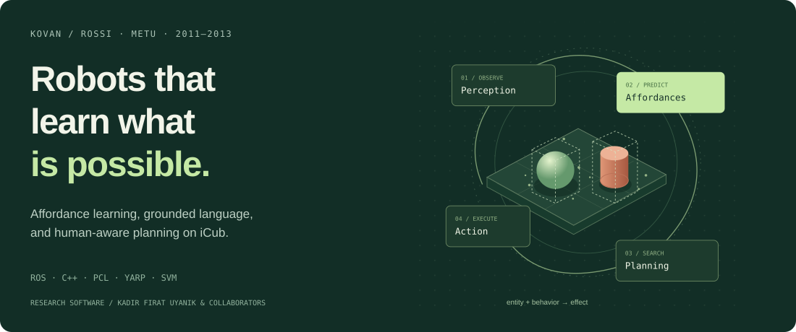

# METU Robotics Research

**Affordance learning, grounded language, and robot-soccer systems**  
Research software by **Kadir Fırat Uyanık**, with KOVAN / ROSSI and METU IEEE RAS collaborators.

## Explore the two ROS stacks

| Stack | Research and engineering | Landing page |
| --- | --- | --- |
| **Affordance learning** · KOVAN / ROSSI · 2011–2013 | iCub perception, behavior-effect prediction, language grounding, human interaction and multi-step planning | **[Explore affordance learning →](stacks/affordance_learning/README.md)** |
| **RoboTurk robot soccer** · METU IEEE RAS · 2009–2011 | Omnidirectional robots, ROS interfaces, collision-aware planning and Webots simulation | **[Explore robot soccer →](stacks/robocup_ssl/README.md)** |

Each stack has its own illustrated overview, architecture diagrams, code-reading guide, research references and archival demo links. The two directories are parts of this repository, not separate repositories.

## Research archive

These are historical **ROS 1 / rosbuild-era** sources, not a ROS 2 distribution or a currently validated installation. The documentation distinguishes published experiments, inspected implementation, and unfinished development snapshots. No modern build, benchmark, or hardware reproduction is claimed.

[Research sources and diagram attribution](docs/RESEARCH_SOURCES.md) · [Original code-history analytics](https://www.openhub.net/p/metu-ros-pkg)

Code and bundled third-party dependencies retain their existing, file-specific licenses and copyright notices. No new repository-wide software license is imposed by these documentation pages.
