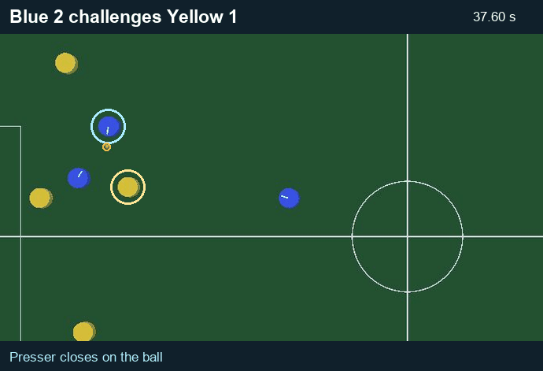

# From seeing the world to acting in it.

Two strands of robotics research at Middle East Technical University: **iCub learns what actions mean; RoboTurk coordinates a team on the soccer field.** This repository preserves the collaborative ROS research archive and provides an entry point to the ongoing RoboTurk ROS 2/Webots successor.

## Choose a project

| Project | Core question | Explore |
| --- | --- | --- |
| **RoboTurk — robot soccer** | How do robots perceive a shared field, find space, win the ball and coordinate a play? | [Demo, results and code map](stacks/robocup_ssl/README.md) |
| **iCub — affordances and language** | Can a robot ground words and plans in the effects of its actions and the help a person can provide? | [Research story, demonstration and papers](stacks/affordance_learning/README.md) |

*RoboTurk's modern Webots simulation. [Matched trial record and control boundaries](https://github.com/kadiru/metu-ros-pkg/blob/ba71026d0843d4057ab620798c725e4dd5078ecf/ros2/roboturk/media/live-tackle/README.md). Historical hardware and modern simulation are documented separately.*

## My contribution

I co-founded and led the METU IEEE RAS RoboCup team, working across distributed C++ autonomy, multi-camera perception, state estimation, planning, robot communication and Webots simulation. In KOVAN / EU FP7 ROSSI, I built iCub perception, data collection and learning/planning components for affordance and language research.

This was team research. Paper author lists, original source authors and per-file licenses remain the authority for attribution. [Research sources and credits](docs/RESEARCH_SOURCES.md)

## Know which version you are reading

- **`stacks/` on the default branch:** historical ROS 1 / rosbuild-era code, including multiple experimental versions. A current build is not validated.
- **[RoboTurk ROS 2 successor](https://github.com/kadiru/metu-ros-pkg/tree/codex/roboturk-ros2/ros2/roboturk):** active work on a separate branch and [draft PR](https://github.com/kadiru/metu-ros-pkg/pull/1). Its guide contains current setup and evaluation details.

For a quick review, follow one project page into its demonstration, a named result and the corresponding source file. Reproducing the archive requires restoring legacy dependencies; the modern successor is the appropriate starting point for new RoboTurk experiments.
