# RoboTurk Robot-Soccer ROS Stack

**RoboCup Small Size League · omnidirectional robots · planning · Webots**\
METU IEEE Student Branch, Robotics and Automation Society · 2009–2011

[Repository overview](../../README.md) · [Match GIFs](#robot-soccer-in-webots) · [Code map](#explore-the-code) · [Archival demos](#watch-the-experiments) · [Research](#papers-and-technical-reports) · [Affordance-learning stack](../../stacks/affordance_learning/README.md)

## From a global field view to robot motion

RoboTurk connects a team of **five four-omniwheel robots** with global vision, ROS message interfaces, planning and embedded robot control. A Webots counterpart supports simulation experiments before working with the physical system.

The work spans hardware/software integration and path-planning experiments: how to move toward a target around other robots, how potential fields can fail, and how obstacle representations and replanning affect navigation.

## Robot soccer in Webots

In the modern ROS 2 successor to this stack, the 3v3 teams train through self-play and the 5v5 teams assign field roles as possession changes. These clips show what changes when a robot learns how to win the ball, where to pass, and how to keep a defender from taking it back. [Modern project and training results](https://github.com/kadiru/metu-ros-pkg/tree/ba71026d0843d4057ab620798c725e4dd5078ecf/ros2/roboturk)

### Winning the ball in a 5v5 match

Follow the circled Blue 2 as it takes the ball from Yellow 1. Across four matched 90-second games per configuration, the trained tackle won the ball cleanly 19 times and the current Presser won it zero times. Both recorded zero body contacts and zero AutoRef crash calls. [Matched results and Webots traces](https://github.com/kadiru/metu-ros-pkg/blob/ba71026d0843d4057ab620798c725e4dd5078ecf/ros2/roboturk/media/live-tackle/README.md)

[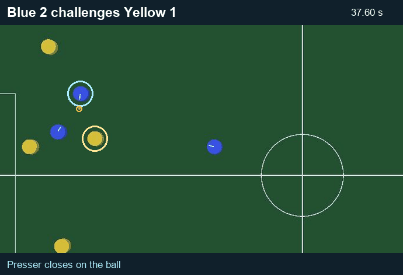](https://github.com/kadiru/metu-ros-pkg/blob/ba71026d0843d4057ab620798c725e4dd5078ecf/ros2/roboturk/media/live-tackle/5v5-takeaway.gif)

In the close-up, the experimental pivot on the right turns the Blue robot and sweeps the ball sideways out of Yellow's dribbler. The direct tackle on the left wins the ball sooner on this start. [Pivot comparison](https://github.com/kadiru/metu-ros-pkg/blob/ba71026d0843d4057ab620798c725e4dd5078ecf/ros2/roboturk/media/live-tackle/README.md#pivot-fetch)

[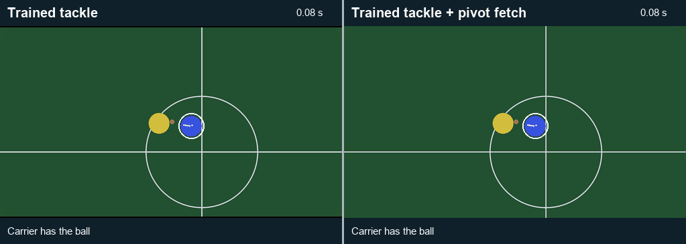](https://github.com/kadiru/metu-ros-pkg/blob/ba71026d0843d4057ab620798c725e4dd5078ecf/ros2/roboturk/media/live-tackle/pivot-fetch.gif)

### Can Blue take the ball from a moving carrier?

Follow the circled Blue Presser. On the left it reaches the carrier and makes body contact. On the right it approaches from the side and carries the ball clear. The trained tackle won all 24 matched Webots challenges with zero body contacts. [Stationary-carrier replay](https://github.com/kadiru/metu-ros-pkg/blob/15fa06657c1aa4ec46b0ce4efa33d717495f54c1/ros2/roboturk/media/ball-side-tackle/stationary-carrier.gif) · [Training and referee results](https://github.com/kadiru/metu-ros-pkg/blob/15fa06657c1aa4ec46b0ce4efa33d717495f54c1/ros2/roboturk/media/ball-side-tackle/README.md)

[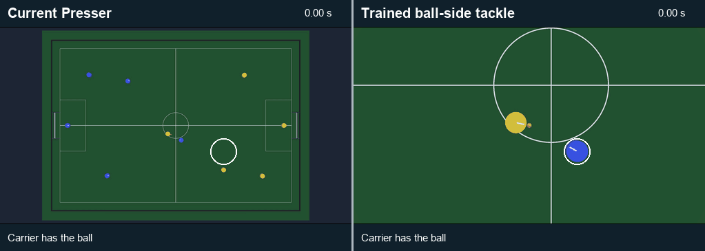](https://github.com/kadiru/metu-ros-pkg/blob/15fa06657c1aa4ec46b0ce4efa33d717495f54c1/ros2/roboturk/media/ball-side-tackle/moving-carrier.gif)

### Why did Blue 2 stop at the penalty area?

The red diamond is a target that would put part of the robot across the penalty-area line. At 48.80 s the right-hand replay moves the target outside the robot-center clearance shown by the dashed line. Blue 2 drives into position 0.44 s later. [Full-field replay](https://github.com/kadiru/metu-ros-pkg/blob/023c26d13b59f94db02a216406d71bb0c6509b40/ros2/roboturk/media/legal-off-ball-targets/blue-2-full-field.gif) · [Matched 5v5 results](https://github.com/kadiru/metu-ros-pkg/blob/023c26d13b59f94db02a216406d71bb0c6509b40/ros2/roboturk/media/legal-off-ball-targets/README.md)

[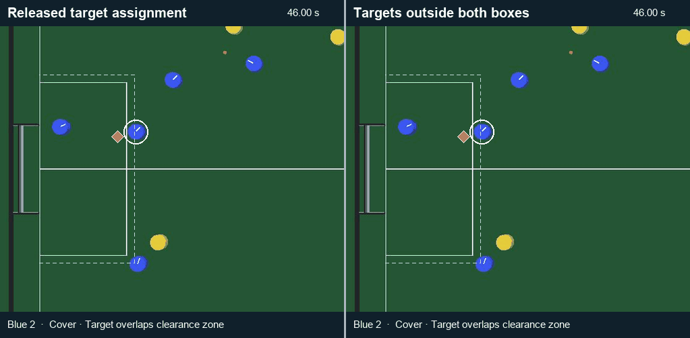](https://github.com/kadiru/metu-ros-pkg/blob/023c26d13b59f94db02a216406d71bb0c6509b40/ros2/roboturk/media/legal-off-ball-targets/blue-2-cover.gif)

### What happens when the direct route reopens?

Follow the circled Blue runner to the gray disk. On the left it follows its waypoint around Yellow and arrives at 5.84 s. On the right it switches to a clear direct route and arrives at 4.00 s. [Matched outlet trials and 5v5 match audit](https://github.com/kadiru/metu-ros-pkg/blob/7c9e8b17db9ebee4d23b5df0b222e8d747da363d/ros2/roboturk/media/errt-shortcut/README.md)

[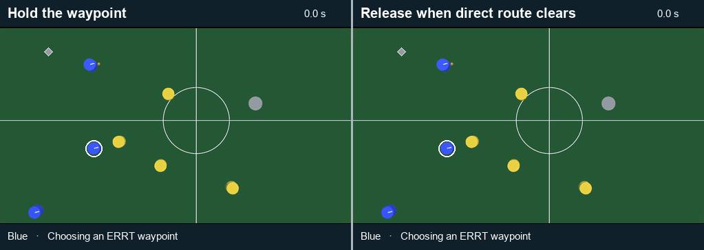](https://github.com/kadiru/metu-ros-pkg/blob/7c9e8b17db9ebee4d23b5df0b222e8d747da363d/ros2/roboturk/media/errt-shortcut/blue-direct-route.gif)

### Can Yellow get moving after it brakes?

Follow the circled Yellow robot. On the left it stops near a Blue defender and stays there until time runs out. On the right it follows the diamond to open space, then reaches the gray passing position in 3.32 s. [Matched starts, completed passes and goals](https://github.com/kadiru/metu-ros-pkg/blob/742eea7486c258d8cdaf8a27e2585bc5f8b5c520/ros2/roboturk/media/errt-clearance/README.md)

[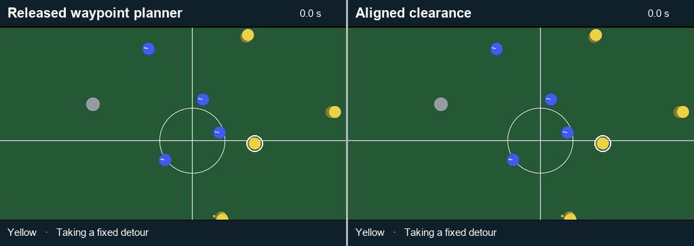](https://github.com/kadiru/metu-ros-pkg/blob/742eea7486c258d8cdaf8a27e2585bc5f8b5c520/ros2/roboturk/media/errt-clearance/recovered-outlet.gif)

### Can Blue stick with a route around Yellow?

The white ring follows Blue. On the left it changes routes 100 times and ends just 2 cm from where it started. On the right it follows the diamond around Yellow and reaches its passing position, the gray disk, at 5.84 s. [Yellow recovering from a different timeout](https://github.com/kadiru/metu-ros-pkg/blob/a858aec053a616a89b81bb678ff72dead47652b3/ros2/roboturk/media/errt-waypoints/yellow-waypoint.gif) · [Stalls, arrival times and clearance across three sets of 40 starts](https://github.com/kadiru/metu-ros-pkg/blob/a858aec053a616a89b81bb678ff72dead47652b3/ros2/roboturk/media/errt-waypoints/README.md)

[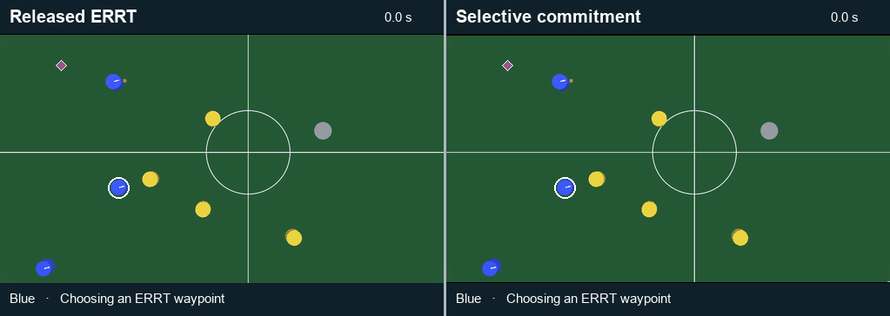](https://github.com/kadiru/metu-ros-pkg/blob/a858aec053a616a89b81bb678ff72dead47652b3/ros2/roboturk/media/errt-waypoints/blue-waypoint.gif)

### Can Blue get open behind the defenders?

Follow the circled Blue robot to the gray disk, where a teammate could pass to it. On the left a Yellow defender blocks its usual routes. On the right Blue finds room around the defender and reaches the disk in three seconds. Over 40 paired 5v5 starts the extra search raised arrivals from 17 to 38. [Stalls, times and clearances](https://github.com/kadiru/metu-ros-pkg/blob/20f60d763b89dea2a09fc84cabd2d755019a05ef/ros2/roboturk/media/crowded-errt/README.md) · [A run both planners missed](https://github.com/kadiru/metu-ros-pkg/blob/20f60d763b89dea2a09fc84cabd2d755019a05ef/ros2/roboturk/media/crowded-errt/blocked-outlet.gif) · [Yellow taking the same route with either planner](https://github.com/kadiru/metu-ros-pkg/blob/20f60d763b89dea2a09fc84cabd2d755019a05ef/ros2/roboturk/media/crowded-errt/yellow-outlet.gif)

[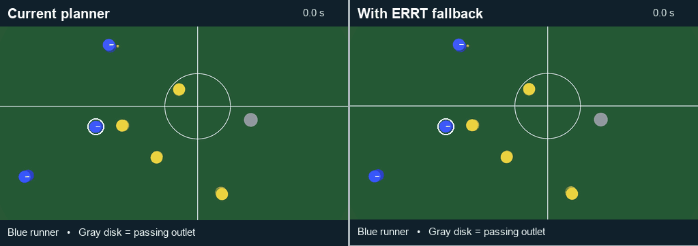](https://github.com/kadiru/metu-ros-pkg/blob/20f60d763b89dea2a09fc84cabd2d755019a05ef/ros2/roboturk/media/crowded-errt/blue-outlet.gif)

### Can Blue bring a live ball back from the touchline?

Watch the white line and the orange ball. On the left, the previous robot stops short. On the right, Blue crosses the line, turns its roller inward and brings the ball back. Across 40 matched 5v5 starts the new steering recovered 37 balls, up from zero, with zero measured robot, board or goal contacts in either run. [Results and close-up replay](https://github.com/kadiru/metu-ros-pkg/blob/a775a5ea0f6f7d7322d7b1e14ac088a5a4114972/ros2/roboturk/media/touchline/README.md) · [How 70 SSL team entries plan robot motion](https://github.com/kadiru/metu-ros-pkg/blob/a775a5ea0f6f7d7322d7b1e14ac088a5a4114972/ros2/roboturk/docs/SSL_PATH_PLANNERS.md)

[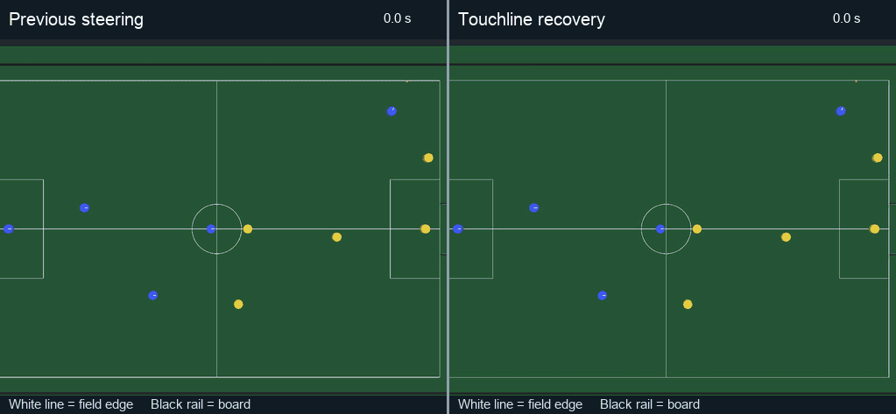](https://github.com/kadiru/metu-ros-pkg/blob/a775a5ea0f6f7d7322d7b1e14ac088a5a4114972/ros2/roboturk/media/touchline/same-start.gif)

### What happens when a pass slows down?

Watch the cyan receiver. On the left it backs away until the ball stops. On the right it meets the same pass, dribbles upfield and scores. On 200 fresh unguarded openings using the same updated Webots carpet, the original team scored 163 and the team with the fitted receiver scored 200. [Watch a fresh goal](https://github.com/kadiru/metu-ros-pkg/blob/6ffee2604d0e5a454a8c1fedb4c9375755d9b7bc/ros2/roboturk/media/carpet-skills/fresh-demo.mp4) · [Paired trials and training details](https://github.com/kadiru/metu-ros-pkg/blob/6ffee2604d0e5a454a8c1fedb4c9375755d9b7bc/ros2/roboturk/media/carpet-skills/README.md)

[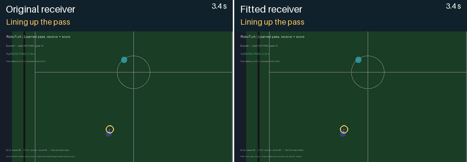](https://github.com/kadiru/metu-ros-pkg/blob/6ffee2604d0e5a454a8c1fedb4c9375755d9b7bc/ros2/roboturk/media/carpet-skills/reception-replay.gif)

### Can Blue beat the Yellow goalkeeper?

Blue keeps the trained receiver and learns where and when to release the shot. Yellow’s field defender chases the ball while its learned goalkeeper covers the goal. On 40 identical starts the previous Blue team scored 22 goals from 37 stable receptions. The new finish scored 33 from 37. [Full-speed Webots films and paired results](https://github.com/kadiru/metu-ros-pkg/blob/61e0f4f7a92ba8fe2571a85f640b16921ffebac4/ros2/roboturk/media/guarded-finish/README.md)

[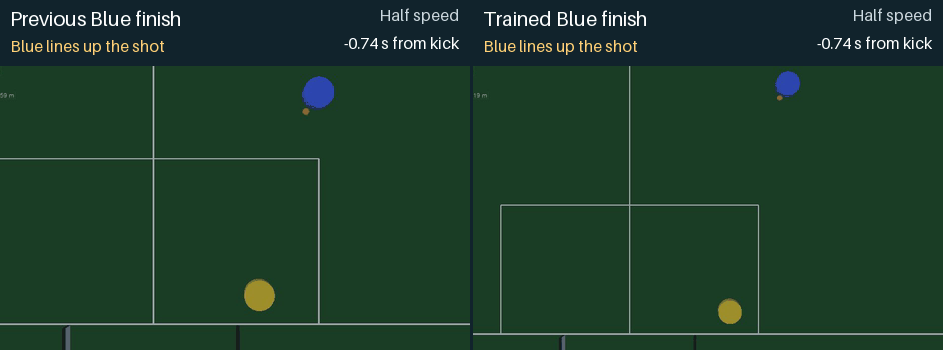](https://github.com/kadiru/metu-ros-pkg/blob/61e0f4f7a92ba8fe2571a85f640b16921ffebac4/ros2/roboturk/media/guarded-finish/shots.gif)

### Who gets to the pass first?

Blue passes, Cyan receives and Yellow closes. Watch Cyan move toward the ball and cushion it at the roller. On 40 fresh openings against the same defender, the previous receiver secured 24 passes and scored 17 goals. The new receiver secured 35 and scored 32. [Full-speed Webots demo and paired trials](https://github.com/kadiru/metu-ros-pkg/blob/6d0dbd737b830971d4724e3f4941de5e02604feb/ros2/roboturk/media/secure-pass/README.md)

[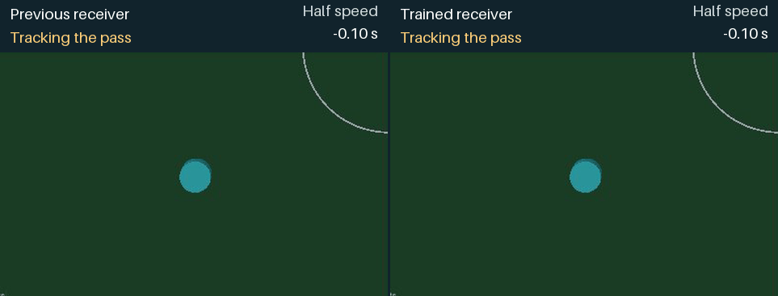](https://github.com/kadiru/metu-ros-pkg/blob/6d0dbd737b830971d4724e3f4941de5e02604feb/ros2/roboturk/media/secure-pass/first-touch.gif)

### Can Cyan escape the marker?

Follow the yellow defender after Blue passes. Cyan controls the ball on both fields. On the left, Yellow closes before Cyan finishes turning. On the right, Cyan moves away as it turns, then shoots. On the same 40 fresh 2v1 openings this carry increased goals from 1 to 13. [Watch the uncut goal](https://github.com/kadiru/metu-ros-pkg/blob/4b771f0c7a0cf9da9c077d11cb5d3d7621ad1ba2/ros2/roboturk/media/closing-press/escape-carry.mp4) · [Reception, scoring and first-touch results](https://github.com/kadiru/metu-ros-pkg/blob/4b771f0c7a0cf9da9c077d11cb5d3d7621ad1ba2/ros2/roboturk/media/closing-press/README.md)

[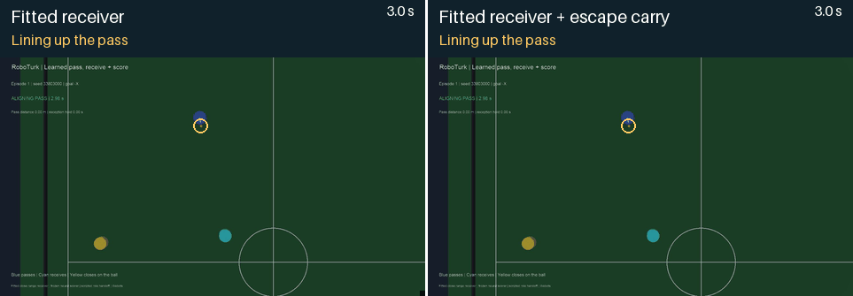](https://github.com/kadiru/metu-ros-pkg/blob/4b771f0c7a0cf9da9c077d11cb5d3d7621ad1ba2/ros2/roboturk/media/closing-press/closing-marker.gif)

### How does Blue read Yellow’s movement?

The short trails show where each robot has been. The pink dashes show where Blue estimates Yellow will go if it keeps its measured velocity. Each team gets only its own kickoff destinations. On 10 matched restarts, the shared planner’s median time to formation was 9.24 seconds and the independent teams’ was 8.58 seconds. [Compare the two fields](https://github.com/kadiru/metu-ros-pkg/blob/943ff2f8259bd7022737d198db2a3b4f8a850ba7/ros2/roboturk/media/team-kickoff/matched-kickoffs.gif) · [Watch the officially refereed match](https://github.com/kadiru/metu-ros-pkg/blob/943ff2f8259bd7022737d198db2a3b4f8a850ba7/ros2/roboturk/media/team-kickoff/official-match.mp4) · [Read the results](https://github.com/kadiru/metu-ros-pkg/blob/943ff2f8259bd7022737d198db2a3b4f8a850ba7/ros2/roboturk/media/team-kickoff/README.md)

[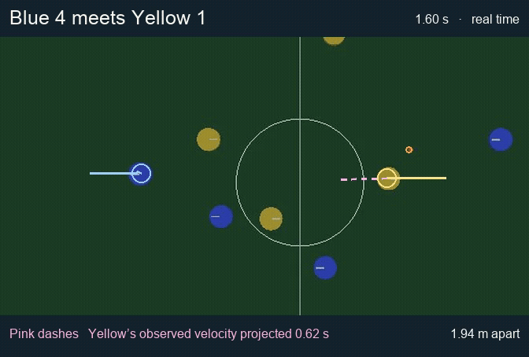](https://github.com/kadiru/metu-ros-pkg/blob/943ff2f8259bd7022737d198db2a3b4f8a850ba7/ros2/roboturk/media/team-kickoff/observed-opponent.mp4)

### How fast can ten robots change ends?

The two fields show the same 5v5 opening played with different kickoff planners. Follow the short trails as teammates and opponents cross the field. The previous planner takes 46.6 seconds to get everyone into position. The new planner lets more players travel together and the referee releases the kickoff after 12.5 seconds. Both clips run at 4× speed. [Uncut match](https://github.com/kadiru/metu-ros-pkg/blob/6f15017b5495dc893b30d19970218e162be4839e/ros2/roboturk/media/parallel-kickoff/official-match.mp4) · [How we compared the teams](https://github.com/kadiru/metu-ros-pkg/blob/6f15017b5495dc893b30d19970218e162be4839e/ros2/roboturk/media/parallel-kickoff/README.md)

[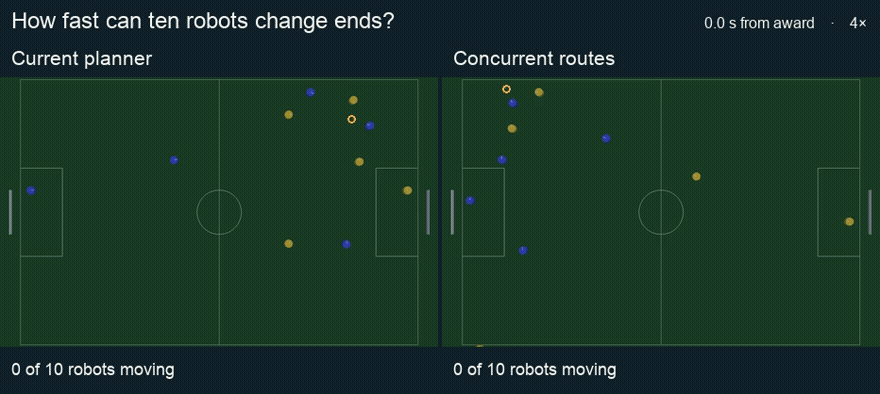](https://github.com/kadiru/metu-ros-pkg/blob/6f15017b5495dc893b30d19970218e162be4839e/ros2/roboturk/media/parallel-kickoff/kickoff-race.mp4)

### Follow the goalkeeper across half-time

Blue 0 changes ends on both fields. The blue ring follows the robot in Webots and the pink cross follows the referee’s tracker. On the left the simulator moves the goalkeeper over eight metres in one step. On the right the robots drive to their kickoff spots before the referee starts the second half. [Watch the uncut match](https://github.com/kadiru/metu-ros-pkg/blob/5d8a02fa2270f725338283502af25be52e1dc536/ros2/roboturk/media/kickoff-drive/official-match.mp4) · [Results on four paired openings](https://github.com/kadiru/metu-ros-pkg/blob/5d8a02fa2270f725338283502af25be52e1dc536/ros2/roboturk/media/kickoff-drive/README.md)

[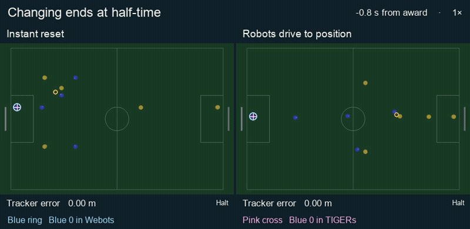](https://github.com/kadiru/metu-ros-pkg/blob/5d8a02fa2270f725338283502af25be52e1dc536/ros2/roboturk/media/kickoff-drive/changing-ends.mp4)

### Who gives the kickoff after a goal?

Blue scores in a 5v5 Webots match. TIGERs sees the ball cross the line, the RoboCup SSL Game Controller puts the goal on the scoreboard, and Yellow gets the kickoff. The uncut film follows both teams through the side change and Blue’s 2–0 finish. [Watch both halves](https://github.com/kadiru/metu-ros-pkg/blob/9a59cb0800a8fb9e755e27080c0385480fd3a8dc/ros2/roboturk/media/official-league/official-match.mp4) · [Paired results and the kickoff tracking replay](https://github.com/kadiru/metu-ros-pkg/blob/9a59cb0800a8fb9e755e27080c0385480fd3a8dc/ros2/roboturk/media/official-league/README.md)

[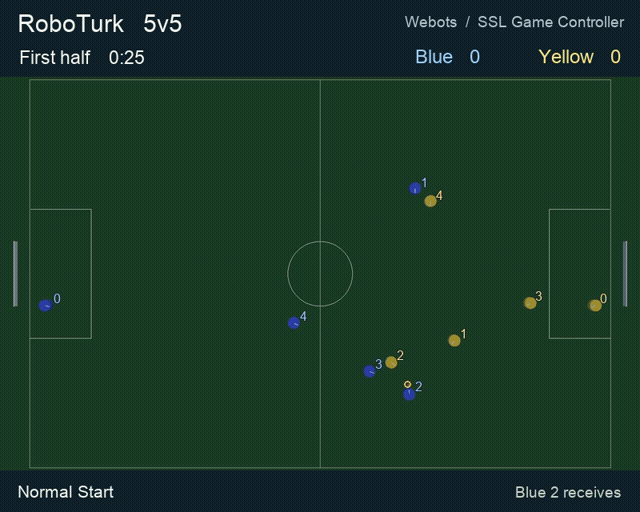](https://github.com/kadiru/metu-ros-pkg/blob/9a59cb0800a8fb9e755e27080c0385480fd3a8dc/ros2/roboturk/media/official-league/official-match.mp4)

### When two players cross paths

Watch Blue 4 and Yellow 2. On the left, the referee calls a 1.61 m/s crash. On the right, each team steers using the other players' observed motion. On 16 fresh one-minute Webots starts the trained teams drew zero crash calls against 47 for the previous teams, completed 201 passes against 151, and scored 21 goals apiece across the two evaluations. [Both close encounters](https://github.com/kadiru/metu-ros-pkg/blob/3c5119662c40723e58a96bc93b113832618da85d/ros2/roboturk/media/open-motion/two-encounters.mp4) · [Watch Blue score](https://github.com/kadiru/metu-ros-pkg/blob/3c5119662c40723e58a96bc93b113832618da85d/ros2/roboturk/media/open-motion/first-goal.gif) · [Full match and results](https://github.com/kadiru/metu-ros-pkg/blob/3c5119662c40723e58a96bc93b113832618da85d/ros2/roboturk/policies/open_motion_v1/README.md)

[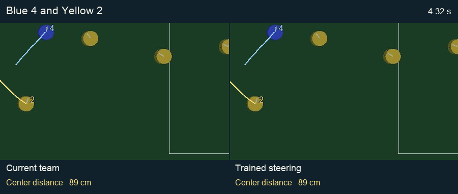](https://github.com/kadiru/metu-ros-pkg/blob/3c5119662c40723e58a96bc93b113832618da85d/ros2/roboturk/media/open-motion/two-encounters.mp4)

### Can Blue reach the ball without hitting Yellow?

Watch Blue 4 after the ball goes out. On the left, it runs into Yellow 2. On the right, the trained approach takes it around Yellow and Blue 3 receives the free kick. With the official referee connected, the revised team completed 40 of 40 crowded placements with zero crash calls. The previous team completed 19 on the same starts. [Full restart](https://github.com/kadiru/metu-ros-pkg/blob/82b1f9ef4f33122c6ef71dea60cd81062b07cb08/ros2/roboturk/media/placement-traffic/touchline-restart.mp4) · [Uncut 5v5 match](https://github.com/kadiru/metu-ros-pkg/blob/82b1f9ef4f33122c6ef71dea60cd81062b07cb08/ros2/roboturk/media/placement-traffic/open-match.mp4) · [Training and referee results](https://github.com/kadiru/metu-ros-pkg/blob/82b1f9ef4f33122c6ef71dea60cd81062b07cb08/ros2/roboturk/policies/placement_v2/README.md)

[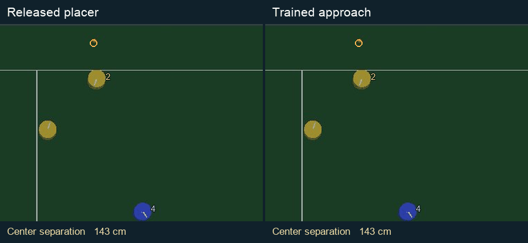](https://github.com/kadiru/metu-ros-pkg/blob/82b1f9ef4f33122c6ef71dea60cd81062b07cb08/ros2/roboturk/media/placement-traffic/touchline-restart.mp4)

### Who plays which role in 5v5?

Watch Yellow 2 win the ball at 14.64 seconds. It passes to Yellow 4, moves to the right wing, then receives the return pass. The rosters beside the pitch show a role for every jersey. [Full 60-second match](https://github.com/kadiru/metu-ros-pkg/blob/61b830cdacc0cf0e53f2aa2b3ef7ddf4e7dc7cb7/ros2/roboturk/media/five-roles/five-roles.mp4) · [Role assignments and match traces](https://github.com/kadiru/metu-ros-pkg/tree/61b830cdacc0cf0e53f2aa2b3ef7ddf4e7dc7cb7/ros2/roboturk/media/five-roles)

[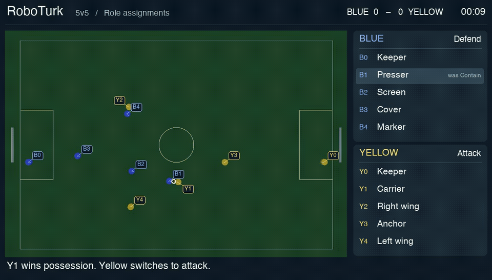](https://github.com/kadiru/metu-ros-pkg/blob/61b830cdacc0cf0e53f2aa2b3ef7ddf4e7dc7cb7/ros2/roboturk/media/five-roles/five-roles.mp4)

### Reconsidering the pass

Watch Blue 2 at 6.84 seconds. On the left, a defender intercepts the original pass. On the right, the carrier switches from receiver 1 to 0 and the team scores. Both replays agree through the moment of the decision. [Delay, switch and dribble in fresh matches](https://github.com/kadiru/metu-ros-pkg/blob/dc4381ee7abe83aab519ec26775b34334aed52b3/ros2/roboturk/media/pass-release/release-choices.gif) · [Full fresh match](https://github.com/kadiru/metu-ros-pkg/blob/dc4381ee7abe83aab519ec26775b34334aed52b3/ros2/roboturk/media/pass-release/open-play-match.mp4) · [Results and all 43 original interceptions](https://github.com/kadiru/metu-ros-pkg/tree/dc4381ee7abe83aab519ec26775b34334aed52b3/ros2/roboturk/policies/pass_release_v1)

[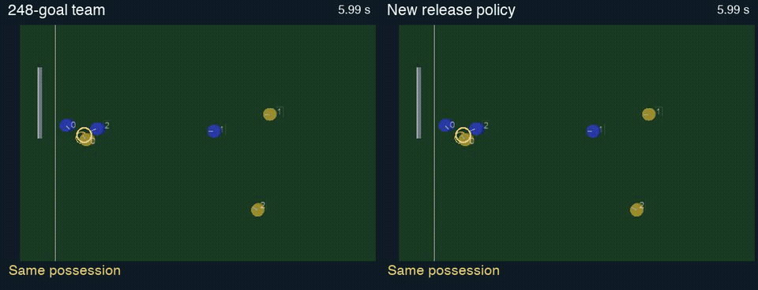](https://github.com/kadiru/metu-ros-pkg/blob/dc4381ee7abe83aab519ec26775b34334aed52b3/ros2/roboturk/media/pass-release/same-possession.mp4)

### A teammate with a better shot

Both replays reach the same steal. On the left the ball winner shoots. On the right, Yellow 0 plays the ball ahead of Yellow 2, who runs onto it and scores. On 40 fresh Webots starts the new team scored 248 clean-takeaway goals and the previous team scored 77. [Full match](https://github.com/kadiru/metu-ros-pkg/blob/a439b168c34a34714aa319ece425971c19314744/ros2/roboturk/media/counterpass/open-play-match.mp4) · [Results and policy](https://github.com/kadiru/metu-ros-pkg/tree/a439b168c34a34714aa319ece425971c19314744/ros2/roboturk/policies/counterpass_v1)

[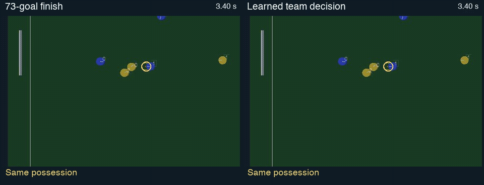](https://github.com/kadiru/metu-ros-pkg/blob/a439b168c34a34714aa319ece425971c19314744/ros2/roboturk/media/counterpass/same-possession.mp4)

### Three steals, three second chances

Watch the same three takeaways twice. The old team plays on the left. On the right, Blue escapes the pressure and scores from all three positions it trained on. In a separate test on 40 fresh kickoffs, the new team scored 73 goals from 391 clean steals. The old team scored 1 from 12. [Fresh Webots match](https://github.com/kadiru/metu-ros-pkg/blob/6679443115b6c190076cb4bde94b1cd8b39f8c48/ros2/roboturk/media/clean-takeaway/open-play-match.mp4) · [Match results](https://github.com/kadiru/metu-ros-pkg/tree/6679443115b6c190076cb4bde94b1cd8b39f8c48/ros2/roboturk/policies/takeaway_v1)

[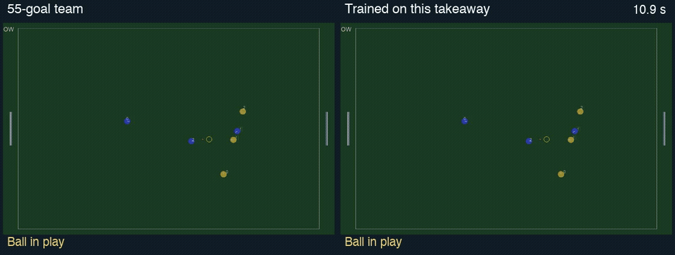](https://github.com/kadiru/metu-ros-pkg/blob/6679443115b6c190076cb4bde94b1cd8b39f8c48/ros2/roboturk/media/clean-takeaway/three-repaired-takeaways.mp4)

### Same opening, two outcomes

Both replays start with the robots and ball in the same positions. On the left, Yellow gets a touch before Blue can shoot. On the right, watch Blue 2 take the ball out of the crowd, dribble half a metre and score.

[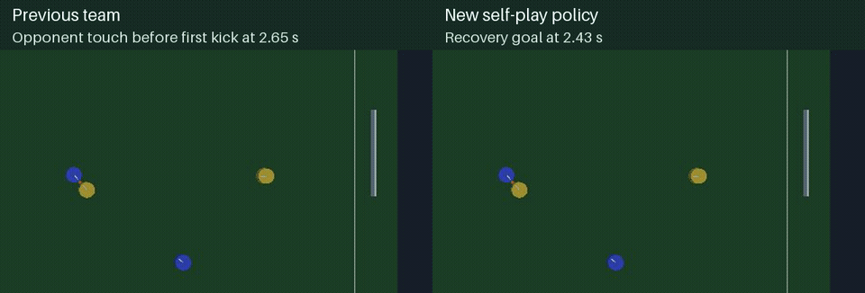](https://github.com/kadiru/metu-ros-pkg/blob/1cef7fddd1677b4e632119f331f65ea7168acff7/ros2/roboturk/media/recovery-transition/matched-recovery.mp4)

### Pass into a teammate’s path

Yellow 0 has a defender in the way. Watch the marked spot ahead of Yellow 1. The pass goes there while Yellow 1 is still running, and the receiver meets the ball and scores.

[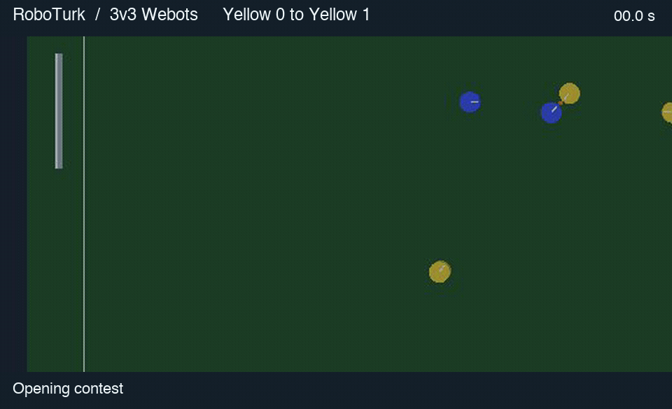](https://github.com/kadiru/metu-ros-pkg/blob/1cef7fddd1677b4e632119f331f65ea7168acff7/ros2/roboturk/media/lead-outlet/lead-pass.mp4)

### Shield the ball under pressure

Watch the inset as Yellow closes on Blue 1. Blue 1 turns its body between the defender and the ball, keeps possession, then turns toward goal and shoots. The team completed this sequence in 27 of 40 fresh simulated openings. [Match-by-match results](https://github.com/kadiru/metu-ros-pkg/tree/1cef7fddd1677b4e632119f331f65ea7168acff7/ros2/roboturk/policies/pressure_receive_v1)

[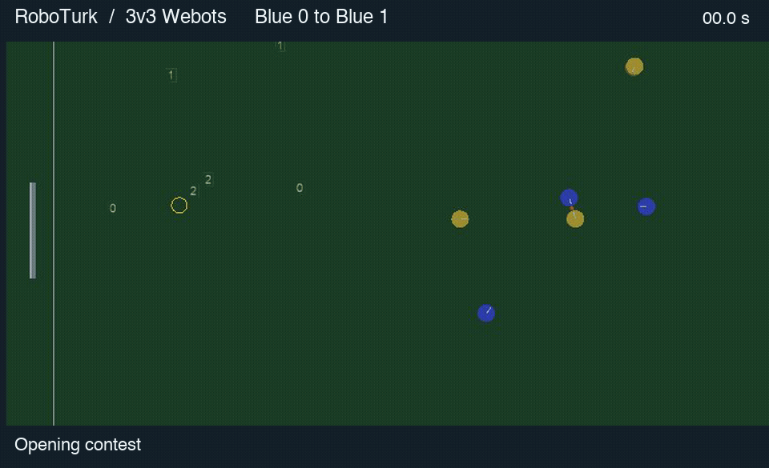](https://github.com/kadiru/metu-ros-pkg/blob/1cef7fddd1677b4e632119f331f65ea7168acff7/ros2/roboturk/media/pressure-receive/pressure-shield.mp4)

## System architecture

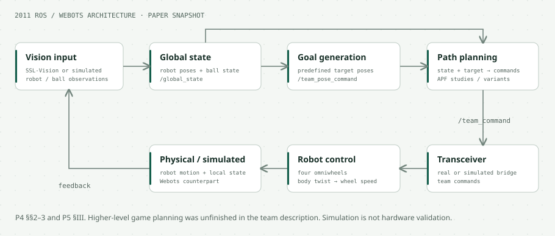

Conceptual overview based on the **RoboTurk 2011 Team Description** [P4] and **A study on Artificial Potential Fields** [P5]. The original design separates vision/global state, goal and path planning, command transport, robot control and feedback, with real and simulated counterparts. The team description is a development snapshot, not a claim that all pictured modules were complete.

## Explore the code

| Start here | What to look for |
| --- | --- |
| [`ssl_vision/`](ssl_vision/) | Vision integration resources |
| [`ssl_msgs/`](ssl_msgs/) / [`ssl_srvs/`](ssl_srvs/) | State, command and service interfaces |
| [`ssl_path_planner_/src/SSLPathPlanner.cpp`](ssl_path_planner_/src/SSLPathPlanner.cpp) | Substantive planner: obstacle geometry, collision checks, path reuse, OMPL planning and per-robot execution |
| [`SSLPathPlanner.h`](ssl_path_planner_/include/ssl_path_planner/SSLPathPlanner.h) | Trajectory types, geometry, publishers, subscribers and configured limits |
| [`ssl_game_planner_/`](ssl_game_planner_/) | Historical goal/game-planning package |
| [`ssl_wsim/`](ssl_wsim/) / [`ssl_webots_sim_/`](ssl_webots_sim_/) | Simulation resources |
| [`ssl_teleop_control/`](ssl_teleop_control/) | Teleoperation resources |

**Start with `ssl_path_planner_`, including the trailing underscore.** The similarly named [`ssl_path_planner`](ssl_path_planner/src/main.cpp) is a separate scaffold whose entry point returns immediately. They should not be treated as the same implementation.

The substantive planner builds obstacles from robots, the ball and goals, uses CGAL geometry tests, reuses valid paths and replans when needed. Its initialization selects OMPL **pRRT**, with eight threads, goal bias 0.8 and range 0.08; the planning call uses a **0.100-second solve budget**. These are source-code settings, not measured latency or demonstrated real-time guarantees. See [initialization](ssl_path_planner_/src/SSLPathPlanner.cpp#L1137-L1171) and [planning](ssl_path_planner_/src/SSLPathPlanner.cpp#L651-L750).

## What the planning studies showed

The technical reports [P5–P6] compare additive attractive/repulsive potential fields with navigation functions in three simulation scenarios. The reported execution times and path lengths are:

| Scenario | Additive: time / path | Navigation: time / path |
| --- | --- | --- |
| One obstacle, direct-free path | 2.5 s / 1.25 m | 2.5 s / 1.26 m |
| Three obstacles, indirect-free path | Did not reach goal | 45.52 s / 1.97 m |
| Two obstacles, direct-free path | Did not reach goal | 1.5 s / 1.09 m |

Source: Table I in the reports. These are small historical simulation cases, not a general planner ranking. The work also investigates visibility-aware **obstacle grouping**, representing nearby obstacles as virtual obstacles to address local minima and oscillatory behavior in the tested settings.

The EE586 progress report discusses visibility graphs and RRT variants as further implementation/comparison work. The later source snapshot contains OMPL planning code, but that does not turn the report into a completed APF/VG/RRT benchmark.

## Watch the experiments

**[Obstacle grouping demonstration →](https://www.youtube.com/watch?v=0rp-VhkjYd0)**

| Scenario | Additive potential | Navigation function |
| --- | --- | --- |
| One obstacle | [Watch](https://www.youtube.com/watch?v=ra-4UXbUaz0) | [Watch](https://www.youtube.com/watch?v=QWG0X2xIJ-Y) |
| Three obstacles | [Watch](https://www.youtube.com/watch?v=XreCjhkEJA8) | [Watch](https://www.youtube.com/watch?v=AaW1E8bh9kg) |
| Two obstacles | [Watch](https://www.youtube.com/watch?v=hGoSAFj7SL4) | [Watch](https://www.youtube.com/watch?v=k8oT6fFCZaM) |

Archival video links recovered from [P5], Section VI. These are original experiments, not newly recorded demonstrations; availability is controlled by the video host.

## Papers and technical reports

**[P4] [RoboTurk 2011 Team Description](https://download.tigers-mannheim.de/tdps/2011_TDP_RoboTurk.pdf)**\
Kadir Fırat Uyanık, Mumin Yildirim, Salih Can Camdere, Meric Sariisik, Sertac Olgunsoylu. *RoboCup Small Size League*, 2011. Hardware redesign, ROS architecture and Webots simulation. At the time of writing, several nodes were stubs, physical encoders had not yet been mounted, and higher-level game behaviors remained unfinished.

**[P5] [A study on Artificial Potential Fields](https://www.academia.edu/2007421/A_study_on_Artificial_Potential_Fields)**\
Kadir Fırat Uyanık. Course technical report, 6 pages. Potential-field experiments, navigation functions and archival demonstration links. [Read the report on Academia.edu](https://www.academia.edu/2007421/A_study_on_Artificial_Potential_Fields).

**[P6] [A comprehensive study on path planning algorithms in multi-agent robot soccer domain](https://www.scribd.com/document/55167175/A-comprehensive-study-on-path-planning-algorithms-in-multi-agent-robot-soccer-domain)**\
Kadir Fırat Uyanık. *EE586 Artificial Intelligence — Project Progress Report*, 7 pages. Completed preliminary APF tests and a proposed broader comparison. [Read the report on Scribd](https://www.scribd.com/document/55167175/A-comprehensive-study-on-path-planning-algorithms-in-multi-agent-robot-soccer-domain).

[P5] and [P6] were verified against the original author-supplied PDFs. The links above open public document pages, not PDF files hosted in this repository; downloading may require an account with the respective host. Scribd displays an alternative platform title, “Path Planning in Multi-Agent Robotics”; the original report title is retained here. [Detailed source notes](../../docs/RESEARCH_SOURCES.md).

## Archive status and credits

Historical ROS 1 / rosbuild-era sources, with multiple experimental package versions. No current build, hardware run, or performance reproduction has been performed for this documentation update. Preserve the existing per-file licenses and the original authors' credit when reusing code or diagrams.
