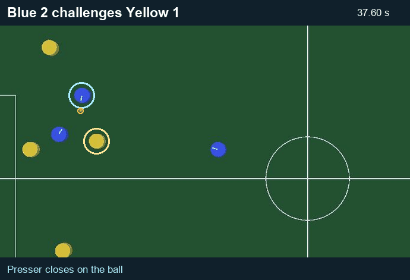
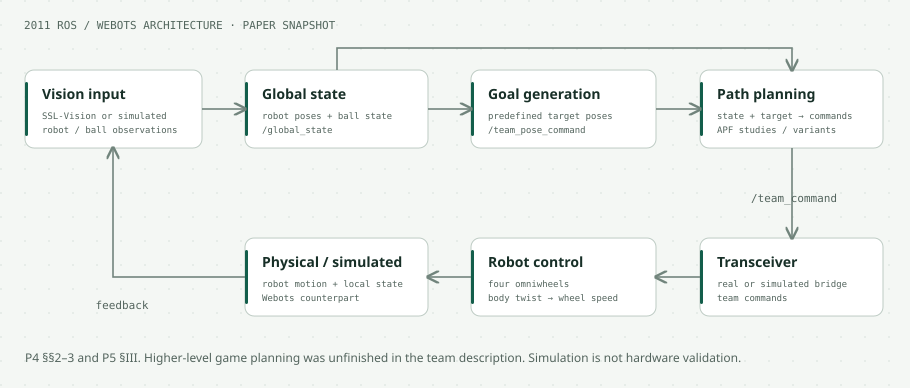

# RoboTurk — a team that sees, plans and plays.

Robot soccer compresses many robotics problems into one field: noisy observations, moving obstacles, fast decisions and teammates who must act together. RoboTurk began as a **five-robot omnidirectional Small Size League team** at METU IEEE RAS. Its modern successor explores learned skills and coordinated play in ROS 2 and Webots.

*Modern simulation: the circled Blue robot executes a trained tackle. This is a specific skill comparison inside a match, not a claim that the whole team is learned or that match scoring improved.*

[ROS 2 source and setup](../../ros2/roboturk/README.md) · [Full comparison gallery](EXPERIMENT_GALLERY.md) · [Original robot-soccer film](https://vimeo.com/kadiru/multi-robot-soccer)

## What has changed in the modern experiments

| Matched comparison | Observed result | Evidence |
| --- | --- | --- |
| Ball recovery in four 90-second 5v5 games per configuration | **19 clean takeaways vs 0**, with zero body contacts and zero AutoRef crash calls in both | [Live-tackle protocol and traces](https://github.com/kadiru/metu-ros-pkg/blob/ba71026d0843d4057ab620798c725e4dd5078ecf/ros2/roboturk/media/live-tackle/README.md) |
| Finishing against a defender and goalkeeper, 40 identical starts | **33 goals vs 22**, both from 37 stable receptions | [Guarded-finish comparison](https://github.com/kadiru/metu-ros-pkg/blob/61e0f4f7a92ba8fe2571a85f640b16921ffebac4/ros2/roboturk/media/guarded-finish/README.md) |

The rows use different experiments and frozen revisions. They do not form a single overall win rate. The gallery includes misses, stalled paths, contact accounting and the distinction between scripted control and learned components.

## The system idea

*The original research illustration follows observations through the ROS modules to robot commands and feedback. It describes the historical architecture; higher-level game planning was unfinished in the team description. [Technical reports and source context](EXPERIMENT_GALLERY.md#papers-and-technical-reports).*

**Kadir's role:** team co-founder and lead; distributed C++ autonomy, perception/state estimation, planning, communication and simulation. The original team and report authors are credited in the [research and technical reports](EXPERIMENT_GALLERY.md#papers-and-technical-reports). Existing source licenses and contributors remain intact.

## Read or reproduce

Start with the [ROS 2 project guide](../../ros2/roboturk/README.md) for current work. The pinned comparisons above link to the source and replay instructions for each experiment.

This directory is the **historical ROS 1 stack**. Use its [code map](EXPERIMENT_GALLERY.md#explore-the-code) for planning, perception and Webots experiments. Legacy dependencies need restoration; no fresh historical hardware run is claimed.

## Next milestone

Show that individual skill gains survive full-team evaluation across new starts and opponents, while retaining legal motion and low contact counts. Keep isolated skill tests separate from full-match outcomes.

[Every illustrated comparison](EXPERIMENT_GALLERY.md#robot-soccer-in-webots) · [Archival demonstrations](EXPERIMENT_GALLERY.md#watch-the-experiments) · [Repository overview](../../README.md)
