# RoboTurk: ROS 2, Webots and learned soccer skills

A modern, separately maintained successor to [Kadir Fırat Uyanık's RoboTurk stack](https://github.com/kadiru/metu-ros-pkg/tree/master/stacks/robocup_ssl). The historical checkout is preserved at `../upstream`; no archival sources were overwritten.

A research prototype with learned soccer skills, continuous 2v2, 3v3 and 5v5 play, ROS 2 messages/nodes and a native Webots Supervisor backend. It is not a competition-ready team. See [validation](docs/VALIDATION.md) for exactly what has run.

## Can the tackle win the ball in a full 5v5 lineup?

On four matched 90-second Webots starts, the trained tackle recorded 19 clean takeaways and the current Presser recorded zero. Both recorded zero body contacts and zero TIGERs AutoRef crash calls. A separate close-up shows an experimental pivot that sweeps the ball sideways out of the opposing roller. [Webots GIFs, results, and reproduction commands](media/live-tackle/README.md)

## Can the Presser take the ball from a moving carrier?

The fitted ball-side tackle won 24 of 24 matched fresh Webots challenges with zero body contacts. The current Presser won 0 clean challenges. [Native Webots replays, training and AutoRef comparison](media/ball-side-tackle/README.md)

## Keeping off-ball targets outside the penalty areas

A matched native replay shows Blue 2 reaching its Cover position 0.44 s after its stalled target moves outside the penalty area. [Two-view Webots demo and matched 5v5 results](media/legal-off-ball-targets/README.md)

## Taking the direct route when it reopens

In a paired Webots replay, Blue reached its outlet in 4.00 s after releasing its waypoint early, compared with 5.84 s through the waypoint. [Native replay, per-robot brake audit and matched games](media/errt-shortcut/README.md)

## Reopening clearance for a stalled 5v5 runner

On the remaining timeout replay, the runner opened space and reached its passing position in 3.32 s. The updated planner reached 40 of 40 fresh outlets, compared with 40 for the release. [Native Webots replay, paired outlet trials and full-match results](media/errt-clearance/README.md)

## Following a waypoint through a crowded defense

Blue and Yellow reached the outlet on both previously timed-out plays. On an independent set of 40 starts, the released planner reached 37 outlets and selective waypoint commitment reached 40. [Native Webots replays, stalls, arrival times and clearance](media/errt-waypoints/README.md)

## Finding a passing outlet in a crowded 5v5 defense

On the same 40 fresh Webots starts, adding an extended RRT fallback increased on-time arrivals from 17 to 38 and reduced starts with a stall from 24 to 1. Neither planner recorded a contact. [Paired Webots demos, clearance and timing](media/crowded-errt/README.md)

## Timed trajectories for 5v5 support players

The first optional trajectory planner compares acceleration-limited routes and shares timed paths among teammates. [Crossing animation, matched Webots trials and reproduction commands](media/trajectory-search/README.md)

## Can a robot recover the ball from outside the touchline?

The previous steering recovered 0 of 40 balls. The new steering recovered 37 of 40. [Native Webots comparison and clearance measurements](media/touchline/README.md) · [How SSL teams plan motion](docs/SSL_PATH_PLANNERS.md)

## Can Blue beat the goalkeeper after receiving under pressure?

In 40 matched 2v2 Webots openings, the previous Blue team secured 37 passes and scored 22 goals. The keeper-aware finish secured 37 and scored 33. [Paired GIFs, native recordings and training](media/guarded-finish/README.md)

## Can Cyan secure the pass before Yellow arrives?

On 40 fresh paired openings, the previous receiver secured 24 passes and scored 17 goals. The trained receiver secured 35 and scored 32. Watch Cyan step toward the pass, cushion it, then turn toward goal. [Paired Webots recordings, counts and training](media/secure-pass/README.md)

## Can the receiver escape a closing defender?

Both receivers hold the same pass at 5.28 s. One turns in place and loses the ball. The other carries away from Yellow while turning and scores. This change raised scoring from 1 to 13 goals on 40 paired 2v1 starts. On 40 further paired starts the full-hold carry scored 20 and the earlier carry scored 17. [Watch the Webots replay](media/closing-press/closing-marker.gif) · [Matched results and training records](media/closing-press/README.md)

## When a pass slows down

On the same 200 fresh Webots openings the original receiver helped the team score 163 goals and the fitted receiver helped it score 200. In the replay, the original receiver backs away until the ball stops. The fitted receiver takes possession and shoots. [Watch the matched replay](media/carpet-skills/reception-replay.gif) · [Fresh demo and qualification results](media/carpet-skills/README.md)

## How far does a pass roll?

A 2 m/s flat kick travels 3.98 m and stops in 5.48 s on the simulated Division B carpet. The same ground model handles the first skid, steady rolling and rest. All 25 Webots worlds share the measured field and collidable goals. [Watch the ball stop](media/ssl-physics/roll.gif) · [Dimensions, team sources and native measurements](media/ssl-physics/README.md)

## Each team plans its own kickoff

Blue and Yellow observe one another’s motion and plan their own routes to formation. On 10 matched Webots restarts, median setup to robot readiness was 9.24 s for shared routes and 8.58 s for independent teams. Four fresh official matches per planner produced 0 and 0 accepted kickoff crash calls, respectively. [Watch Blue respond to Yellow](media/team-kickoff/observed-opponent.gif) · [Results and evidence](media/team-kickoff/README.md)

[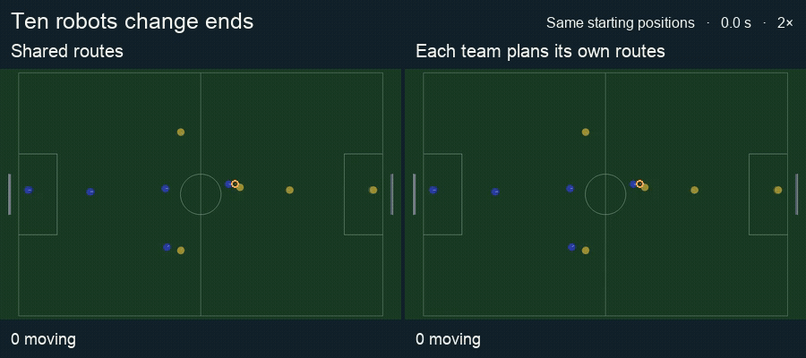](media/team-kickoff/matched-kickoffs.mp4)

## Faster 5v5 kickoffs

Watch both teams change ends under the official referee. On the same 8 replayed restarts, the median time to reach formation fell from 31.28 to 9.88 seconds. In four fresh live matches per planner, the Game Controller accepted 0 kickoff crash calls with the current planner and 0 with concurrent routes. [Matched timings and evidence](media/parallel-kickoff/README.md) · [Full match](media/parallel-kickoff/official-match.mp4)

[](media/parallel-kickoff/kickoff-race.mp4)

## Watch the teams change ends

The blue ring marks Blue 0 in Webots. The pink cross marks where TIGERs sees it. During a half-time reset they separate by over eight metres. Watch them stay together when the robots drive to their positions. On four fresh paired openings, the Game Controller accepted 3 crash calls with instant resets and 0 with driven kickoffs. Both teams kept their open-play policies frozen. [Full match](media/kickoff-drive/official-match.mp4) · [Passing, scoring and tracker measurements](media/kickoff-drive/README.md)

[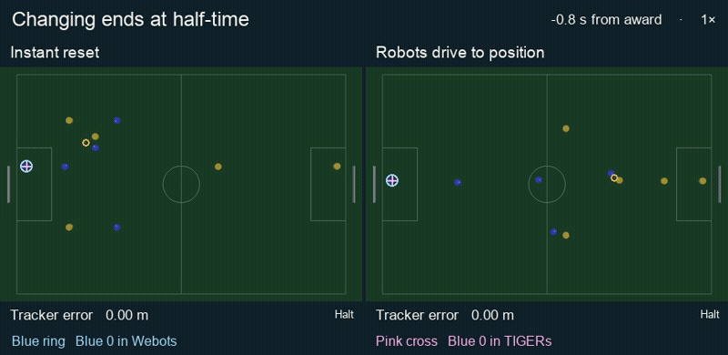](media/kickoff-drive/changing-ends.mp4)

## A 5v5 match under the official referee

Blue scores, Yellow takes the kickoff, and the teams switch ends for the second half. The SSL Game Controller kept time and awarded every goal across eight Webots games on four matched openings. Learned steering recorded 3 accepted crashes, 51 completed passes and 6 goals. Previous steering recorded 7, 43 and 8, respectively. A kickoff replay checks the distance between the players named in a crash report. [Uncut 2–0 match](media/official-league/official-match.mp4) · [Paired results and replay](media/official-league/README.md)

[](media/official-league/official-match.mp4)

## Two open-play collisions, replayed in 5v5

Watch Blue 4 and Yellow 2 cross paths. On the left TIGERs calls a 1.61 m/s crash. On the right, the players estimate each other's motion from consecutive overhead positions and pass with 32 cm between their centers. Across 16 fresh one-minute matches the trained team went from **47 crash calls to zero** and from **151 to 201 completed passes**, with **21 goals** for each policy.

[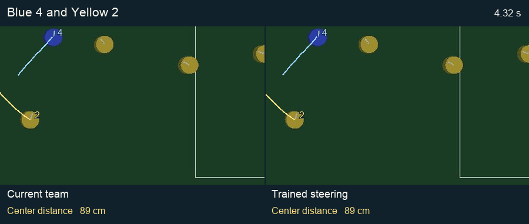](media/open-motion/two-encounters.mp4)

[Watch both original encounters](media/open-motion/two-encounters.mp4) · [Uncut fresh match](media/open-motion/fresh-match.mp4) · [Blue's scoring play](media/open-motion/first-goal.gif) · [Training and all paired results](policies/open_motion_v1/README.md)

## Can Blue get to the ball without hitting Yellow?

After the ball goes out, watch Blue 4 on the left run into Yellow 2. On the right, Blue 4 takes a wider approach, places the ball and sets up a free kick to Blue 3. The official RoboCup Game Controller accepted **40/40** crowded placements by the revised team with zero crash calls. On the same fresh starts, the previous team completed **19/40** and had 21 crashes.

[](media/placement-traffic/touchline-restart.mp4)

[Uncut 25-second open-play match and restart](media/placement-traffic/open-match.mp4) · [Full replay of the incident](media/placement-traffic/touchline-restart.mp4) · [Training and paired referee results](policies/placement_v2/README.md) · [Earlier ball-placement experiment](policies/placement_v1/README.md)

## Watch a robot score an officially refereed goal

Yellow shoots, TIGERs AutoRef detects the goal, and the official Game Controller awards Blue the kickoff. The same detector called all four goals and all five ball-outs on three archived 5v5 matches, with zero extra goal calls.

[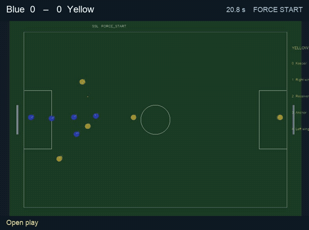](media/autoref/webots-autoref.mp4)

[Watch the full sequence](media/autoref/webots-autoref.mp4) · [Match results, protocol evidence and reproduction](media/autoref/README.md)

## Watch the 5v5 role assignments

Follow Yellow 2 through a turnover, a pass to Yellow 4 and the return pass. The ten jersey numbers stay fixed. The rosters show who is carrying, receiving, pressing or covering as the ball moves.

[](media/five-roles/five-roles.mp4)

[Full 60-second Webots match](media/five-roles/five-roles.mp4) · [How roles are assigned, match traces and live launch command](media/five-roles/README.md)

## Watch the official referee control a 5v5 match

The RoboCup SSL Game Controller awards Blue a kickoff, halts both teams during play, then restarts them. The scoreboard follows an operator correction from 2–0 to 1–0. The final sequence shows what happens when the controller disconnects.

[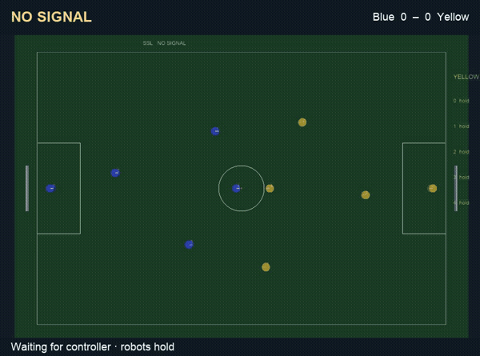](media/ssl-referee/referee.mp4)

[Watch the film](media/ssl-referee/referee.mp4) · [Frame-by-frame transition measurements](media/ssl-referee/verification.json) · [Connect your controller](#official-game-controller)

## When the pass is about to be intercepted

At 6.84 s, Blue 2 switches from receiver 1 to 0. The previous pass is intercepted. The new sequence ends in a goal at 11.28 s. Over 40 matched fresh Webots kickoffs the challenger's interception rate was 10.4% against 27.8% for the 248-goal team.

[](media/pass-release/same-possession.mp4)

[Delay, switch and dribble in fresh matches](media/pass-release/release-choices.gif) · [Full fresh match](media/pass-release/open-play-match.mp4) · [Policy, all 43 interceptions and fresh results](policies/pass_release_v1/README.md)

## Pass or shoot after a steal

The 3v3 team scored **248 goals after clean takeaways** on 40 fresh 90-second Webots starts. The previous team scored 77 on the same kickoffs. Watch the right panel as Yellow 0 finds Yellow 2 moving into space.

[](media/counterpass/same-possession.mp4)

[Full Webots match](media/counterpass/open-play-match.mp4) · [Learned policy, all paired starts and head-to-head results](policies/counterpass_v1/README.md)

## Clean takeaways in 3v3

The team scored **73 goals from 391 clean takeaways** in 40 fresh 90-second Webots matches. The 55-goal team scored 1 from 12 on the same starts. In the clip, Yellow 0 intercepts Blue 1’s pass, secures it at 4.48 s and scores at 5.52 s.

[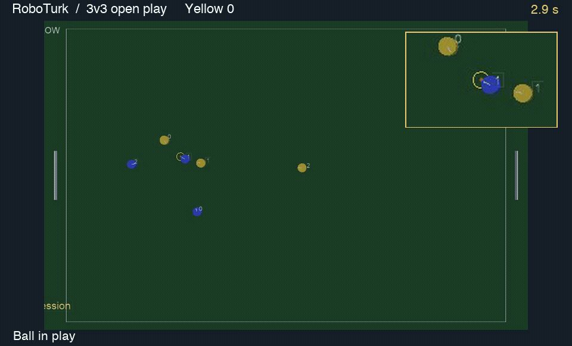](media/clean-takeaway/open-play-recovery.mp4)

[All three original losses and repaired goals side by side](media/clean-takeaway/three-repaired-takeaways.gif) · [Full 90-second match](media/clean-takeaway/open-play-match.mp4) · [Same-start comparisons, all three recoveries and training evidence](policies/takeaway_v1/README.md)

## Open-play recovery goals in 90-second 3v3 matches

Across 16 matched starts, the new 3v3 teams scored **55 goals from 176 open-play recoveries**. The previous 31/40 opening team scored 9 from 54 in the same 24 minutes of play. The test counted live takeaways and contested-ball wins throughout each match.

[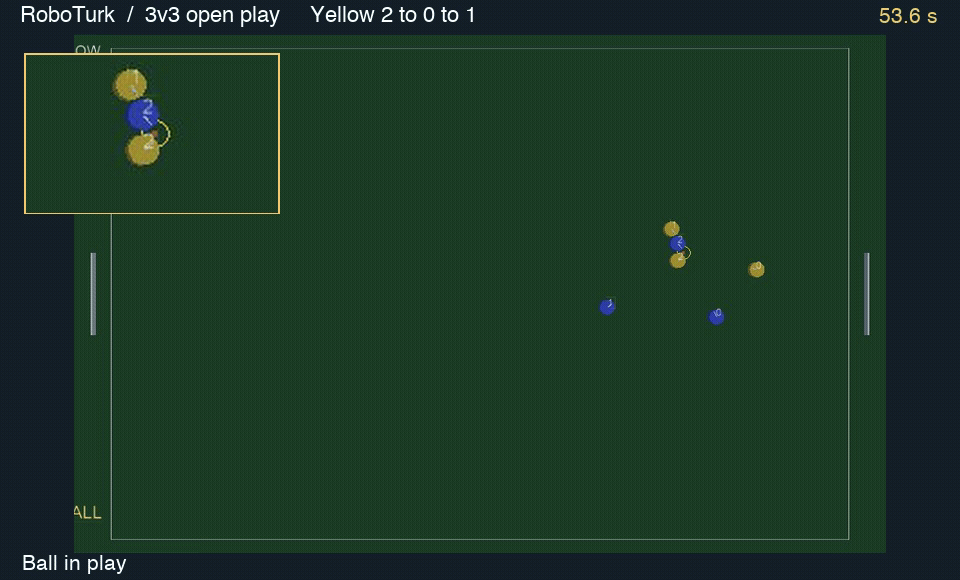](media/open-play/open-play-recovery.mp4)

Yellow 2 wins the ball at 55.20 s and plays it to Yellow 0. Yellow 0 finds Yellow 1, who scores at 62.52 s. [Watch the full 90-second match](media/open-play/open-play-match.mp4) · [Same start, both policies](media/open-play/same-start.gif) · [All paired and head-to-head results](policies/open_play_v1/README.md)

## Protecting the first touch in 3v3

The recovering team protected the first touch, led a teammate past the defender and finished under pressure on **31 of 40 fresh Webots openings**. The original ball winner lost possession before the pass in 1 opening. On identical starts, the previous team scored 24/40 and lost possession before the pass in 3 openings.

[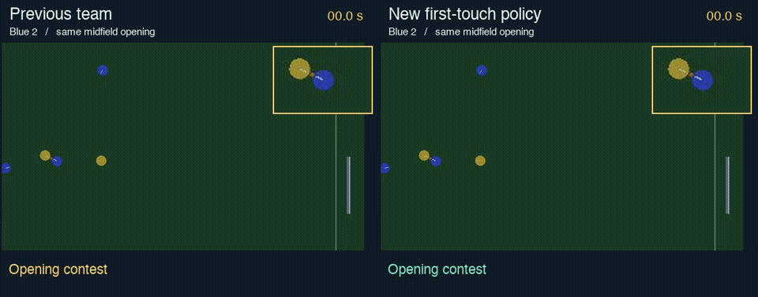](media/recovery-touch/first-touch-comparison.mp4)

*Watch Blue 2 at the opening contest. The left panel shows the original loss. On the right the carrier keeps the ball, finds Blue 0, and the receiver scores.* [Fresh opening GIF](media/recovery-touch/first-touch.gif) · [Uncut three-opening video](media/recovery-touch/first-touch.mp4) · [Training and all 40 matched pairs](policies/recovery_touch_v1/README.md)

## Shielding a lead pass in 3v3

The frozen receiver turned **27 of 40 fresh opening contests** into a pressured reception, a shield and a goal. On the same starts, the previous team scored 15 lead-pass goals and earned zero goals with a verified shield under pressure.

[](media/pressure-receive/pressure-shield.mp4)

*Blue 0 leads Blue 1 by 0.33 m. The defender closes to 0.46 m at reception.* [Previous interception and new finish side by side](media/pressure-receive/matched-reception.gif) · [Uncut three-opening demo](media/pressure-receive/pressure-shield.mp4) · [Policy and all 40 matched pairs](policies/pressure_receive_v1/README.md)

## Leading the open teammate in 3v3

The frozen 3v3 teams scored **31/40** after leading an open teammate around a blocked dribble lane. Opening interceptions fell from nine in the preceding release to **1**. On these same fresh starts the previous team scored from 27 direct-to-receiver passes and had 7 interceptions.

[](media/lead-outlet/lead-pass.mp4)

*Yellow 0 leads Yellow 1 by 0.25 m. The receiver runs 0.21 m along that heading before controlling the pass. Yellow 1 scores at 4.27 s.* [Full three-opening demo](media/lead-outlet/lead-pass.mp4) · [Full GIF](media/lead-outlet/all-openings.gif) · [Previous interception and new goal side by side](media/lead-outlet/matched-lead.gif) · [Trained policy, interception analysis and all 40 pairs](policies/lead_outlet_v1/README.md)

## Passing around a blocked lane in 3v3

The recovering team passed to an open teammate and scored on **25 of 40 fresh Webots openings**. The target was 24. Both colors and both possible receiver slots contributed goals. All 40 opening contests count.

[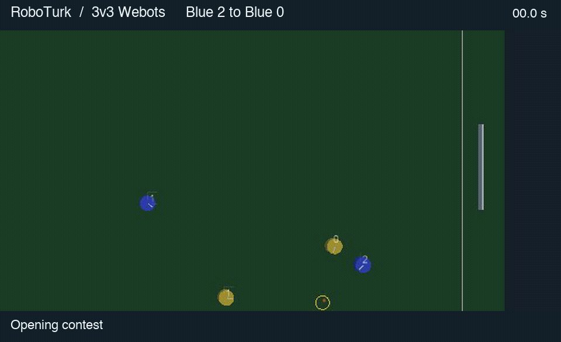](media/blocked-outlet/blocked-outlet.mp4)

*Blue 2 wins the ball, passes to Blue 0 at 3.64 s, and Blue 0 scores at 6.35 s.* [Full three-opening Webots recording](media/blocked-outlet/blocked-outlet.mp4) · [Full GIF](media/blocked-outlet/all-openings.gif) · [Policy, training and all 40 outcomes](policies/blocked_outlet_v1/README.md)

## 32 goals from 40 fresh 3v3 opening contests

On the same 40 fresh Webots starts, the new team scored from **32 opening recoveries (80%)**, up from **20 (50%)** for the previous team. The target was 24/40. The new controller starts centering the moving ball as soon as one contestant holds it alone. Twenty-three of the 32 opening goals followed a controlled dribble.

[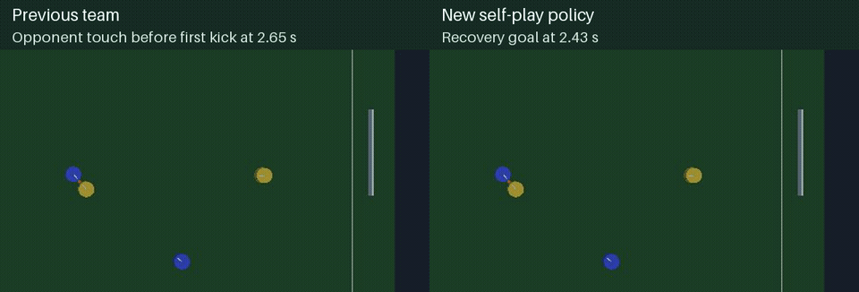](media/recovery-transition/matched-recovery.mp4)

*The two native recordings share the same starting positions and clock. On the left the opponent touches the ball at 2.65 s. On the right Blue 2 keeps possession, dribbles 0.51 m and scores at 2.43 s.* [Three fresh uncut Webots games](media/recovery-transition/recovery-to-goal.mp4) · [Fresh scoring-play GIF](media/recovery-transition/recovery-goal-play.gif) · [Full GIF](media/recovery-transition/recovery-to-goal.gif) · [Where the earlier team lost possession](media/recovery-transition/previous-losses.png) · [Policy, training and all 40 match pairs](policies/recovery_attack_v3/README.md)

## Earlier 3v3 recovery decisions in Webots

The same team makes two different choices after recovering the ball. In ordinary play, Yellow 2 keeps possession, dribbles 0.40 m and scores. In a separate fresh game, Yellow 0 finds Yellow 1 with a pass. Yellow 1 receives, turns and scores.

[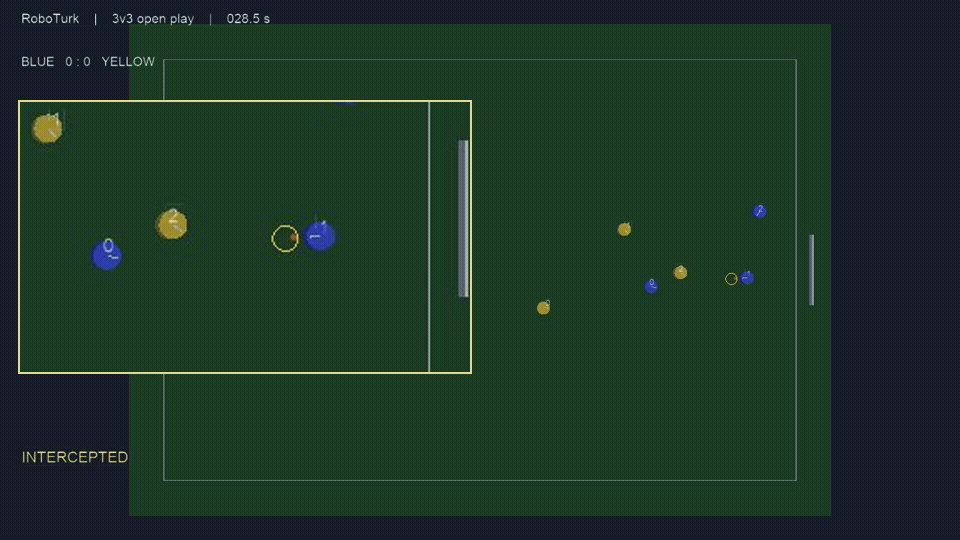](media/recovery-shield/recovery-to-goal.mp4)

*The first four seconds show the spontaneous recovery. After a short break the second game starts at its opening contest. Both clips play at normal speed. The full three-game demo reproduced all 10,500 measured states, decisions and goals in a second native launch.* [Three uncut games](media/recovery-shield/recovery-to-goal.mp4) · [Full GIF](media/recovery-shield/recovery-to-goal.gif) · [Full ordinary match](media/recovery-shield/recovery-finish.mp4)

On 40 matched starts, the newly trained teams converted **17 opening contests**, compared with **3** for the previous outlet teams. They also scored from **4/11 spontaneous recoveries** in 12 ordinary one-minute games. The opening-conversion threshold was 24/40. [Policy, training and all 116 games](policies/recovery_attack_v2/README.md)

## Earlier 3v3 recovery, dribble, pass and finish

Yellow 0 wins a contested ball in open play, dribbles 0.25 m and passes to Yellow 1. The receiver shoots across the left goal line. Both teams run the same frozen self-play strategy, choosing again after a carry or a reception.

[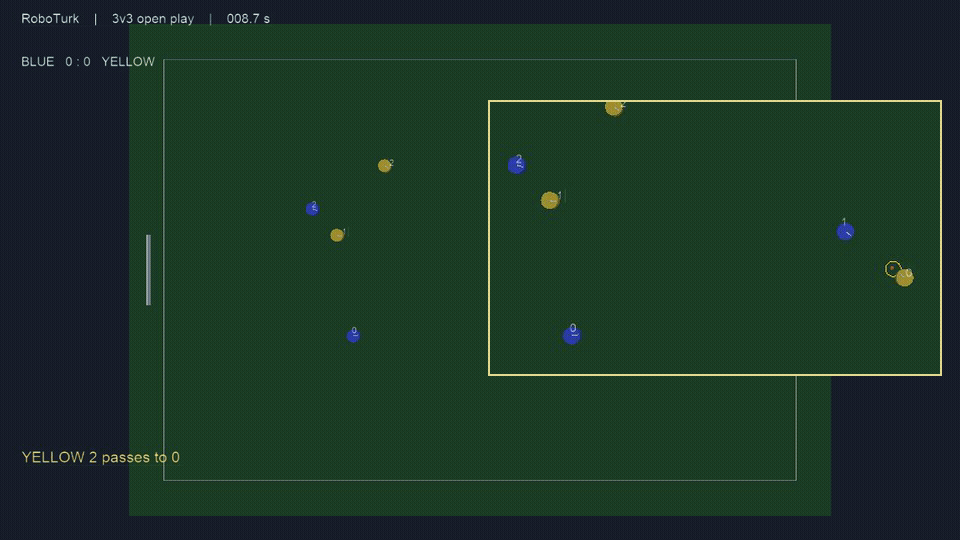](media/recovery-pass-finish.mp4)

*Yellow 0 gains sole control at 10.19 seconds, passes at 11.48 and Yellow 1 completes the reception at 12.96. The shot crosses the goal line at 15.39. The inset enlarges the same Webots frames. The rendered rerun reproduced every recorded state in the original 60-second match.* [Full open-play match](media/recovery-pass-finish.mp4) · [Three fresh uncut demo matches](media/recovery-to-goal.mp4) · [Full demo GIF](media/recovery-to-goal.gif)

Across two independent matched Webots evaluations, the new team scored from **28/60 opening contests**, compared with **6/60** for the previous team. It improved on the previous team in both evaluations and missed the 60% opening-conversion target in both. In 18 ordinary one-minute games it scored from **8/14 spontaneous recoveries**. [Model, training and both evaluation protocols](policies/recovery_attack_v1/README.md)

## 3v3 contested recovery and outlet passing

Two opponents reach the ball together. One learns how to free it with its dribbler while a teammate moves into a receiving position. On 12 matched 90-second Webots starts, the new team reduced time spent holding the ball jointly from **318.80 to 16.58 seconds**. It completed **10 recovery-to-pass sequences in seven games** when both sides used the new policies. In head-to-head games, the trained side completed all six such sequences.

[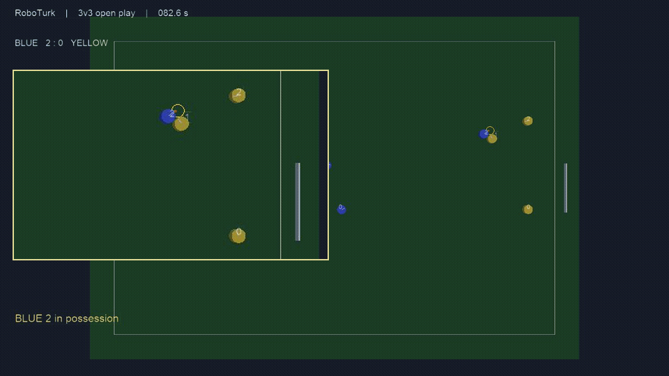](media/contest-outlet-self-play.mp4)

*At 84.26 seconds, Blue 2 and Yellow 2 contest the ball in open play. Yellow 2 establishes sole control at 85.64, kicks at 88.20, and Yellow 0 completes the reception at 89.20. The inset enlarges the same Webots frames. The full recording includes both fresh 90-second matches.* [Full three-minute GIF](media/contest-outlet-self-play.gif) · [Native MP4](media/contest-outlet-self-play.mp4) · [Policies, training and match results](policies/contest_outlet_v2/README.md).

## 3v3 self-play with two possible pass recipients

Six robots now choose between their two teammates in native Webots. Two receiver
policies trained through 40 one-minute matches against historical opponents.
All six players completed passes to both teammates in held-out play. The policies
completed **250/371 intended passes (67.4%)** in 32 one-minute matches and
**46/61 (75.4%)** in eight 90-second matches without a possession clock.

[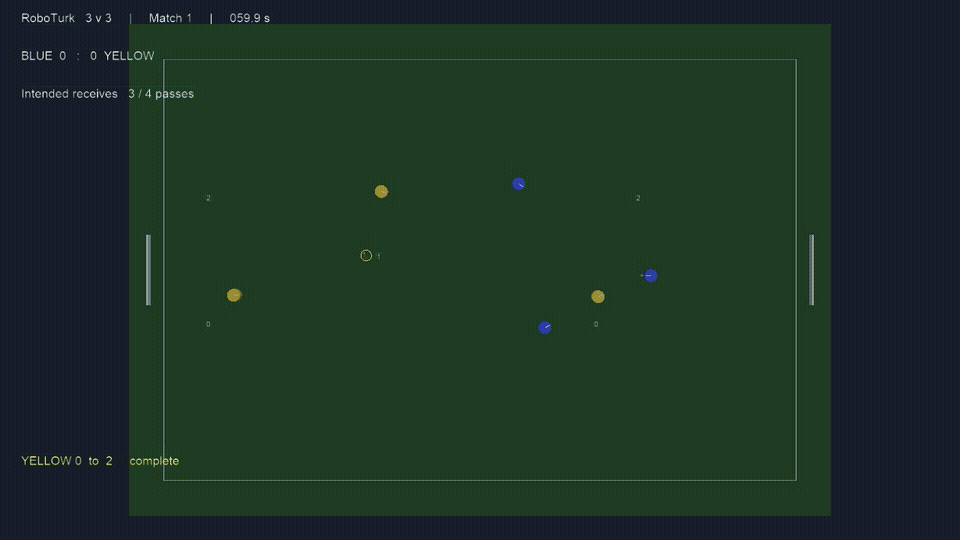](media/three-recipient-self-play.mp4)

*12-second excerpt from the second fresh demo match. Blue 2 completes its pass
to 0, receives the ball back, and tries 1. Yellow intercepts the second pass.*
[Full two-minute GIF](media/three-recipient-self-play.gif) ·
[Original Webots video](media/three-recipient-self-play.mp4) ·
[Model card, controls and all outcomes](policies/recipient_3v3_v1/README.md).

The fresh demo retains both scoreless matches and all 14 pass attempts, including
10 intended receptions. Receiver selection is learned, the pass motor is frozen,
and the surrounding 3v3 tactics use explicit controllers. Two of the eight
90-second games had a completion in the final 30 seconds.

## Earlier ten-skill 2v2 strategy

The [learned skill strategy](policies/strategy_self_play_v1/README.md) integrates
receive-and-stop, one-touch redirect and defensive clearance into ten neural
behavior choices, trained through two historical self-play leagues.
**Both seeds passed every reserved gate: 120/120 complete matches, 45 goals,
28 stopped receptions, 25 redirect goals and 33 clearances**, with zero detected
contacts or field exits. There were 79 draws. All physics and checkpoint audits
passed. An explicit geometric safety filter intervened on 33–35% of ticks.

[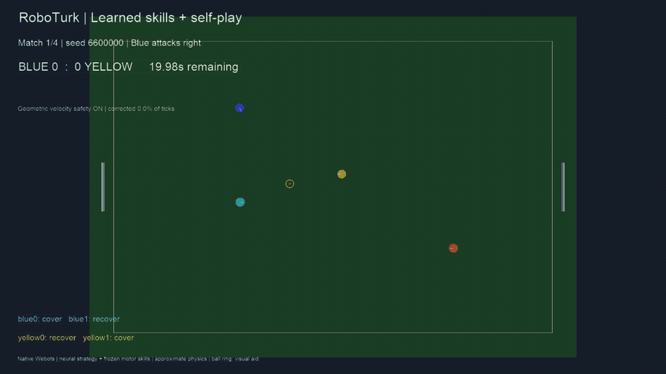](media/learned-skills-self-play-demo.mp4)

*Full-length, normal-speed GIF of all four fresh matches: two goals, one stopped
reception, one redirect goal and one defensive clearance. Click for the original
79.96-second native video. Receive near 0:22, redirect goal near 0:42, clearance
near 1:02. No cuts or selected outcomes.*

[Architecture and training](docs/LEARNED_SKILL_STRATEGY.md) ·
[Every reserved result](policies/strategy_self_play_v1/qualification-summary.json) ·
[Team-paper inspiration](docs/TDP_SKILL_PACK.md).
This remains approximate ground-truth 2v2 simulation with simplified restarts.

The earlier isolated [TDP-inspired skill pack](policies/tdp_skills_v1/README.md) adds timed
receive-and-stop (197/200 reserved cases), one-touch redirect (200/200), and defensive
recover-and-clear (200/200), with zero collision/field-exit/own-goal/premature-release
failures. Three receive timeouts are retained. [Native 30.8-second demo](media/tdp-skills-demo.mp4)
shows all 12 fresh cases, 12/12 successful. [CMDragons, Thai Skuba and TIGERs provenance](docs/TDP_SKILL_PACK.md)
explains the explicit play/role/committed-option coordinator around learned motion
and release. That release preserves its previous continuous learned manager. Its isolated
skill rates do not establish composed match-strategy performance; the new
[integration experiment](policies/strategy_self_play_v1/README.md) trains and
evaluates a separate learned selector over all ten skills.

[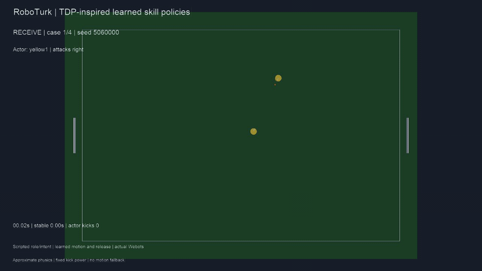](media/tdp-skills-demo.mp4)

*Animated preview: all 12 skill cases, 30.8 seconds at normal speed. Click for the full-resolution video.*

The [continuous 2v2 release](policies/continuous_play_v2/README.md) adds learned
recovery, support, pressing, coverage and counterattacks through two independent
historical self-play leagues. Both seeds passed all reserved gates:120/120matches
completed,73goals,146stable receptions and74counterattack matches, with zero
detected contacts or field exits. An explicit geometric safety layer changed
translation on16–20%of ticks. All interventions and failures are retained.

[Uncut native Webots demo](media/continuous-self-play-demo.mp4): three fresh45-second
matches, scores0–0,1–0,0–0. [Architecture and limits](docs/CONTINUOUS_PLAY.md).
The [unfiltered attempts](policies/continuous_play_v1/README.md) remain available.
This is approximate ground-truth simulation with simplified restarts; official
SSL match, hardware and complete live ROS graph qualification remain outstanding.

[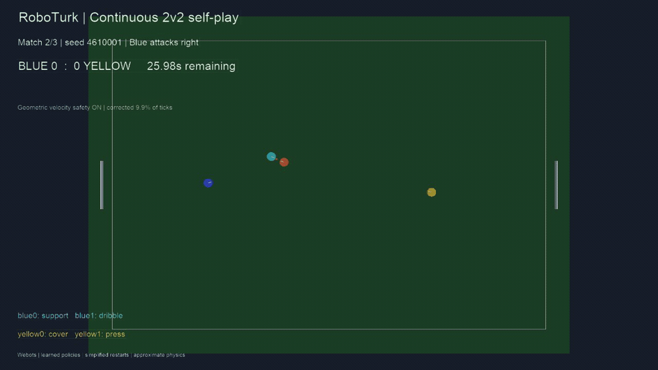](media/continuous-self-play-demo.mp4)

*Selected goal highlight, 1:04–1:20 at normal speed. Click for all three uncut matches and their outcomes.*

The previous qualified drill replaces scripted tactical targets and handoffs with a **neural
manager** that chooses when to pass, dribble or shoot, which robot acts, and where
to receive/dribble/aim. Two alternating self-play generations trained the manager,
defender and keeper for 196,608 native PPO steps; learned motion skills stay frozen.

All reserved panels passed: **233/240**, **118/120** and **117/120** clean outcomes.
The final pair produced **107 goals, 126 defensive stops and seven failures**.
Clean includes legitimate defensive stops, not only attacker wins.
[Model card, checkpoints and every outcome](policies/decision_self_play_v2/README.md) ·
[Architecture, training and replay](docs/LEARNED_DECISIONS.md).

The [fresh 45.6-second Webots demo](media/learned-decisions-self-play-demo.mp4) retains
all nine consecutive games: five goals, two interceptions and two saves. Episode 3
(starting 6.84 s) shows learned passing, receiver handoff, dribbling and scoring.

[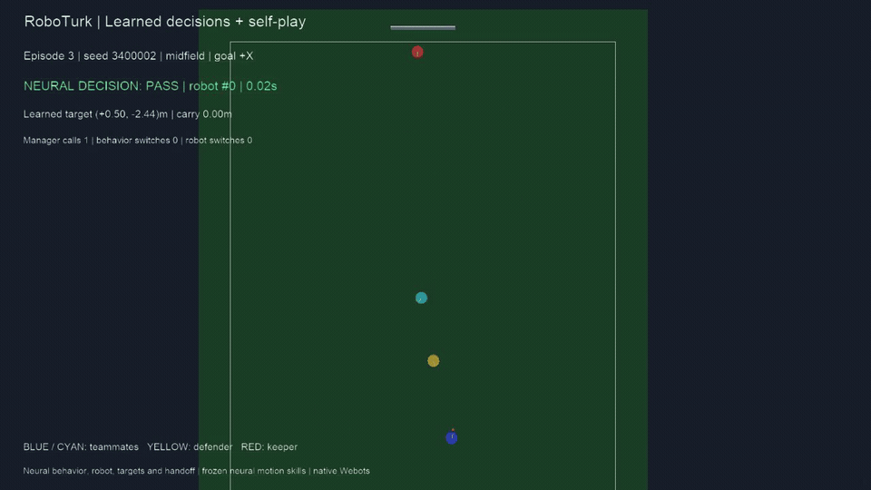](media/learned-decisions-self-play-demo.mp4)

*Selected pass-and-score sequence, 0:06.84–0:18.60 at normal speed. Click for all nine consecutive games, including defensive stops.*

Initialization used imitation/DAgger and supervised defensive coaching. Self-play
updates decision readouts and opponents while preserving learned coordinate
regression and motion skills; no isolated PPO gain is established. This remains an
approximate ground-truth, initial-possession 2v2 drill, with live ROS graph and
hardware qualification still separate.

## Previous mobile self-play release

The previous release gives the neural defender and keeper wider planar movement and
trains both sides through **five generations of alternating self-play** (655,360
PPO steps). The final pair produced **194/200 clean reserved outcomes**: 78 goals,
100 defender interceptions and 16 keeper saves. Six failures remain documented.
Clean means a goal or valid defensive stop, not an attacking win. Historical panels
also passed: 99/100 and 97/100 clean outcomes.

The [fresh 73.2-second Webots demo](media/mobile-self-play-demo.mp4) includes all eight
consecutive games: two goals, three interceptions and three saves, with no collisions
or unforced failures. The goals are episodes 7 and 8. All frames and original timing
are retained. [Model card, checkpoints and evidence](policies/self_play_v1/README.md) ·
[Self-play protocol and replay commands](docs/SELF_PLAY.md).

[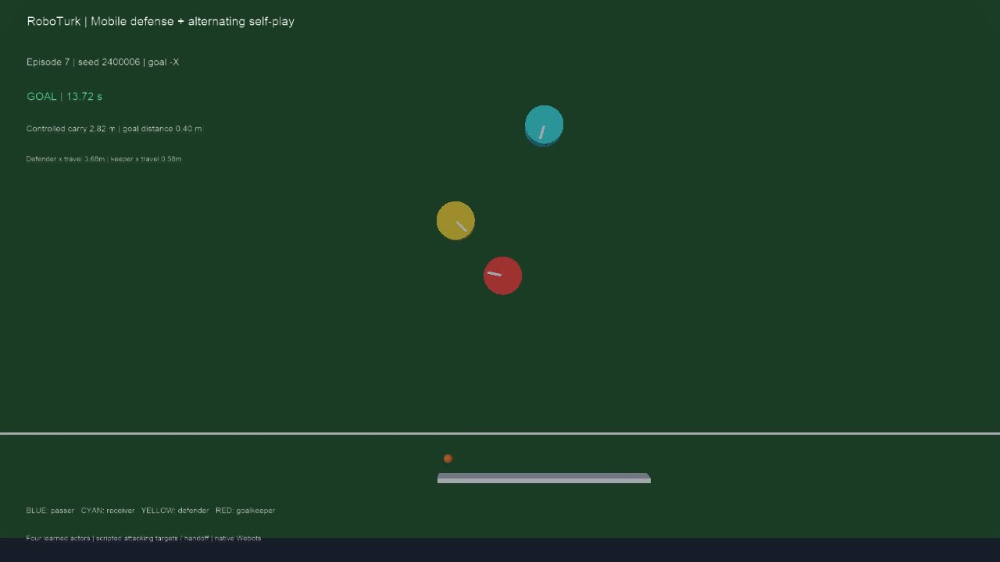](media/mobile-self-play-demo.mp4)

Motion and kick decisions are learned; tactical targets and phase handoff remain
scripted. This is an approximate, ground-truth two-attacker versus defender/keeper
drill. Training includes imitation and supervised spacing preparations; neither
isolated PPO gains nor monotonically improving match strength is established.

## Earlier fixed-opponent milestone

The two attackers now **pass around a learned defender, receive, dribble and score
against a learned goalkeeper**. Both opponent motion controllers are neural policies;
the attacking transfer and finishing policies were retrained against those frozen
opponents. The four-policy play scored **200/200 reserved native Webots cases**,
with **zero pre-release possession losses or robot collisions**. Mean sequence:
**15.22s**; mean ball displacement to reception **2.93m** and retained receiver carry
**3.77m**. [Model card and every outcome](policies/learned_opponents_play_v1/README.md) ·
[Training and qualification protocol](docs/LEARNED_OPPONENTS.md).

The [fresh native Webots demo](media/learned-opponents-pass-receive-score-demo.mp4)
scored **6/6 consecutive cases**. All2,346 native frames are retained at normal
simulation speed (93.84s). Blue is the passer, cyan the receiver/scorer, yellow the
defender and red the keeper.

[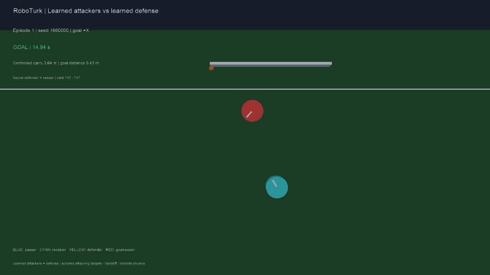](media/learned-opponents-pass-receive-score-demo.mp4)

The neural defender intercepted **100/100** reserved direct passes; the neural
keeper saved **99/100** reserved direct shots. Their [independent defensive checks](policies/learned_opponents_v1/README.md)
include stationary and teacher comparisons. The previous attackers scored45/60
against these same frozen opponents, with15 keeper saves. All failed candidates
and development outcomes remain published.

A62-input/seven-output transfer actor controls both attackers until stable reception;
a32-input/four-output finisher controls dribbling, turning and shot release. The
33-input/three-output opponents control their own translation and rotation throughout
both phases, without reset or analytic motion fallback. Receiving/finishing targets,
open-corner aim selection, role handoff and fixed kick speeds remain scripted.
Training used demonstrations, DAgger and anchored PPO; no incremental PPO success-rate
benefit over the best imitation stage is established.

This is a bounded approximate, ground-truth Webots curriculum, starting with passer
possession. The defender is a lane guard (0.25–0.55m/s); the keeper retains a goal-line
role,0.65–0.95m/s speed limit and0.08–0.14s command delay. It does not establish
unrestricted match strength, a self-play equilibrium or calibrated hardware behavior.
A complete live ROS/Webots graph with applied-kick feedback also remains to be validated.

Earlier releases remain available: [analytic-opponent keeper play](policies/keeper_finish_v1/README.md)
(199/200), [defended passing](policies/defended_pass_receive_v3/README.md),
[unguarded passing/scoring](policies/pass_receive_v2/README.md),
[capture/dribble/shoot](policies/capture_dribble_shoot_v2/README.md),
[capture/dribble](policies/capture_dribble_v1/README.md) and
[capture](policies/chase_capture_v1/README.md) (each200/200 in its own curriculum).
Separate [block/recover](policies/block_shot_v1/README.md) and
[passing-lane coverage](policies/cover_pass_lane_v1/README.md) policies each passed200/200
and have a [native defensive demo](media/defensive-micro-behaviors-demo.mp4).
[Behavior contracts and paper provenance](docs/BEHAVIOR_SOURCES.md) trace inspiration
to CMDragons2015, TIGERs Mannheim2025 and ER-Force2024.

Replay the learned-opponent play with the pinned environment and Webots installation:

```sh
../.venv/bin/python scripts/run_webots.py \
  --webots ../runtime/Webots-nightly.app/Contents/MacOS/webots \
  --mode opponents-demo \
  --checkpoint policies/learned_opponents_play_v1/transfer/policy.zip \
  --shoot-checkpoint policies/learned_opponents_play_v1/finish/policy.zip \
  --defender-checkpoint policies/learned_opponents_v1/defender/policy.zip \
  --keeper-checkpoint policies/learned_opponents_v1/keeper/policy.zip \
  --episodes 6 --seed 1660000 --output runs/learned-opponents-demo --timeout 1800 --render
```

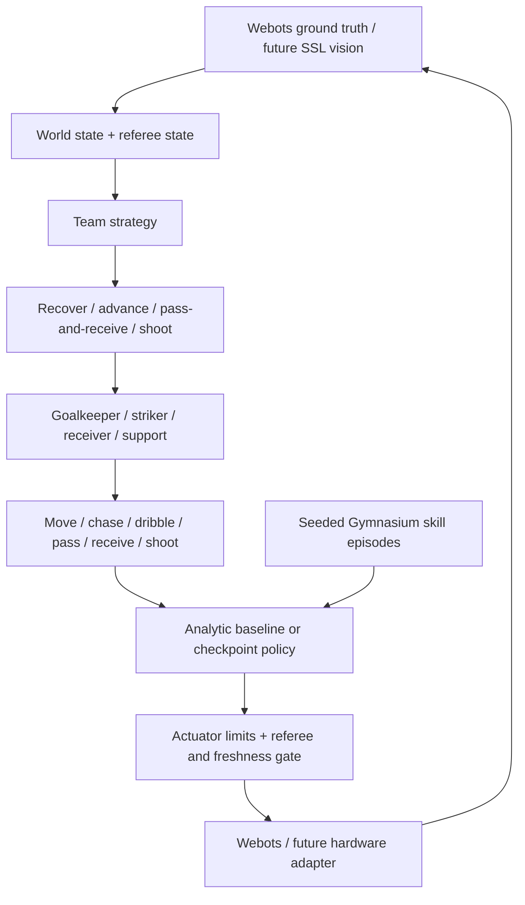

## Run the core on this Mac

From this directory, the isolated environment is `../.venv`:

```sh
PYTHONPATH=src/roboturk_core ../.venv/bin/python -m roboturk.cli evaluate --skill chase --episodes 10
../.venv/bin/python -m pytest -q
```

For a fresh machine (Python 3.12 recommended):

```sh
python3.12 -m venv .venv
. .venv/bin/activate
python -m pip install -e 'src/roboturk_core[rl,test]' ruff
python -m roboturk.cli evaluate --skill pass
```

The CLI's default backend is **synthetic planar dynamics**, intended for contract tests and pipeline debugging. It has no wheel physics, teleports a held ball to the mouth, and must not be used as evidence of realistic dribbling or transfer.

## Run Webots

Use Webots R2025a on a supported platform. On macOS 27, the original R2025a binary has a [known startup bug fixed upstream](https://github.com/cyberbotics/webots/pull/7032). Local validation uses the dated `nightly_17_11_2026` R2025a asset, recorded separately from stable.

```sh
../.venv/bin/python scripts/run_webots.py \
  --webots ../runtime/Webots-nightly.app/Contents/MacOS/webots \
  --skill chase --episodes 10 --output runs/webots/chase
```

Add `--render` to display the field. On Linux, use `--webots /usr/local/webots/webots` or the location of your Webots executable. A display server is needed even with `--no-rendering`; use Xvfb for unattended Linux runs.

Use `--mode suite` to evaluate all six analytic skill baselines serially. Set `ROBOTURK_TRACE=1` for per-episode trajectory samples in single-skill evaluation output.

Webots uses native ODE contacts, carpet friction forces and torques, a planar drive limited to 3 m/s and 5 m/s², and a spring/damper dribbler. Flat kicks have a 10 m/s actuator ceiling and a 6.5 m/s ceiling in official matches. Robot wheel dynamics, carpet response and kicker transfer remain to be measured on RoboTurk hardware. Historical policy results were collected with the simulator revision pinned in each study. [Current physics and field measurements](media/ssl-physics/README.md)

## ROS 2 workspace

The initial Linux baseline is **ROS 2 Jazzy / Ubuntu 24.04**, matching Webots R2025a's published Ubuntu binaries. Jazzy remains supported through May 2029. Lyrical is the current ROS 2 release, but a Lyrical/Ubuntu 26.04/Webots combination has not been validated here. [Version evidence and migration audit](docs/MIGRATION.md).

```sh
source /opt/ros/jazzy/setup.bash
rosdep install --from-paths src --ignore-src -r -y
colcon build --symlink-install
source install/setup.bash
ros2 launch roboturk_ros soccer.launch.py webots:=/usr/local/webots/webots
```

The launch listens for the official referee and starts in HALT until a fresh command arrives. To run with the local practice heartbeat, use the following command.

```sh
ros2 launch roboturk_ros soccer.launch.py webots:=/usr/local/webots/webots practice:=true
```

The launch starts the simulator, both strategy nodes and one referee source. The default source listens on 224.5.23.1 port 10003. For a different endpoint, set the launch arguments `referee_address`, `referee_port` and `referee_interface`. This is a custom Supervisor/rclpy bridge; it does not depend on `webots_ros2_driver`. ROS uses a single simulation owner and monotonic `/clock`. Training runs directly inside the Supervisor so each action advances an exact number of physics steps without ROS callback timing in the learning loop.

| Interface | Meaning |
| --- | --- |
| `/roboturk/world` | Typed field-frame robot/ball state and effective referee state |
| `/roboturk/blue/commands`, `/roboturk/yellow/commands` | Full team snapshots of body-frame commands |
| `/roboturk/referee` | Effective motion gate, original SSL command, stage, source, counter, score, restart team and blue attack direction |
| `/roboturk/reset` | Seeded practice formation reset; clears commands and enters HALT |
| `/clock` | Simulation time, monotonic across formation resets |

The ROS actuator bridge holds on HALT or STOP, on commands older than 250 ms, and on referee heartbeats older than 500 ms. The native Webots 5v5 Supervisor also implements the touchline placement play described above.

### Official Game Controller

Run the official executable on the same multicast network as RoboTurk. The Web UI defaults to `http://localhost:8081`. On macOS or Linux, give the downloaded executable execute permission and use its path for `ssl-game-controller` below. [Official release downloads](https://github.com/RoboCup-SSL/ssl-game-controller/releases/tag/v3.23.1).

```sh
ssl-game-controller
```

From the modern stack directory, run a real-time 5v5 match. Use a new output directory for each run.

```sh
python scripts/run_five_roles.py runs/official-match --referee ssl --watch --seconds 120
```

For a single-machine session, start the controller with `-publishAddress 127.0.0.1:10003` and pass `--referee-address 127.0.0.1` to the match, or `referee_address:=127.0.0.1` to the ROS launch. For multicast on a multi-interface host, pass the receiving interface's IPv4 address with `--referee-interface`. For a remote controller, synchronize host clocks. Packet time and local heartbeat age each have a 500 ms freshness window.

Use **Force Start** for immediate open play. For a kickoff, prepare the team and send **Normal Start**. In native 5v5, preparing a kickoff places the ball at center and the ten robots in formation once for that command. During a kickoff or free kick, the awarded team moves first. The opponent can play after the ball moves 5 cm. A Normal Start received without the preceding kickoff preparation holds both teams. On a valid ball-placement award the native Supervisor assigns a placer and an outlet, clears the corridor and waits for the official free kick. A STOP during this sequence asks the robots to give the ball space. Halt, penalty and timeout hold the robots. Autonomous penalty taking and general STOP-distance positioning remain open.

Official mode takes the score and field sides from the broadcast. Webots supplies local ball and robot state to the teams. The native match can also publish SSL-Vision detections to an external AutoRef. The tested TIGERs integration reports events to the Game Controller and feeds its decisions back into play. [Run the closed-loop fixture](media/autoref/README.md#run-the-experiment). The default native training launcher continues to use its local referee for reproducible seeds. [Official referee protocol](https://github.com/RoboCup-SSL/ssl-game-controller/blob/v3.23.1/proto/state/ssl_gc_referee_message.proto).

## Training and policy replacement

```sh
# Bounded CPU smoke run in synthetic dynamics; not a performance experiment.
PYTHONPATH=src/roboturk_core ../.venv/bin/python -m roboturk.cli train \
  --skill chase --steps 2048 --output runs/synthetic_smoke/policy

# Actual Webots backend; choose a budget explicitly before a longer run.
../.venv/bin/python scripts/run_webots.py \
  --webots ../runtime/Webots-nightly.app/Contents/MacOS/webots \
  --mode train --skill chase --steps 2048 --timeout 180 \
  --output runs/webots_smoke/policy

# Evaluate the checkpoint on held-out seeds in the same backend.
../.venv/bin/python scripts/run_webots.py \
  --webots ../runtime/Webots-nightly.app/Contents/MacOS/webots \
  --skill chase --checkpoint runs/webots_smoke/policy.zip \
  --seed 1000 --episodes 20 --output runs/webots_smoke/evaluation
```

PPO uses one CPU thread here. A `.zip` checkpoint has a companion `.json` with observation contract version, skill, full configuration, backend and seed. Loading rejects incompatible skill/configuration/contract combinations. Successful loading is not a qualification for deployment.

In Python, register `CheckpointPolicy(path, skill, cfg)` with `BehaviorLibrary.register`, matching `Skill.CHASE`, `Skill.DRIBBLE` or `Skill.SHOOT` to the checkpoint. Dribble and scoring policies receive `Intent.target` through their shared observation contracts; for the released scoring policy this is the opponent goal center. The ROS strategy node accepts a `policies` JSON parameter mapping individual skill names to checkpoint paths. Both paths apply the same actuator masks and runtime referee gate. Recurrent policies and observation normalization beyond the fixed contract are not supported yet.

## What to develop next

1. Validate the complete Webots/ROS live graph on Ubuntu. CI already builds all three ROS packages and passes the two bridge/interface tests; full simulator integration remains separate.
2. Confirm which physical robot revision to reproduce: the archive contains both three- and four-wheel references. Add real motor/roller geometry and measure step response, slip, braking, dribbler capture and kick speed.
3. Improve obstacle avoidance and skill termination, add randomized opponents, latency, observation noise and dynamics; evaluate held-out configurations.
4. Extend continuous2v2 to larger teams, stronger opponent pools, recurrent policies and broader held-out starts. Measure win/draw/loss, possession, pass completion, intervention rates and uncertainty; preserve independent training seeds and controlled ablations.
5. Add official SSL vision/game-controller adapters, set pieces and rule enforcement. Compare the current shared per-robot behavior policies with centralized-critic training and longer-horizon team strategy learning.

New code has no release license selected yet (`LicenseRef-Unlicensed` metadata). The historical repository's file-specific licenses and authorship remain intact. No archive implementation was copied into the modern Python stack.
