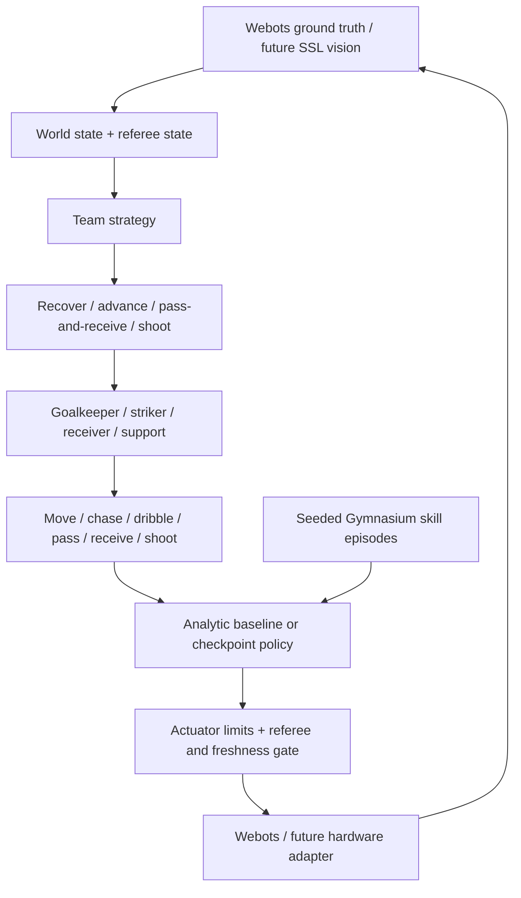

# RoboTurk: ROS 2, Webots and learned soccer skills

A modern, separately maintained successor to [Kadir Fırat Uyanık's RoboTurk stack](https://github.com/kadiru/metu-ros-pkg/tree/master/stacks/robocup_ssl). The historical checkout is preserved at `../upstream`; no archival sources were overwritten.

This is an initial implementation, not a competition-ready team. It provides six skill environments, interchangeable analytic/learned policies, a stateful team-play layer, ROS 2 messages/nodes and a Webots Supervisor backend. See [validation](docs/VALIDATION.md) for exactly what has run.

**In progress:** continuous symmetric 2v2 with recovery, support, counterattacks
and independent training seeds. [Current experiments and retained failures](policies/continuous_play_v1/README.md)
include working native match infrastructure and policies still undergoing corrective
training. This new milestone is not yet qualified. The latest qualified release follows.

The latest release replaces scripted tactical targets and handoffs with a **neural
manager** that chooses when to pass, dribble or shoot, which robot acts, and where
to receive/dribble/aim. Two alternating self-play generations trained the manager,
defender and keeper for 196,608 native PPO steps; learned motion skills stay frozen.

All reserved panels passed: **233/240**, **118/120** and **117/120** clean outcomes.
The final pair produced **107 goals, 126 defensive stops and seven failures**.
Clean includes legitimate defensive stops, not only attacker wins.
[Model card, checkpoints and every outcome](policies/decision_self_play_v2/README.md) ·
[Architecture, training and replay](docs/LEARNED_DECISIONS.md).

The [fresh 45.6-second Webots demo](media/learned-decisions-self-play-demo.mp4) retains
all nine consecutive games: five goals, two interceptions and two saves. Episode 3
(starting 6.84 s) shows learned passing, receiver handoff, dribbling and scoring.

[](media/learned-decisions-self-play-demo.mp4)

Initialization used imitation/DAgger and supervised defensive coaching. Self-play
updates decision readouts and opponents while preserving learned coordinate
regression and motion skills; no isolated PPO gain is established. This remains an
approximate ground-truth, initial-possession 2v2 drill, with live ROS graph and
hardware qualification still separate.

## Previous mobile self-play release

The previous release gives the neural defender and keeper wider planar movement and
trains both sides through **five generations of alternating self-play** (655,360
PPO steps). The final pair produced **194/200 clean reserved outcomes**: 78 goals,
100 defender interceptions and 16 keeper saves. Six failures remain documented.
Clean means a goal or valid defensive stop, not an attacking win. Historical panels
also passed: 99/100 and 97/100 clean outcomes.

The [fresh 73.2-second Webots demo](media/mobile-self-play-demo.mp4) includes all eight
consecutive games: two goals, three interceptions and three saves, with no collisions
or unforced failures. The goals are episodes 7 and 8. All frames and original timing
are retained. [Model card, checkpoints and evidence](policies/self_play_v1/README.md) ·
[Self-play protocol and replay commands](docs/SELF_PLAY.md).

[](media/mobile-self-play-demo.mp4)

Motion and kick decisions are learned; tactical targets and phase handoff remain
scripted. This is an approximate, ground-truth two-attacker versus defender/keeper
drill. Training includes imitation and supervised spacing preparations; neither
isolated PPO gains nor monotonically improving match strength is established.

## Earlier fixed-opponent milestone

The two attackers now **pass around a learned defender, receive, dribble and score
against a learned goalkeeper**. Both opponent motion controllers are neural policies;
the attacking transfer and finishing policies were retrained against those frozen
opponents. The four-policy play scored **200/200 reserved native Webots cases**,
with **zero pre-release possession losses or robot collisions**. Mean sequence:
**15.22s**; mean ball displacement to reception **2.93m** and retained receiver carry
**3.77m**. [Model card and every outcome](policies/learned_opponents_play_v1/README.md) ·
[Training and qualification protocol](docs/LEARNED_OPPONENTS.md).

The [fresh native Webots demo](media/learned-opponents-pass-receive-score-demo.mp4)
scored **6/6 consecutive cases**. All2,346 native frames are retained at normal
simulation speed (93.84s). Blue is the passer, cyan the receiver/scorer, yellow the
defender and red the keeper.

[](media/learned-opponents-pass-receive-score-demo.mp4)

The neural defender intercepted **100/100** reserved direct passes; the neural
keeper saved **99/100** reserved direct shots. Their [independent defensive checks](policies/learned_opponents_v1/README.md)
include stationary and teacher comparisons. The previous attackers scored45/60
against these same frozen opponents, with15 keeper saves. All failed candidates
and development outcomes remain published.

A62-input/seven-output transfer actor controls both attackers until stable reception;
a32-input/four-output finisher controls dribbling, turning and shot release. The
33-input/three-output opponents control their own translation and rotation throughout
both phases, without reset or analytic motion fallback. Receiving/finishing targets,
open-corner aim selection, role handoff and fixed kick speeds remain scripted.
Training used demonstrations, DAgger and anchored PPO; no incremental PPO success-rate
benefit over the best imitation stage is established.

This is a bounded approximate, ground-truth Webots curriculum, starting with passer
possession. The defender is a lane guard (0.25–0.55m/s); the keeper retains a goal-line
role,0.65–0.95m/s speed limit and0.08–0.14s command delay. It does not establish
unrestricted match strength, a self-play equilibrium or calibrated hardware behavior.
A complete live ROS/Webots graph with applied-kick feedback also remains to be validated.

Earlier releases remain available: [analytic-opponent keeper play](policies/keeper_finish_v1/README.md)
(199/200), [defended passing](policies/defended_pass_receive_v3/README.md),
[unguarded passing/scoring](policies/pass_receive_v2/README.md),
[capture/dribble/shoot](policies/capture_dribble_shoot_v2/README.md),
[capture/dribble](policies/capture_dribble_v1/README.md) and
[capture](policies/chase_capture_v1/README.md) (each200/200 in its own curriculum).
Separate [block/recover](policies/block_shot_v1/README.md) and
[passing-lane coverage](policies/cover_pass_lane_v1/README.md) policies each passed200/200
and have a [native defensive demo](media/defensive-micro-behaviors-demo.mp4).
[Behavior contracts and paper provenance](docs/BEHAVIOR_SOURCES.md) trace inspiration
to CMDragons2015, TIGERs Mannheim2025 and ER-Force2024.

Replay the learned-opponent play with the pinned environment and Webots installation:

```sh
../.venv/bin/python scripts/run_webots.py \
  --webots ../runtime/Webots-nightly.app/Contents/MacOS/webots \
  --mode opponents-demo \
  --checkpoint policies/learned_opponents_play_v1/transfer/policy.zip \
  --shoot-checkpoint policies/learned_opponents_play_v1/finish/policy.zip \
  --defender-checkpoint policies/learned_opponents_v1/defender/policy.zip \
  --keeper-checkpoint policies/learned_opponents_v1/keeper/policy.zip \
  --episodes 6 --seed 1660000 --output runs/learned-opponents-demo --timeout 1800 --render
```



## Run the core on this Mac

From this directory, the isolated environment is `../.venv`:

```sh
PYTHONPATH=src/roboturk_core ../.venv/bin/python -m roboturk.cli evaluate --skill chase --episodes 10
../.venv/bin/python -m pytest -q
```

For a fresh machine (Python 3.12 recommended):

```sh
python3.12 -m venv .venv
. .venv/bin/activate
python -m pip install -e 'src/roboturk_core[rl,test]' ruff
python -m roboturk.cli evaluate --skill pass
```

The CLI's default backend is **synthetic planar dynamics**, intended for contract tests and pipeline debugging. It has no wheel physics, teleports a held ball to the mouth, and must not be used as evidence of realistic dribbling or transfer.

## Run Webots

Use Webots R2025a on a supported platform. On macOS 27, the original R2025a binary has a [known startup bug fixed upstream](https://github.com/cyberbotics/webots/pull/7032). Local validation uses the dated `nightly_17_11_2026` R2025a asset, recorded separately from stable.

```sh
../.venv/bin/python scripts/run_webots.py \
  --webots ../runtime/Webots-nightly.app/Contents/MacOS/webots \
  --skill chase --episodes 10 --output runs/webots/chase
```

Add `--render` to display the field. On Linux, use `--webots /usr/local/webots/webots` or the location of your Webots executable. A display server is needed even with `--no-rendering`; use Xvfb for unattended Linux runs.

Use `--mode suite` to evaluate all six analytic skill baselines serially. Set `ROBOTURK_TRACE=1` for per-episode trajectory samples in single-skill evaluation output.

The Webots model uses ODE contacts, an **ideal body-velocity actuator**, a bounded spring/damper dribbler, and an edge-triggered ball-velocity kick. It does not teleport the ball during stepping. The robot body is a simplified cylinder; motor dynamics, rollers, battery, radio latency and physical dribbler/kicker geometry are not yet calibrated. The authored training field is 9 × 6 m with a 1 m goal mouth, a 90 mm robot radius and a 21.5 mm ball radius. These are prototype parameters, not a claim of full current SSL rule compliance.

## ROS 2 workspace

The initial Linux baseline is **ROS 2 Jazzy / Ubuntu 24.04**, matching Webots R2025a's published Ubuntu binaries. Jazzy remains supported through May 2029. Lyrical is the current ROS 2 release, but a Lyrical/Ubuntu 26.04/Webots combination has not been validated here. [Version evidence and migration audit](docs/MIGRATION.md).

```sh
source /opt/ros/jazzy/setup.bash
rosdep install --from-paths src --ignore-src -r -y
colcon build --symlink-install
source install/setup.bash
ros2 launch roboturk_ros soccer.launch.py webots:=/usr/local/webots/webots
```

Starts in HALT. For a deliberately enabled simulated practice game:

```sh
ros2 launch roboturk_ros soccer.launch.py webots:=/usr/local/webots/webots practice:=true
```

The launch starts the simulator, blue/yellow strategy nodes, and optionally a practice referee heartbeat. This is a custom Supervisor/rclpy bridge; it does not depend on `webots_ros2_driver`. ROS uses a single simulation owner and monotonic `/clock`. Training runs directly inside the Supervisor so each action advances an exact number of physics steps without ROS callback timing in the learning loop.

| Interface | Meaning |
| --- | --- |
| `/roboturk/world` | Typed field-frame robot/ball state and effective referee state |
| `/roboturk/blue/commands`, `/roboturk/yellow/commands` | Full team snapshots of body-frame commands |
| `/roboturk/referee` | Internal HALT/STOP/RUNNING heartbeat; official SSL protocol is future work |
| `/roboturk/reset` | Seeded practice formation reset; clears commands and enters HALT |
| `/clock` | Simulation time, monotonic across formation resets |

Commands older than 250 ms stop; referee heartbeats older than 500 ms halt. HALT and STOP both conservatively hold all actuators. Set pieces, defense areas, ball placement and full rule constraints remain to be implemented. Do not connect this prototype directly to physical actuators.

## Training and policy replacement

```sh
# Bounded CPU smoke run in synthetic dynamics; not a performance experiment.
PYTHONPATH=src/roboturk_core ../.venv/bin/python -m roboturk.cli train \
  --skill chase --steps 2048 --output runs/synthetic_smoke/policy

# Actual Webots backend; choose a budget explicitly before a longer run.
../.venv/bin/python scripts/run_webots.py \
  --webots ../runtime/Webots-nightly.app/Contents/MacOS/webots \
  --mode train --skill chase --steps 2048 --timeout 180 \
  --output runs/webots_smoke/policy

# Evaluate the checkpoint on held-out seeds in the same backend.
../.venv/bin/python scripts/run_webots.py \
  --webots ../runtime/Webots-nightly.app/Contents/MacOS/webots \
  --skill chase --checkpoint runs/webots_smoke/policy.zip \
  --seed 1000 --episodes 20 --output runs/webots_smoke/evaluation
```

PPO uses one CPU thread here. A `.zip` checkpoint has a companion `.json` with observation contract version, skill, full configuration, backend and seed. Loading rejects incompatible skill/configuration/contract combinations. Successful loading is not a qualification for deployment.

In Python, register `CheckpointPolicy(path, skill, cfg)` with `BehaviorLibrary.register`, matching `Skill.CHASE`, `Skill.DRIBBLE` or `Skill.SHOOT` to the checkpoint. Dribble and scoring policies receive `Intent.target` through their shared observation contracts; for the released scoring policy this is the opponent goal center. The ROS strategy node accepts a `policies` JSON parameter mapping individual skill names to checkpoint paths. Both paths apply the same actuator masks and runtime referee gate. Recurrent policies and observation normalization beyond the fixed contract are not supported yet.

## What to develop next

1. Validate the complete Webots/ROS live graph on Ubuntu. CI already builds all three ROS packages and passes the two bridge/interface tests; full simulator integration remains separate.
2. Confirm which physical robot revision to reproduce: the archive contains both three- and four-wheel references. Add real motor/roller geometry and measure step response, slip, braking, dribbler capture and kick speed.
3. Improve obstacle avoidance and skill termination, add randomized opponents, latency, observation noise and dynamics; evaluate held-out configurations.
4. Extend the qualified play to free-ranging defenders and keepers, moving receivers and broader defensive training. Maintain analytic and random-policy comparisons, success rates, collision rates and uncertainty across training seeds.
5. Add official SSL vision/game-controller adapters and rule enforcement, then multi-agent rollouts, centralized-critic training and self-play. Generic skill tasks control one robot; the passing play uses a centralized two-robot transfer policy, a learned finisher and two bounded learned opponents.

New code has no release license selected yet (`LicenseRef-Unlicensed` metadata). The historical repository's file-specific licenses and authorship remain intact. No archive implementation was copied into the modern Python stack.
