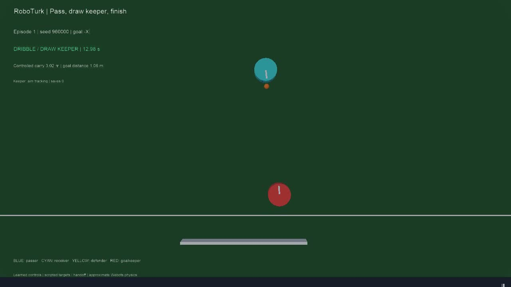
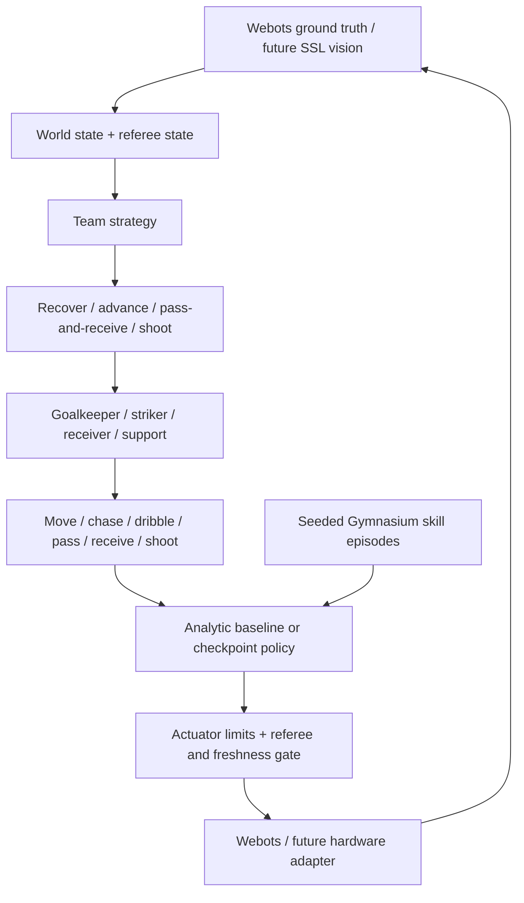

# RoboTurk: ROS 2, Webots and learned soccer skills

A modern, separately maintained successor to [Kadir Fırat Uyanık's RoboTurk stack](https://github.com/kadiru/metu-ros-pkg/tree/master/stacks/robocup_ssl). The historical checkout is preserved at `../upstream`; no archival sources were overwritten.

This is an initial implementation, not a competition-ready team. It provides six skill environments, interchangeable analytic/learned policies, a stateful team-play layer, ROS 2 messages/nodes and a Webots Supervisor backend. See [validation](docs/VALIDATION.md) for exactly what has run.

The learned **two-robot play passes around a defender, receives, draws the goalkeeper and scores**. The frozen play scored **199/200 reserved Webots cases (99.5%)**, with **zero pre-release possession losses or robot collisions**. One pass was intercepted; all 199 successful receptions ended in goals. Mean complete sequence: **14.94 s**; mean ball displacement to reception: **2.83 m**; receiver carry: **3.49 m**. [Model card and all outcomes](policies/keeper_finish_v1/README.md) · [Training protocol](docs/KEEPER_TRAINING.md).

The [fresh native Webots demo](media/keeper-pass-receive-score-demo.mp4) scored **6/6** consecutive cases. Blue is the passer, cyan the receiver/scorer, yellow the midfield defender and red the goalkeeper. Every native frame and outcome is retained (99.16 seconds).

[](media/keeper-pass-receive-score-demo.mp4)

The existing goal-conditioned transfer actor controls both attackers. A new learned finisher supplies dribbling, turning and release commands after measured stable reception, without a physics reset or teacher fallback. Receiving-point selection, draw/finish aim targets, phase handoff and kick power are scripted. The fixed analytic opponents stay active throughout the play. The previous scorer managed 0/40 goals against this corrected keeper on the comparison development set.

New physical blocking/recovery and passing-lane coverage curricula have shared inference contracts and are being trained separately. [Behavior contracts and team-paper provenance](docs/BEHAVIOR_SOURCES.md) trace the ideas to CMDragons2015, TIGERs Mannheim2025 and ER-Force2024. These learned defensive primitives do not replace the fixed opponents during attacking qualification.

This benchmark starts with passer possession and uses ground-truth state, approximate Webots dynamics, a bounded midfield line guard and delayed lateral goalkeeper. It qualifies this distribution; unrestricted adversaries, calibrated hardware and full SSL matches require further work. A complete live ROS/Webots graph with applied-kick feedback also remains to be validated.

Earlier qualified releases remain available: [defended passing](policies/defended_pass_receive_v3/README.md), [unguarded passing/scoring](policies/pass_receive_v2/README.md), [capture/dribble/shoot](policies/capture_dribble_shoot_v2/README.md), [capture/dribble](policies/capture_dribble_v1/README.md) and [capture](policies/chase_capture_v1/README.md), each200/200 in its own declared curriculum. Their demos and failed earlier candidates are retained.

Replay the keeper play with the pinned environment and Webots installation:

```sh
../.venv/bin/python scripts/run_webots.py \
  --webots ../runtime/Webots-nightly.app/Contents/MacOS/webots \
  --mode keeper-demo --checkpoint policies/defended_pass_receive_v3/policy.zip \
  --shoot-checkpoint policies/keeper_finish_v1/policy.zip \
  --episodes 6 --seed 960000 --output runs/keeper-demo --timeout 900 --render
```



## Run the core on this Mac

From this directory, the isolated environment is `../.venv`:

```sh
PYTHONPATH=src/roboturk_core ../.venv/bin/python -m roboturk.cli evaluate --skill chase --episodes 10
../.venv/bin/python -m pytest -q
```

For a fresh machine (Python 3.12 recommended):

```sh
python3.12 -m venv .venv
. .venv/bin/activate
python -m pip install -e 'src/roboturk_core[rl,test]' ruff
python -m roboturk.cli evaluate --skill pass
```

The CLI's default backend is **synthetic planar dynamics**, intended for contract tests and pipeline debugging. It has no wheel physics, teleports a held ball to the mouth, and must not be used as evidence of realistic dribbling or transfer.

## Run Webots

Use Webots R2025a on a supported platform. On macOS 27, the original R2025a binary has a [known startup bug fixed upstream](https://github.com/cyberbotics/webots/pull/7032). Local validation uses the dated `nightly_17_11_2026` R2025a asset, recorded separately from stable.

```sh
../.venv/bin/python scripts/run_webots.py \
  --webots ../runtime/Webots-nightly.app/Contents/MacOS/webots \
  --skill chase --episodes 10 --output runs/webots/chase
```

Add `--render` to display the field. On Linux, use `--webots /usr/local/webots/webots` or the location of your Webots executable. A display server is needed even with `--no-rendering`; use Xvfb for unattended Linux runs.

Use `--mode suite` to evaluate all six analytic skill baselines serially. Set `ROBOTURK_TRACE=1` for per-episode trajectory samples in single-skill evaluation output.

The Webots model uses ODE contacts, an **ideal body-velocity actuator**, a bounded spring/damper dribbler, and an edge-triggered ball-velocity kick. It does not teleport the ball during stepping. The robot body is a simplified cylinder; motor dynamics, rollers, battery, radio latency and physical dribbler/kicker geometry are not yet calibrated. The authored training field is 9 × 6 m with a 1 m goal mouth, a 90 mm robot radius and a 21.5 mm ball radius. These are prototype parameters, not a claim of full current SSL rule compliance.

## ROS 2 workspace

The initial Linux baseline is **ROS 2 Jazzy / Ubuntu 24.04**, matching Webots R2025a's published Ubuntu binaries. Jazzy remains supported through May 2029. Lyrical is the current ROS 2 release, but a Lyrical/Ubuntu 26.04/Webots combination has not been validated here. [Version evidence and migration audit](docs/MIGRATION.md).

```sh
source /opt/ros/jazzy/setup.bash
rosdep install --from-paths src --ignore-src -r -y
colcon build --symlink-install
source install/setup.bash
ros2 launch roboturk_ros soccer.launch.py webots:=/usr/local/webots/webots
```

Starts in HALT. For a deliberately enabled simulated practice game:

```sh
ros2 launch roboturk_ros soccer.launch.py webots:=/usr/local/webots/webots practice:=true
```

The launch starts the simulator, blue/yellow strategy nodes, and optionally a practice referee heartbeat. This is a custom Supervisor/rclpy bridge; it does not depend on `webots_ros2_driver`. ROS uses a single simulation owner and monotonic `/clock`. Training runs directly inside the Supervisor so each action advances an exact number of physics steps without ROS callback timing in the learning loop.

| Interface | Meaning |
| --- | --- |
| `/roboturk/world` | Typed field-frame robot/ball state and effective referee state |
| `/roboturk/blue/commands`, `/roboturk/yellow/commands` | Full team snapshots of body-frame commands |
| `/roboturk/referee` | Internal HALT/STOP/RUNNING heartbeat; official SSL protocol is future work |
| `/roboturk/reset` | Seeded practice formation reset; clears commands and enters HALT |
| `/clock` | Simulation time, monotonic across formation resets |

Commands older than 250 ms stop; referee heartbeats older than 500 ms halt. HALT and STOP both conservatively hold all actuators. Set pieces, defense areas, ball placement and full rule constraints remain to be implemented. Do not connect this prototype directly to physical actuators.

## Training and policy replacement

```sh
# Bounded CPU smoke run in synthetic dynamics; not a performance experiment.
PYTHONPATH=src/roboturk_core ../.venv/bin/python -m roboturk.cli train \
  --skill chase --steps 2048 --output runs/synthetic_smoke/policy

# Actual Webots backend; choose a budget explicitly before a longer run.
../.venv/bin/python scripts/run_webots.py \
  --webots ../runtime/Webots-nightly.app/Contents/MacOS/webots \
  --mode train --skill chase --steps 2048 --timeout 180 \
  --output runs/webots_smoke/policy

# Evaluate the checkpoint on held-out seeds in the same backend.
../.venv/bin/python scripts/run_webots.py \
  --webots ../runtime/Webots-nightly.app/Contents/MacOS/webots \
  --skill chase --checkpoint runs/webots_smoke/policy.zip \
  --seed 1000 --episodes 20 --output runs/webots_smoke/evaluation
```

PPO uses one CPU thread here. A `.zip` checkpoint has a companion `.json` with observation contract version, skill, full configuration, backend and seed. Loading rejects incompatible skill/configuration/contract combinations. Successful loading is not a qualification for deployment.

In Python, register `CheckpointPolicy(path, skill, cfg)` with `BehaviorLibrary.register`, matching `Skill.CHASE`, `Skill.DRIBBLE` or `Skill.SHOOT` to the checkpoint. Dribble and scoring policies receive `Intent.target` through their shared observation contracts; for the released scoring policy this is the opponent goal center. The ROS strategy node accepts a `policies` JSON parameter mapping individual skill names to checkpoint paths. Both paths apply the same actuator masks and runtime referee gate. Recurrent policies and observation normalization beyond the fixed contract are not supported yet.

## What to develop next

1. Validate the complete Webots/ROS live graph on Ubuntu. CI already builds all three ROS packages and passes the two bridge/interface tests; full simulator integration remains separate.
2. Confirm which physical robot revision to reproduce: the archive contains both three- and four-wheel references. Add real motor/roller geometry and measure step response, slip, braking, dribbler capture and kick speed.
3. Improve obstacle avoidance and skill termination, add randomized opponents, latency, observation noise and dynamics; evaluate held-out configurations.
4. Extend the qualified defended-passing play to free-ranging opponents, moving receivers and goalkeepers. Maintain analytic and random-policy comparisons, success rates, collision rates and uncertainty across training seeds.
5. Add official SSL vision/game-controller adapters and rule enforcement, then multi-agent rollouts, centralized-critic training and self-play. Generic skill tasks control one robot; the passing play uses a centralized two-robot policy and a scripted opponent.

New code has no release license selected yet (`LicenseRef-Unlicensed` metadata). The historical repository's file-specific licenses and authorship remain intact. No archive implementation was copied into the modern Python stack.
