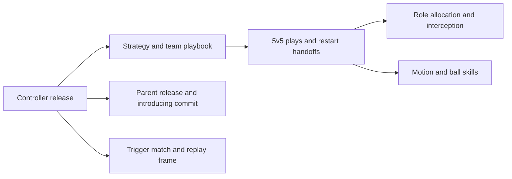

# Controller versions in Hoca

In **Match setup → Practice**, select a controller release independently for Blue and Yellow. The first catalog contains Team-wide assignment, Local Priority, and Coordinated, each at `1.0.0`. Their labels are stable. The selected playbook and passing preference remain match settings. Game mode uses the default team-wide controller release for both teams.

The [controller catalog](controller-versions.json) gives each release an ID, parent, introduction commit, trigger, changes by layer, dependencies, and links to recorded moments when available. **Controller history** in Hoca displays the release notes and opens the linked evidence. A change can keep its family name and increment its version. A new family name describes a substantial change in the controller's approach.



## What a match records

Each Hoca-launched match writes `controller-versions.json` beside its recording. It captures both release records, the source build, and hashes of the world and policy inputs. The full Git commit identifies the source across branches. The build number is the first-parent commit count and is meaningful within one line of development. A local working copy has a separate change digest. Match setup keeps the strategies, seed, motion limits, and runtime options in `spec.json`. The match menu shows the recorded versions and telemetry clip exports carry the same record. Use a committed checkout for a reproducible comparison.

The picker offers installed implementations. To re-run a specific historical source build today, launch Hoca from that commit's checkout in a separate environment. Parallel historical builds and mid-match simulation forks are future work.

## Connect a change to its evidence

1. Save the parent recording and the decision frame. Add a stable moment ID to the catalog with the frame, time, seed, archive path, and coaching question. Confirm that the link opens on the correct frame.
2. Create a candidate release record with the parent release, the affected layers, and the dependencies affected by the change. Keep the original release record alongside it. Commit the candidate code and link its introduction commit from the catalog.
3. Compare the candidate with the baseline on the same fresh starts, swap team colors, and save the comparison with the release IDs and source build. Record outcomes such as possession retained, completed passes, goals, and body contacts.
4. Use a validated candidate as the next baseline. Archive rejected candidates and the evidence behind the decision when those results will help future experiments.

The first proposal, **Yellow's crowded outlet**, opens the full recorded match at frame 90 (3.60 s). The [source archive](../media/match-viewer/replays/38727045-interception) contains 3,411 Webots frames. All 34 samples in the coaching export match within the export's rounding precision, and the recorded pass agrees with the export. The source match report is linked in the catalog. The archived match predates the build stamp. This moment is evidence for a future alternative-outlet experiment.

The matched native benchmark accepts catalog IDs and writes both the exact selections and the build into `comparison.json`.

```sh
python scripts/benchmark_five_decisions.py runs/version-comparison \
  --baseline team-wide@1.0.0 --challenger coordinated@1.0.0 --starts 4
```
