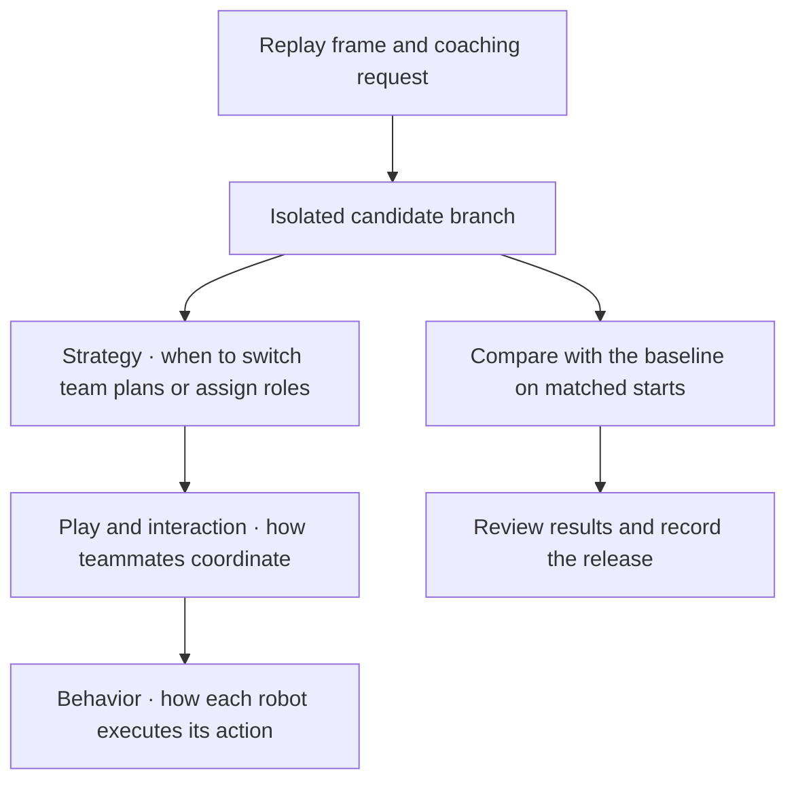

# Decision change requests

A request describes what the team should do differently in a situation and what would count as a better result. The attached frame is evidence for the situation. The requested action can be one candidate to test alongside other ways of meeting the coaching objective.

For the crowded Y2 pass, the objective could be to keep possession and advance when the first receiver is under pressure. A candidate could have Y4 get open, Y2 score its passing options by how soon each receiver and defender can reach them, and Y4 cushion the pass. Those changes can span an interaction, the pass evaluator, and an individual receiving behavior. The comparable test is clean possession and progression against the same Blue controller on matched starts.



## Open a candidate

1. In a saved Hoca replay or while reviewing a live match, pause at the decision and select **Request change**. Give it a title, team, desired outcome, and any acceptance criteria. Adjust the evidence interval to include the lead-up and outcome.
2. Under **Controller**, name a new controller or choose a saved release as the base. Select **Create candidate branch**. Hoca puts the trial under the main timeline, keeping earlier trials available in the trial picker. Each code change has its own Git worktree. In match settings, **Copy candidate workspace** gives you its location. `docs/controller-changes/<request>/request.json` preserves the request and evidence. `candidate.json` records the starting commit, recorded release, change plan, version, and results.
3. In that workspace, trace the decision to the relevant layers. Fill in the affected behavior, interaction, and strategy entries and their dependencies before assigning a version. Keep the observed match, proposed behavior, and measured trial results distinct in the candidate record.

**Download request** lets you hand the same package to a coding agent or run the local command from the RoboTurk stack. Use `--base` with a commit or ref to start from another code baseline. The default is the current checkout's committed HEAD.

```sh
python scripts/decision_changes.py create /path/to/hoca-change.json
```

## Watch the candidate in Hoca

Select **Run Webots trial** once the candidate code is ready. Webots runs eight seconds using the candidate worktree and then waits in place. It starts from the recorded poses, velocities, score, and limits at an open-play decision frame. The branch shares the main match up to the fork and then shows the trial's own events. Select either row to use it with play, pause, the scrubber, and the previous and next markers. **Return to fork** selects the main match and seeks the exact source frame. The score shows the controller name and release for each team. While watching the candidate, Hoca uses its proposed version or the Git commit if no version has been assigned.

## Use a controller in the match

Open **Controllers** above Match events. Pick Blue or Yellow and a saved release, read its change report, and select **Test from main timeline** at an open-play frame. **Continue with this controller** resumes the paused Webots trial as the match continuation and preserves the original timeline and Git checkout. A live Practice match hands off its simulator. A finished recording gets a playable continuation. Live Game mode keeps its fixed controllers.

## Merge and continue

Commit the candidate controller changes and run a preview of that commit. **Merge & continue** fast-forwards the local main branch to the tested commit, or verifies that main already includes it. If main has diverged, merge the tested commit before selecting the action. Hoca archives and ends the original simulator if it is still live. The candidate resumes in the same Webots process from the end of the preview. Viewers following the original match move to the live branch. You can still select the original recording to review it.

The branch reconstructs an open-play start and continues with the local match logic. Both teams run under the candidate build, so an edit to shared controller code may affect both teams. Use matched trials against a fixed opponent to judge a candidate's effectiveness. Exact restoration of the original match will require the controllers' internal state and the official referee state. Hoca stores the trial build and each run's raw Webots recording locally beside the timeline.

## Bump the highest layer changed

| Version field | What changed | Example from v1.0.0 |
| --- | --- | --- |
| Patch | Execution of an individual skill within the existing action contract | Cushion the first touch more reliably → **v1.0.1** |
| Minor | Coordination across robots within a play or interaction | Time the outlet run and release together, with a revised receiving skill → **v1.1.0** |
| Major | Team-wide strategy, play selection, or how roles are allocated across situations | Switch from a fixed presser assignment to choosing the press and cover as a unit → **v2.0.0** |

Classify the highest layer whose **decisions or behavior** change. Wiring several files together can support a lower-level change. A change that breaks an existing controller or skill interface takes a major bump as well. Keep runtime decision scoring separate from the evaluation used to compare versions. Report changes to the latter as changes to the test protocol and keep the comparison protocol fixed within a trial.

```sh
python scripts/decision_changes.py version 1.0.0 behavior interaction
```

A controller release pins the versions of the behaviors it uses. Record dependencies by component, interface, and the source commit or policy artifact used. Once the candidate has been tested, record the results, commit the changes with their source moment, and review them for promotion through the [controller catalog](CONTROLLER_VERSIONS.md).
