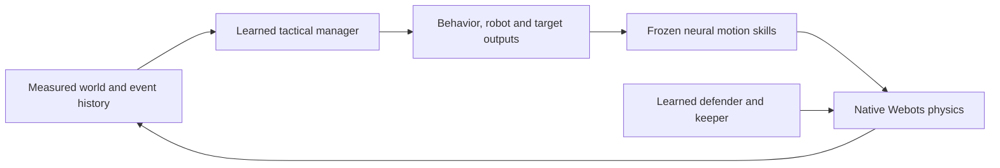

# Learned tactical decisions and self-play v1

Started November19,2026 America/Los_Angeles. This is a new experiment; the previous
mobile-self-play release remains available at commit76679c00 and is not evidence
for learned target/option selection. Do not modify its policy artifacts.

## Contract and scope

A centralized neural manager chooses pass/receive, dribble or shoot, the acting
blue robot, a receiving point, a dribble setup point and goal-mouth aim. The same
manager runs throughout an episode. No scripted receiving-point planner, finish
phase threshold or reception-triggered handoff runs in deployed inference.
Physical possession/dwell, applied kicks and previous decisions are observations;
they do not select the next behavior. Discrete choices use actor-output argmax;
continuous targets decode within the field/goal geometry. Fixed learned transfer
and finishing networks supply motion and precise release timing. Referee/visibility
stops, actuator bounds, kick speeds and each skill's actuator semantics remain.
The manager is trained along with defender and goalkeeper against historical
snapshots. Low-level motion skills remain frozen for this milestone.

The old scripted play is allowed only as a training teacher/baseline. Imitation and
DAgger initialize manager decisions; alternating native PPO then updates all three
strategic/opponent roles. Report these contributions separately, without assuming
PPO improves playing strength. Preserve failed candidates and every test outcome.

## Scenarios and split protocol

The bounded drill starts with one blue robot holding the ball. Families are evenly
cycled by seed modulo3: midfield passing, advanced flank possession, close goal
possession. Both goal directions and blue IDs vary. Family labels/seed/outcome are
not policy observations. Both neural defenders stay active across every decision.
Midfield defense initially blocks the direct pass; advanced/close situations start
with the field defender behind the holder and keeper near goal. This tests action
choice across starting situations rather than full-match recovery or counterattack.

| Purpose | Seeds |
| --- | --- |
| Teacher development |3020000–3020059|
| Native demonstrations |3000000–3000299|
| Mixed DAgger |3010000–3010149|
| PPO resets only |3100000–3199999|
| Learned development |3200000–3200059|
| Broader development |3201000–3201119|
| Shared cross-play |3202000–3202029|
| Reserved final/final |3300000–3300239|
| Reserved final attack/bootstrap defense |3310000–3310119|
| Reserved bootstrap attack/final defense |3320000–3320119|
| Consecutive fresh demo |3400000–3400008|

Initial plan:300teacher and150mixedDAgger episodes, then three generations with
32,768PPOsteps each for defender, keeper and manager. Select the last completed
generation using only development results. Record all updates, hashes and opponent
pool choices. Development-only amendments must be documented before reserved tests.

Freeze and publish models/runtime before reserved cases. Never tune on those cases
or reuse them to qualify a changed candidate. Gates:≥95% clean outcomes (goal or
legitimate defensive contact stop),≤2% robot collisions,≤3% unforced errors; final
pair≥20% goals and final defense≥20% stops against bootstrap. Each final-pair family
must have≥90% clean outcomes and≥10% goals. Also require≥20 actual passes,≥20 stable receptions,
≥20 episodes with≥0.5m controlled carry,≥20 actual shots and≥5 goals without a prior
pass in the240final cases. These measure exercised decisions, not tactical optimality.
All nine demo cases must be clean; include every case in original order. A failed
qualification/demo stays published; a new candidate requires new reserved seeds.

Audit physical kick events, stable measured reception, possession, collisions,
whole-ball goal crossing, both opponents' uninterrupted inference/physics counts,
manager decisions, target variation and model/runtime hashes. Test that inference
never calls scripted planners or derives behavior choice from measured reception.
Keep decisions/logs for losses and defensive wins, not only goals. Compare a teacher
baseline and all retained snapshot pairings on development scenarios.

Approximate ground-truth Webots simulation, ideal body velocities, spring dribbler,
velocity kicks, contact-distance/modeled mouth stop predicate and initial possession
remain explicit limits. No full-match, official-rule or hardware qualification.

## Initial native development and monitor correction

First teacher-decision baseline, with frozen neural skills/opponents:56/60clean,
28goals/28stops, two possession-loss labels, one field exit and one collision.
Midfield18/20clean, advanced18/20, close20/20. One loss label occurred before any
stable reception; the new monitor mistakenly treated a transient mouth touch as
acquisition. It now requires20stable control ticks before enforcing received-ball
retention (initial holder starts acquired). This is a measurement correction, not
a behavior selector. The other loss followed stable reception and remains a failure.
All original outcomes remain in development/teacher-initial.json. Added explicit
reception events, possession counts, goal crossing segment and terminal coordinates.
No reserved cases have run. A corrected teacher panel precedes300native teacher and
150mixedDAgger collection; teacher control is labeled separately from learned results.

The corrected same-seed teacher panel produced57/60clean:28goals,15interceptions,
14keeper saves,one loss after stable reception,one field exit andone collision.
The first transient contact case now terminates as a later legitimate interception.
Native demonstration collection started with this source; all original results
and runtime hashes are retained. No neural-manager performance claim yet.

## Inference boundary and reproducibility

`DecisionPlay` receives world state, measured physics substeps and applied-kick
feedback. Its75inputs contain physical robot/ball geometry and velocity, possession
and dwell measurements, observed kick history, initial blue positions, previous
manager outputs, controlled forward travel and geometric distances/angles. It never
receives a seed, scenario-family label, teacher phase or teacher target. Blue robots
are ordered by their initial possession roles; IDs and attacking direction vary.

| Manager outputs | Runtime meaning |
| --- | --- |
|0–2|Learned pass/receive, dribble and shoot scores; argmax chooses the behavior|
|3–4|Learned acting-robot scores; argmax chooses the blue robot|
|5–6|Receiving point in normalized attack-frame field coordinates|
|7–8|Dribble setup point in the same frame|
|9|Learned left/right corner score; its sign selects a geometric goal-mouth corner|

All target coordinates come from network outputs. Coordinate decoding imposes only
field/goal bounds. The pass skill controls the selected passer and the other robot;
the dribble/shoot skill controls the selected holder while the other holds position.
Dribble has no kick actuator. Shoot uses the existing learned precise-release head.
The pass decoder retains its measured applied-pass memory; that memory cannot
select dribble, shoot, robot ownership or a target. Initial acquisition and physical
stable reception are measured by a separate monitor, not a handoff rule.



Training-only `DecisionTeacher` contains the former target/phase logic and labels
manager observations. Its baseline/demo-collection records explicitly identify
teacher control. Unit checks make old target/phase planners raise if called from
`DecisionPlay`, verify that reception cannot force a mode/owner change, and check
referee/visibility stopping. Event-audit tampering tests use retained native baseline
records; these are software checks, not additional performance trials.

Once a frozen bundle is available, replay from the repository root with the pinned
Python environment and native Webots installation:

```sh
python scripts/run_webots.py --webots /path/to/webots \
  --mode decision-demo --checkpoint policies/decision_self_play_v1/final-bundle.json \
  --episodes 9 --seed 3400000 --output runs/decision-replay --timeout 1800 --render
```

Replay of declared scenarios is not a new independent qualification. The runtime
manifest pins native binaries and package versions. Historical absolute paths are
provenance; staged bundle paths are relative to the modern repository root.


## Development amendment: v2 decision encoding before self-play

The first neural clone scored4/60 with52clean outcomes; mixedDAgger initialization
improved to16/60 and57clean. All16goals were close-range starts, with no midfield
or advanced-family goals. These candidates are retained as failed development.
V1 dataset:300teacher+150mixedDAgger games,107,028manager observations. Teacher-only
arrays are recoverable as the first71,913rows; the separate reconstructed NPZ receipt
explicitly does not claim the original compressed container bytes.

V2 keeps75inputs/10outputs but makes output9 a learned corner score: its sign selects
±(goal half-width−0.07m), avoiding interpolation between mutually exclusive corner
choices. Receive/dribble points remain continuous learned coordinates. Previous-action
memory now encodes the executed choice/target, not raw uncertain logits. This is
an explicit contract change (roboturk.tactical_decision.v2), not an analytic corner
selector. Old v1 checkpoints require their original runtime commit.

Refit sampling now balances reset and decision-switch examples as well as all three
behavior classes. The old DAgger manager initializes120epochs of supervised refitting;
then150fresh mixedDAgger games3030000–3030149 and another120epochs refine the new
contract before self-play. Native/development results and original v1 artifacts
remain separate. All reserved seeds are untouched. Add a≥10% goal-rate gate to each
final-pair family, before any reserved run, to prevent close-range-only scoring from
passing the new strategic benchmark.

Development traces also showed empty fire retriggers after an already-applied valid
shot: all four teacher invalid-kick labels and all six initial neural invalid labels
were of this form. The monitor now records these harmless no-op requests separately
instead of inventing another physical kick. It does not suppress/override actions;
new applied/unheld kicks, wrong-owner releases and out-of-range shots remain invalid.
Original strict-monitor failures remain. This correction is separate from any learned
improvement. The keeper's field exits are real and must be addressed through training;
no position clamp or weakening of the defense is introduced.

Development amendment, November 19 Pacific (before any reserved resets): v2 DAgger
scored32/60 but only53/60clean (two keeper field exits, two ball-outs, three timeouts).
Midfield target traces drifted by over1m or switched flanks. Retain that failed version.
Contractv3 keeps75observations and adds an eleventh learned output: positive updates
the receiving point, negative retains the last executed point. There is no automatic
reset update, arrival trigger, reception handoff or teacher fallback. Option/robot,
dribble point and goal corner still come from the neural manager each command.
The previous-action observation retains the original ten executed fields.

V3 preparation explicitly migrates the first ten output rows and all matching model
weights from v2. Gate labels on existing native data indicate reset or a change in the
consecutive teacher receiving-point label; fresh training-only DAgger uses the same
teacher-change labels. Refit120epochs, development60, fresh150mixed games at
3040000–3040149 (80%learned/20%teacher percommand), refit120, development60.
All supervised contributions and failed development results remain separate from PPO.

Self-play uses Gaussian latent option/owner/gate exploration (logstd−0.5), target
logstd−4.5 and defensive-motion logstd−3.5. PPO learning rate1e−5; anchor projection
rate2e−6; actor trust limits managerMSE5e−4/max0.2 and defenseMSE3e−4/max0.15.
Defensive reward includes a smooth training-only field-margin cost; collision or
field exit costs40, goal/other unforced ending costs25, valid defensive stop earns25.
No runtime boundary projection is added. Every reset, including the unfinished last
rollout, is logged alongside sampled decisions, actor updates and historical pools.
