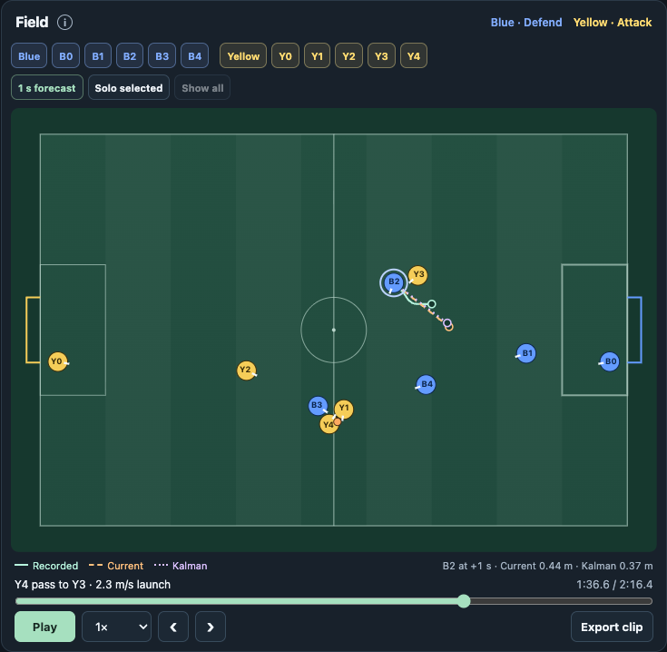

# One-second robot forecasts in Hoca

The [plan-aware forecast](TEAM_FORECAST.md) is the newer clean-Webots comparison. This page preserves the original velocity and Kalman benchmark.

Open a saved match and turn on **1 s forecast**. Select a robot on the pitch, in a lineup, or in the robot detail menu. The solid mint line is its recorded motion. The dashed amber line is the current straight-line forecast and the dotted lavender line is the Kalman forecast. Circles mark the positions at +1 s. The readout shows each forecast's distance from the recorded endpoint.



## What runs

Both models receive the same sequence of robot XY positions in field metres. **Current** reproduces the opposing-robot point forecast used in timed motion planning. It takes the difference between the two latest samples divided by the 40 ms sample interval, then computes position as `p + v × t`. **Kalman** runs a causal linear filter on position and velocity for each planar axis and projects its posterior state with the same constant-velocity equation. The filter uses a fixed 5 mm measurement standard deviation, 1 m/s initial velocity standard deviation, and white acceleration spectral density of 1 m²/s³. It uses no fitted weights.

Both forecasts use positions through the selected frame. Subsequent Webots poses supply the reference path. The comparison resets at stoppages and discontinuities and requires a shared 200 ms warm-up and a full second of continuous open play. The 100 and 500 ms targets are linearly interpolated between recorded frames. The overlay is for saved-match review. Live 5v5 still uses its existing steering and trajectory controllers.

## Results

Mean Euclidean position error in metres, pooled over **64,620 paired robot forecasts** from 6,462 instants in four complete official Webots matches. The three seeds include one shared by the two 45-second-halves runs. Forecast windows overlap.

| Input | Model | 100 ms | 500 ms | 1 s | Mean along path | 1 s p95 |
| --- | --- | ---: | ---: | ---: | ---: | ---: |
| Recorded XY | Current | 0.013 | 0.170 | 0.482 | 0.202 | 1.378 |
| Recorded XY | Kalman | 0.015 | 0.176 | 0.489 | 0.208 | 1.398 |
| XY with 10 mm noise | Current | 0.057 | 0.309 | 0.706 | 0.339 | 1.625 |
| XY with 10 mm noise | Kalman | 0.039 | 0.239 | 0.584 | 0.269 | 1.483 |

The stress test adds independent zero-mean Gaussian noise with 10 mm standard deviation per coordinate and gives both models the same draws. The reference positions stay clean. This test measures sensitivity to position noise. Camera delay and missed detections would require other tests.

On the recorded input, the current model has the lower mean one-second error in all four matches. With noisy positions, Kalman has the lower error in all four and reduces the pooled mean by **17.3%**. Both models still miss large changes of direction and speed. At tick 2416 in the interception replay, B2 curves away from both forecasts. The distances to its recorded endpoint are 0.44 m for current and 0.37 m for Kalman.

The [machine-readable results](../media/match-viewer/forecast-results.json) include per-match results, input hashes, seed, and filter settings. With the recordings in their original locations, run this from the RoboTurk stack root.

```sh
PYTHONPATH=src/roboturk_core:src/roboturk_ros python scripts/benchmark_motion_forecast.py \
  --output runs/motion-forecast/results.json \
  baseline-45=runs/game-45s-20261126-NDlaIX/run \
  interception-45=runs/pass-interception/full-game \
  viewer-2278=../../../modern/runs/match-timing-viewer/2278b0f974f6/run \
  official-30=../../../modern/runs/role-viewer-30s-38727031/official
```

## Toward a joint learned predictor

The replay harness and visualization can score and inspect a future model. The next baseline is to forecast using acceleration and braking limits as well as the last estimated velocity. For learned forecasting, the training input needs each robot's recent track, longer match context, the ball, and referee events. Use separate match splits and varied robot dynamics to test transfer. The model should give several plausible joint paths with calibrated probabilities, enforce feasible motion, and optionally take our team's candidate actions as inputs. Those are capabilities of the proposed predictor. The two baselines here each produce a single independent XY path per robot. [Trajectron++](https://arxiv.org/abs/2001.03093)
