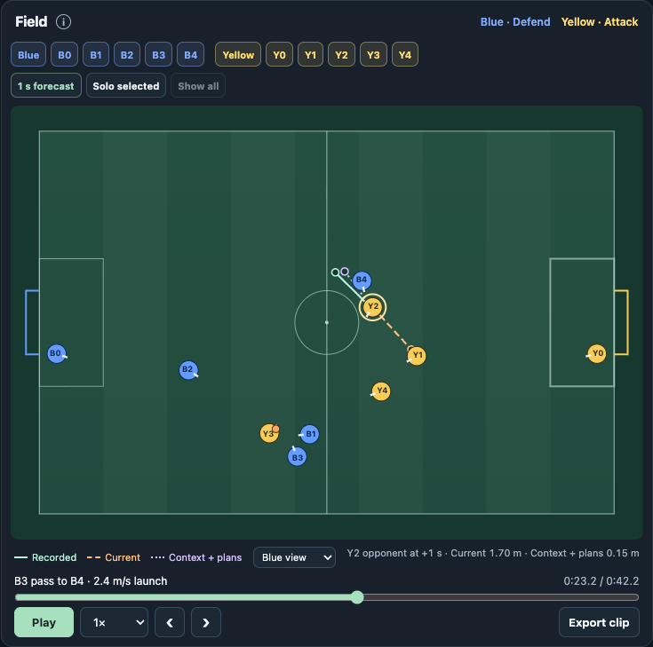
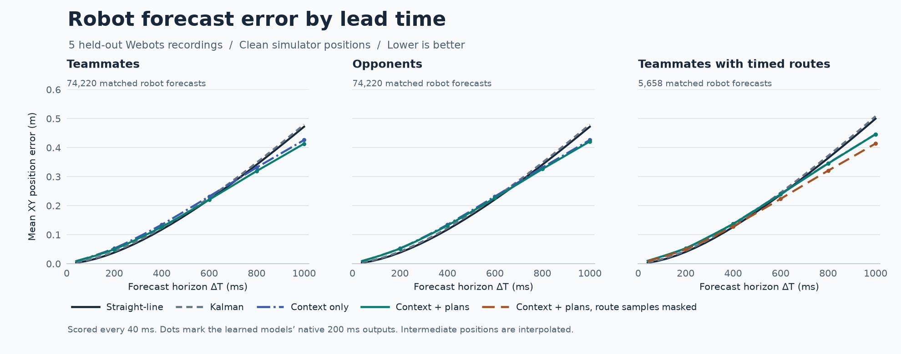

# Plan-aware forecasting on clean Webots matches

In Hoca, turn on **1 s forecast** and choose **Blue view** or **Yellow view**. The selected side's commands, targets and available timed paths condition the dotted forecast for either team. An opponent contributes only observed pose and motion. The solid line is the recorded path and the dashed line is the current straight-line baseline.

## Inputs and model

- **Shared scene** uses all ten robots' positions, headings and velocities, pose changes over the last 0.20, 0.60 and 1.0 s, the ball's state, a geometry-based possession cue, field ends and score. Nearby robot features are relative to the robot being forecast.
- **Known plans** include the forecast robot's own plan when it is a teammate and the two nearest robots from the viewing team. Each plan describes the issued velocity, the role target or active waypoint, and path offsets at 0.20, 0.60 and 1.0 s. New motion audits save the actual timed route wherever the planner generated one. Older logs and robots without a timed route expose a projection of the issued command with the configured acceleration limit, plus the requested target as a separate feature.
- **Prediction** is a supervised two-hidden-layer MLP. It predicts five planar displacements through one second from a single observed scene and an optional team plan view. It produces one path per robot. The model was trained for 24 epochs on CPU using recorded future positions as supervision.

All features have timestamps at or before the forecast origin. The viewing team's plan can condition an opposing robot's prediction without disclosing that opponent's private commands, goals, roles or route. Hoca uses the saved NumPy weights for replay. The 5v5 controller still runs its existing prediction and motion logic.

## Held-out results

The fit used 21 training recordings across five seeds. The test used five recordings across four other seeds, including one new official match with sampled planner routes. Both test viewpoints evaluated the same clean Webots observations and the same recorded ground truth. Each relationship contains 74,220 overlapping robot forecasts. The two learned models share an architecture and training scenes. Only the second includes plan features.

| Mean position error | Straight-line | Context only | Context + plans |
| --- | ---: | ---: | ---: |
| Teammates, 200 ms | 0.038 m | 0.053 m | 0.049 m |
| Opponents, 200 ms | 0.038 m | 0.053 m | 0.052 m |
| Teammates, 1 s | 0.472 m | 0.426 m | **0.414 m** |
| Opponents, 1 s | 0.472 m | 0.426 m | **0.421 m** |
| Teammates, 1 s p95 | 1.321 m | 1.093 m | **1.052 m** |
| Opponents, 1 s p95 | 1.321 m | 1.093 m | **1.069 m** |

At one second, the context-and-plans model improved mean error by **12.4% for teammates** and **10.7% for opponents**. At 200 ms, extrapolating measured velocity was more accurate. In the held-out example at tick 581, the Blue view predicts Y2's one-second endpoint with 0.15 m error. Straight-line extrapolation misses by 1.70 m.

The [curve data](../policies/team_forecast_v1/error-curves.csv) add Kalman to the same clean windows and score all methods every 40 ms. The learned paths are interpolated between their native 200 ms outputs as in Hoca. Context + plans first scores below straight-line at 600 ms for teammates and 680 ms for opponents. To regenerate the curves, pass the two saved model files and the same named test recordings to `scripts/plot_forecast_error.py` in an environment with Matplotlib.

### Do the sampled paths help?

On 5,658 forecasts where a teammate had a recorded timed route, the context-and-plans model averaged **0.446 m** at one second. With sampled routes removed from the same model at inference, and issued commands, targets and waypoints retained, the error was **0.414 m**. The straight-line result was **0.500 m**. This comparison is from one held-out match. We need more traced matches to test when the path adds value, especially through role changes and waypoint replanning.

## Reproduce and extend

The [training and test breakdown](../policies/team_forecast_v1/results.json) records all seeds, window counts, route counts and scores. Fit with `scripts/train_team_forecast.py --train NAME=RECORDING ... --test NAME=RECORDING ... --output OUTPUT` from the stack root using the project Python environment and `PYTHONPATH=src/roboturk_core:src/roboturk_ros`. The four archived training seeds are the five decisions fixtures under `modern/runs/decision-controllers/panel` per seed. The four clean archived test recordings are listed in the [first benchmark](MOTION_FORECAST.md). The two new traced games use the Hoca preset with one 40-second period and seeds 38729000 and 38729001. Native recordings are local.

The learned forecast can already consume our plans and scene context. A multi-agent forecaster would also represent several compatible futures and assign probabilities to them. It would benefit from training on more traced plans and intentional plan changes, then gating its outputs by horizon and checking interception and clearance in closed-loop Webots. This comparison scores forecast accuracy from replay.
