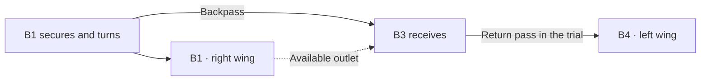

# Relay Outlet v1.0.0

Created November 27, 2026 at 11:46 p.m. Pacific. Updated November 27 at 11:55 p.m. Pacific. [Tested controller commit](https://github.com/kadiru/metu-ros-pkg/commit/2acb222706d00ee6ff8a9e203deef3c507ee67eb)

## Coaching moment

In match `9cda44b067a3` at **0:03.68**, B1 had the ball. B4 was ahead near Yellow traffic, while B3 was open behind B1. B1 chose B4 and Y1 took possession. The coaching request was to protect the ball through the turn, find B3, then send B1 and B4 wide to offer two return passes.

## What changed

| Layer | Change | Uses |
|---|---|---|
| Play selection | Consider a pass to a free teammate behind the carrier when the forward lanes are blocked. | Observed defender motion and passing-lane clearance. |
| Three-robot play | Assign the passer and the original forward option to opposite wings. | Shared possession and pass tracking, reception, and path planning. |
| Ball control | Protect the ball while changing heading, then release when the rear lane is open. | Dribbler grip and turn commands. |

## Webots comparison

| Timeline | First pass | Outcome |
|---|---|---|
| Original recording | B1 → B4 at 0:03.68 | Y1 controls at 0:04.56. |
| Original controller rerun | B1 → B4 at 0:03.76 | B4 controls at 0:05.32. Y4 recovers at 0:06.56. |
| Relay Outlet | B1 → B3 at 0:04.36 | B3 controls at 0:05.76. B4 controls the return at 0:10.28. |

Both Webots trials reconstructed the same recorded start and kept Yellow’s controller fixed. The return used the usual pass scorer after the relay window ended. One opening establishes that the sequence is possible.

[Open the original moment in local Hoca](http://127.0.0.1:54163/matches/9cda44b067a3/?frame=92&robot=B1) · [Watch the tested branch in local Hoca](http://127.0.0.1:54163/matches/9cda44b067a3/?timeline=branch&frame=144&robot=B3)
