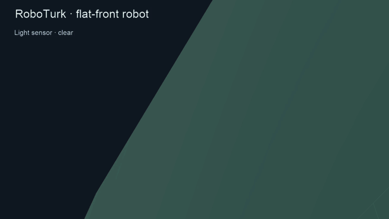

# Flat-front RoboTurk actuator bench



The bench drives a flat-front chassis with four fixed omniwheel axes at 60°, 135°, −135°, and −60°. Each 50 mm wheel has a motor and an encoder. The front has a 90 mm motorized dribbler on a compliant mount, a ray sensor across the mouth, and independent flat and chip slider joints. The green indicator lights when the sensor sees the ball. The flat striker is silver and the chip plate is amber. Launch sequences are shown in slow motion.

```text
Robot body command  →  wheel kinematics       →  four motors and encoders
Dribbler duty       →  roller speed           →  roller motor and encoder
Kick speed + loft   →  ball detected + ready  →  flat striker or fixed-angle chipper
```

Webots simulates the chassis and joint motions. Directional forces at the wheel contact points approximate how driven treads and free rollers grip the carpet. A bounded compliant contact force supports the roller while the measured roller speed is high enough. Both emulated strikers accelerate the 46 g ball through Webots collisions. The chip angle is set by the mechanism, and the command's loft field selects that mechanism. Encoder feedback and the optical ray are available to the robot controller at the 2 ms physics tick.

## What the bench checks

- Forward travel, strafing in both directions, turning in place, and combined travel and turn, repeated at three headings.
- A rolling serve captured and held while the chassis carries it forward.
- Three flat releases and three chips. Each sustained request fires once. The beam clears after release, and the selected striker returns to within 2 mm of home.
- A kick request with a clear sensor is ignored.

The filmed flat kick launched at 3.17 m/s and stayed at a ball-center height of 2.15 cm. The filmed chip launched at 3.96 m/s and reached a ball-center height of 16.08 cm. The served ball stayed in the beam throughout the 7.5 cm carry. All 15 motion trials and six releases passed in both the rendered and headless runs. [Native measurements](measurements.json)

## Run it in Webots

From the RoboTurk ROS 2 directory with the project Python environment active:

```sh
python scripts/run_webots.py --mode actuator-bench --webots /path/to/webots \
  --output runs/actuator-bench/bench.json --timeout 140 --render
```

The command saves the measured results and native frames. Omit `--render` for a headless run. The bench returns a failure code when a check fails.

The close-up qualifies a single simulated robot at bench speeds. Directional traction approximates the passive wheel rollers. The optical beam is a collision ray, and the gains and striker speed conversion are bench settings. Full-speed kick calibration, physical-robot validation, and using the articulated model in 5v5 remain open.

## Sources and design choices

- Original RoboTurk supplies the asymmetric layout, wheel radius, and chassis-to-wheel sign convention. The legacy simulator also distinguished the driving direction from lateral slip. [Legacy player kinematics](../../../../legacy/robocup_ssl/ssl_player/src/SSLPlayer.cpp) · [Legacy wheel contact plugin](../../../../legacy/robocup_ssl/ssl_webots_sim_/plugins/physics/omniwheels/omniwheels.cpp)
- TIGERs Mannheim separates local velocity and shaft conversion from the barrier and kicker timing. The bench follows that boundary and gives release timing its own state. [Robot kinematics](https://github.com/TIGERs-Mannheim/Firmware/blob/master/src/robot/robot_math.c) · [Kicker and IR barrier](https://github.com/TIGERs-Mannheim/Firmware/blob/master/src/shared/module/kicker.c)
- RoboTeam Twente tracks four wheel requests and four encoder measurements separately and selects the flat or chip actuator explicitly. The bench exposes these channels independently. [Wheel feedback](https://github.com/RoboTeamTwente/roboteam_microcontroller5.0/blob/development/Core/Src/peripherals/wheels.c) · [Flat and chip outputs](https://github.com/RoboTeamTwente/roboteam_microcontroller5.0/blob/development/Core/Src/peripherals/shoot.c)
