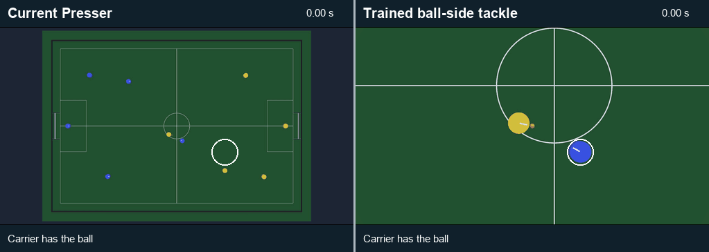

# A ball-side tackle for the 5v5 Presser

The white ring follows the Presser. On the right it comes in from the front flank, matches the ball’s motion, and draws it forward past the carrier’s roller. The moving-carrier replay confirms the takeaway at **1.67 s**. The GIFs play at half speed and their clocks show Webots time.

[Stationary carrier replay](stationary-carrier.gif) · [Fitted policy and training](../../policies/ball_side_tackle_v1/README.md)

## 24 fresh paired Webots starts

| Measurement | Current Presser | Trained tackle |
|---|---:|---:|
| Clean takeaways | 0 | 24 |
| Starts with roller reach | 18 | 24 |
| Possession wins including contact | 1 | 24 |
| Starts with Presser body contact | 14 | 0 |
| Passive AutoRef crash calls | 0 | 0 |
| Closest body-edge gap | -0.06 cm | 5.02 cm |

The trained Presser finished in **1.40–2.70 s**, with a median of **2.28 s**. Every pair shared the exact native robot and ball states. Seeds 38712000–38712023 were held out before fitting.

| Scripted carrier motion | Current clean wins / 6 · body contacts · crash calls | Trained clean wins / 6 · body contacts · crash calls |
|---|---:|---:|
| Stationary | 0/6 · 0 · 0 | 6/6 · 0 · 0 |
| Forward | 0/6 · 2 · 0 | 6/6 · 0 · 0 |
| Lateral | 0/6 · 6 · 0 | 6/6 · 0 · 0 |
| Turning | 0/6 · 6 · 0 | 6/6 · 0 · 0 |

A clean takeaway requires the carrier to still have roller control immediately before the Presser reaches the ball, then at least 0.24 s of exclusive Presser control. A body gap of 1 mm or less at any 2 ms sample in the 4.4 s trial disqualifies the attempt, as does an AutoRef crash call. Each trial starts with the carrier’s roller holding the ball. These are isolated challenges on the native 5v5 field with eight parked robots and a scripted carrier that holds, advances, shifts sideways, or turns. Neither robot kicks during the fixture.

TIGERs AutoRef 1.7.1 received the native 25 Hz SSL vision trace for every start in its own passive session. It produced zero crash calls in both arms even though the current Presser made body contact in 14 starts. A positive control replayed a known archived collision and produced one crash call. [Matched results and AutoRef events](results.json) · [Raw native traces, fit rollouts, and referee logs](trials.zip)

In a separate 32 s normal 5v5 run, the assigned Presser used the opt-in tackle on 27 control ticks. The trial table measures the isolated tackles. [Run the checkpoint in 5v5](../../policies/ball_side_tackle_v1/README.md#run-in-webots)
