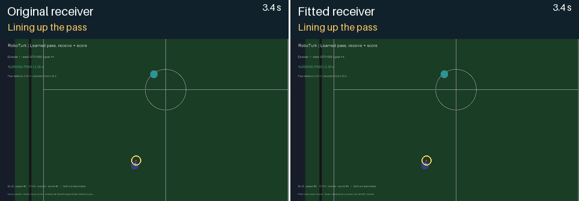
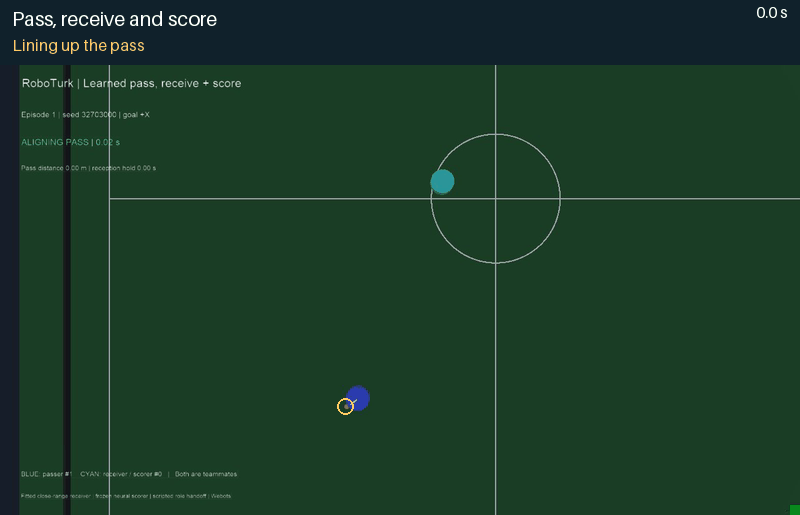

# Receiving a pass on the updated carpet

Both recordings start from the same development opening and use the same passer. Both receivers see the same slowing ball. The original receiver backs away and finishes 23 cm from the stationary ball. The fitted receiver closes the gap, holds possession for 0.40 s and scores at 14.82 s. The ring marks the visible ball in the native Webots recordings. The replay starts just before release and runs at real time. [Original recording](original-timeout.mp4) · [Fitted receiver recording](fitted-replay.mp4)



## Did it work on fresh starts?

Each paired comparison used identical generated robot poses, ball velocities, attack directions and role assignments. The 40-opening screen compared the published simulations immediately before and after the carpet, drive and field update. Both teams used the updated physics for the separate 200-opening qualification. The passer starts with the ball. There are two teammates, an unguarded goal and a scripted handoff to the learned scorer.

| Full goals | Old simulator, original policy | Updated simulator, original policy | Updated simulator, fitted receiver |
| --- | ---: | ---: | ---: |
| Solo capture, carry and shoot, 40 paired openings | 39/40 | 39/40 | — |
| Team pass, receive and score, 40 paired openings | 40/40 | 29/40 | 40/40 |
| Solo capture, carry and shoot, 200 additional openings | — | 198/200 | — |
| Team pass, receive and score, 200 additional paired openings | — | 163/200 | **200/200** |

All 37 original misses were timeouts after a valid pass. The fitted receiver converted every one to a goal and also scored on all 163 starts the original team completed. Both teams had zero recorded pre-kick possession losses and robot collisions. On the 163 starts both teams scored, the median paired change in time to goal was an additional 0.02 s with the fitted receiver. Per-episode records retain every timeout and rejected action. [Paired outcomes and terminal reasons](results.json) · [All trials and starting states](trials.zip)

The solo scorer made the same premature fire request on the same opening in both 40-trial cohorts. It occurred at 0.14 s on the updated simulator, before acquisition. The kicker applied zero kicks. On the additional 200 current-physics trials the solo scorer made 198 goals with zero pre-shot losses. On both misses it requested a kick before gaining possession. Neither request produced a kick. [Solo Webots demo](solo-demo.mp4) · [Solo demo log](solo-demo.json)

## What the receiver learned

All 11 original failures in the updated-physics screen followed valid releases. Every completed reception ended in a goal. The failed passes had a median receiver distance at release of 2.34 m, compared with 1.89 m for successful plays. The repair keeps the same 1.8 m/s pass, 3.5 m/s shot and transfer network. It fits only the receiver's forward, lateral and angular motion during the final 0.65 m, using 1,235 labeled states from 24 separate Webots training openings. Running the published training entry point again reproduced the receiver manifest and its fit report byte for byte. The capture demonstration controller supplied the training labels. At runtime the fitted weights use measured body-relative ball position and velocity. This is supervised imitation under ideal perception. Opposed play and 5v5 match performance require separate tests. [Policy and training procedure](../../policies/carpet_receive_v1/README.md) · [Physics measurements](../ssl-physics/README.md)

The independent demo below uses seed 32703000. The diagnostic replay above uses seed 32701000, which was inspected during development. Both show measured motion from the Webots recorder. [Uncut fresh recording](fresh-demo.mp4) · [Episode log](fresh-demo.json)



## Reproduce the comparison

Use Webots R2025a nightly dated November 17, 2026 and the project Python environment. Run the screen in a checkout of each pinned revision, with each checkout's own Python sources on the controller path. The training and qualification commands for the fitted receiver are in the model card. [Previous simulator revision](https://github.com/kadiru/metu-ros-pkg/tree/943ff2f8259bd7022737d198db2a3b4f8a850ba7/ros2/roboturk) · [Updated simulator with original policies](https://github.com/kadiru/metu-ros-pkg/tree/d246182ef84b07078511f320bf6bba803cbe82df/ros2/roboturk) · [Frozen receiver before its 200 trials](https://github.com/kadiru/metu-ros-pkg/tree/2d4a217752aa3f1cff987dba10c5d88dcbb3701c/ros2/roboturk)

```sh
python scripts/run_webots.py --mode shoot-evaluate --checkpoint policies/capture_dribble_shoot_v2/policy.zip --episodes 40 --seed 32600000 --output runs/screen-shoot --timeout 1800
python scripts/run_webots.py --mode team-evaluate --checkpoint policies/pass_receive_v2/policy.zip --shoot-checkpoint policies/capture_dribble_shoot_v2/policy.zip --episodes 40 --seed 32700000 --output runs/screen-team --timeout 1800
unzip media/carpet-skills/trials.zip -d runs/carpet-evidence
python scripts/compare_skill_trials.py --receiver-changed runs/carpet-evidence/final-original-team.json runs/carpet-evidence/final-fitted-team.json
```

The evidence archive includes native per-episode JSON, the regenerated opening inputs from each task's reset code, and the failing receiver trace sampled every 0.10 s. Policy paths are repository-relative and companion manifest digests are included. The two MP4s can be passed to `make_preview.py` to rebuild the paired GIF.
