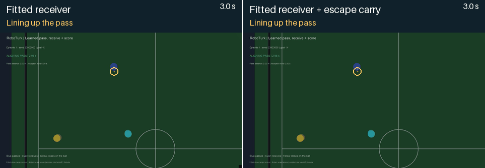
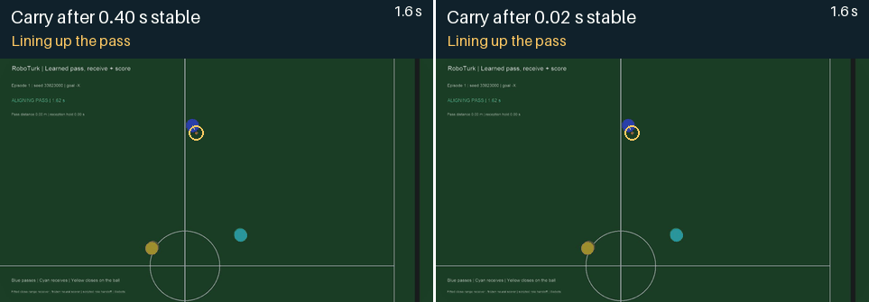

# Receiving and scoring against a closing defender

Cyan secures the pass at 5.28 s on both sides of this native Webots replay. On the left, Yellow takes the ball half a second later. On the right, Cyan carries away from Yellow while turning toward goal and scores at 9.82 s. The same fitted receiver, passer and neural scorer play both openings. [Original finish](original-finish.mp4) · [Escape carry](escape-carry.mp4)



## What changed under pressure?

Both teammates start on the updated Division B carpet with the passer in possession. Yellow starts 1.20–2.25 m laterally from the receiver, with up to 0.40 m longitudinal offset. When observed ball speed reaches 0.9 m/s, Yellow pursues a short extrapolation of ball motion. Its sampled top speed is 0.45–1.05 m/s. Yellow keeps pursuing through reception, carry and shot. Every arm used identical generated poses and marker speed on each shared start. This 2v1 test uses ideal simulator observations, a scripted marker and an open goal.

| Behavior | First touches | Stable receptions | Goals | Ended in interception | Ended in robot proximity |
| --- | ---: | ---: | ---: | ---: | ---: |
| Original receiver | 26 | 19 | 1 | 30 | 9 |
| Fitted receiver | 37 | 25 | 1 | 26 | 13 |
| Fitted receiver + escape carry | 37 | 25 | 13 | 17 | 10 |

Each row covers the same 40 fresh openings, seeds 33802000–33802039. The fitted receiver controlled six more passes than the original. In the fitted arm, 12 first touches failed during the required 0.40 s hold. Of the 25 completed receptions, 24 ended before a shot with the original finish. With the escape carry 13 ended in goals. The escape carry converted 12 additional openings and retained the original goal. The median marker-to-receiver distance at stable reception was 0.45 m. [Per-phase counts and paired outcomes](paired.json) · [All opening states and episodes](trials.zip)

The published unguarded play scored 200/200 on its own distribution. Here the defender contested the ball on every valid pass. The monitor checks every 2 ms for defender possession or ball-center separation within 0.1135 m of the marker center, and flags a robot encounter below 0.19 m center-to-center. The table counts terminal reasons once per episode. The earlier timing also had one premature or otherwise invalid shot. The raw evidence also retains overlapping flags. These are task-monitor thresholds. Official referee crash calls are a separate metric. [Unguarded qualification](../carpet-skills/README.md)

## Starting the carry during the first touch

A second rollout search kept the carry direction and speed fixed and tested when to begin moving. The earlier challenger began after one stable control tick (0.02 s). A reception still required 20 consecutive stable ticks. Only the scorer could request a shot after handoff. Eight separate training openings were shared across the four timings, including the full-hold control. The best earlier timing and full-hold control were then compared on a second set of 40 fresh starts, seeds 33822000–33822039.

| Behavior | First touches | Stable receptions | Goals | Ended in interception | Ended in robot proximity |
| --- | ---: | ---: | ---: | ---: | ---: |
| Wait for the full hold | 38 | 24 | 20 | 13 | 7 |
| Begin after 0.02 s stable | 38 | 21 | 17 | 15 | 7 |

Starting early gained one goal and lost four on the paired starts. Both variants scored on 16 starts. Among the 21 passes both secured, median time from first mouth contact to confirmed possession increased from 0.48 s to 2.59 s. The earlier motion delayed the measured handoff on these catches. Waiting for stable possession remains the stronger tested choice. On the separate demo opening 33823000, the delayed team scored at 8.48 s and the earlier team scored at 8.74 s. [Delayed carry](wait-for-hold.mp4) · [Earlier carry](first-touch.mp4) · [Timing search and policy](../../policies/first_touch_carry_v1/README.md)



## Reproduction

The first search selected two motion parameters from four profiles on eight native training openings. The second searched three early timings against a full-hold reference. Both use episode returns against the scripted marker. The 1.8 m/s pass, 3.5 m/s shot, 50 Hz control and 2 ms physics step are shared across the tests. The profiles are opt-in for this specialist play. Full 5v5 strategy integration and hardware require separate evaluation. [Training commands](../../policies/closing_carry_v1/README.md) · [Seed protocol](protocol.json)

To regenerate the published counts from the archived native records:

```sh
unzip media/closing-press/trials.zip -d runs/closing-evidence
cd runs/closing-evidence
python ../../scripts/compare_closing_press.py original.json fitted.json adapted.json --timing timing-adapted.json timing-early.json
```

To rebuild the primary GIF from the uncut movies, run this command from the project root:

```sh
python media/carpet-skills/make_preview.py media/closing-press/escape-carry.mp4 runs/closing-replay.gif --baseline media/closing-press/original-finish.mp4 --labels "Fitted receiver" "Fitted receiver + escape carry"
```
