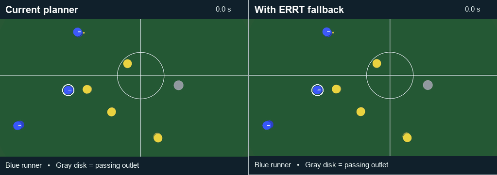

# Finding a passing outlet in crowded 5v5 play

An off-ball runner tries to get open while a nearby defender blocks its route. The white ring follows the runner and the gray disk marks its assigned passing position. On this separate demo opening, Blue stalls on the left and reaches the outlet in 3.00 s on the right.



## Results on 40 fresh starts

| Native Webots measurement | Current planner | With ERRT fallback |
|---|---:|---:|
| Arrived by 8 s | 17/40 | 38/40 |
| Starts with a stall | 24 | 1 |
| Stall episodes | 24 | 1 |
| Total time stalled | 183.16 s | 6.44 s |
| Mean arrival time, charging 8 s for each timeout | 5.88 s | 3.22 s |
| Median arrival on the 17 starts both completed | 2.92 s | 2.92 s |
| Median of each run’s closest runner-to-robot gap | 17.7 cm | 14.0 cm |
| Closest gap between any two robots across all runs | 8.96 cm | 8.96 cm |
| Starts with robot / board / goal-frame contact | 0 / 0 / 0 | 0 / 0 / 0 |

ERRT reached the outlet on 21 additional starts. The previous planner alone completed 0. Both missed 2. On the first shared miss, seed 38612012, the runner kept moving and alternated between the tree and the fixed detours. It still missed the deadline. The fallback brought the runner closer to other robots on a typical run. Across all ten robots the smallest board and goal-frame clearances were 53.0 cm and 41.5 cm respectively in both arms. [Watch the shared miss](blocked-outlet.gif) · [Watch Yellow reach the outlet in 2.92 s with either planner](yellow-outlet.gif)

### What was measured

Each pair used the same ten native robot states, ball state, runner, target and eight-second clock. Seeds 38612000–38612039 generated 30 tightly marked and 10 wider openings, including Blue and Yellow runners. The carrier held the ball while two supporting players and two markers shifted position. The attacking side used the selected planner, and the opposition used the current planner throughout. These are controlled off-ball runs with ideal position observations and fixed role assignments. They measure getting open for a pass. The ball stays with the carrier throughout the exercise.

Arrival required five consecutive 40 ms ticks within 10 cm of the outlet. A stall required 0.60 s continuously below 0.08 m/s and farther than 15 cm from the target before arrival. The mean includes timeouts at 8 s. Body-edge gaps were sampled every 2 ms for the entire play, including after arrival. A gap of 1 mm or less counted as contact. [Per-seed native records](trials.zip) · [Paired results and seed lists](results.json)

### How the fallback works

The optional planner tries the direct timed trajectory, then four fixed detours. When those fail, ERRT tries previously successful waypoints and samples up to 96 tree extensions. It checks candidate segments against the field and robot footprints. Before issuing a velocity command it checks the next 1.2 s of the acceleration-limited trajectory against teammate reservations and opponents extrapolated from observed motion. If it finds no admissible motion, it brakes. Waypoint reuse and adaptive bias follow Bruce and Veloso’s SSL motion-planning work. [Real-Time Randomized Path Planning for Robot Navigation](https://www.cs.cmu.edu/~mmv/papers/02iros-errt.pdf)

In a separate 30-second regular 5v5 Webots match on seed 38614000, both planners finished with Blue leading 1–0. The fallback supplied 90 off-ball commands. Brake commands fell from 448 to 266 across both teams. This single match checks integration with changing roles. The comparison above uses the controlled outlet plays.

## Reproduce

From the modern project root using the project Python environment and Webots:

```sh
python scripts/run_five_roles.py runs/outlet-current --trajectory-planner --open-play-policy policies/open_motion_v1/actor.json --crowded-trials 40 --seed 38612000 --seconds 8
python scripts/run_five_roles.py runs/outlet-errt --trajectory-planner --errt-fallback --open-play-policy policies/open_motion_v1/actor.json --crowded-trials 40 --seed 38612000 --seconds 8
python scripts/compare_crowded.py runs/outlet-current/crowded.json runs/outlet-errt/crowded.json
```

For the Blue demo, run each arm in a fresh directory with `--crowded-trials 1 --seed 38613000 --seconds 8 --frame-images`. The Yellow demo uses seed 38613002 and the shared miss uses 38612012. Omit `--crowded-trials` to use the planner in regular 5v5 open play.
