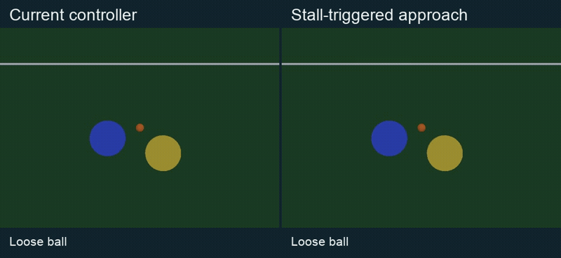

# Recovering a loose ball in traffic

The painted-goal match contained 19 slow approaches with a chaser within 0.60 m of the ball and another robot within 0.38 m of the chaser. All 19 involved a loose ball. The 0.305 m center-to-center steering margin could leave both chasers just outside roller reach.

The optional close approach waits for five slow control ticks and selects one chaser. It caps its approach at 0.42 m/s, uses a 0.202 m center-to-center target around slow neighbors, and checks predicted separation and braking distance. The selector uses the match's position observations and observed neighbor velocities. The close approach ends when a team establishes possession or the chaser leaves the crowd.

[](paired-replay.mp4)

| Native Webots replay set | Measure | Current | Revised |
| --- | --- | ---: | ---: |
| 7 archived stalls | Clean recoveries within 2.6 s | 5 | 5 |
| 7 archived stalls | Clean recoveries within 1 s | 2 | 4 |
| 24 fresh crowded starts | Clean recoveries within 2.6 s | 16 | 17 |
| 24 fresh crowded starts | Clean recoveries within 1 s | 13 | 14 |
| All 31 starts | Body-contact episodes | 0 | 0 |

The starts were paired and all ten robots ran the normal open-play controller. A clean recovery required 240 ms of exclusive roller reach and zero robot body-contact episodes in the trial. The archived poses came from specific frames of the earlier match and their velocities came from consecutive 40 ms samples. The fresh panel used independently seeded two- and three-robot arrangements around a loose ball. Physics was sampled every 2 ms with a 1 mm body-clearance threshold.

The revised chaser was faster on all four archived starts recovered by both controllers. It recovered frame 2725 after the current controller timed out. In frame 2261 the current controller recovered at 2.57 s and the revision timed out. Both timed out on frame 1088. Shared fresh recoveries had a median paired time change of 0.00 s. The clip replays frame 311 at half speed. Blue 1 secures it in 0.48 s with the revision and 1.44 s with the current controller. [Paired measurements](results.json) · [Original Webots match](../referee-restarts/README.md) · [Native traces and replay harness](evidence.zip)

TIGERs AutoRef replayed all seven archived starts for both approaches and reported zero crashes in either arm. In a separate 5v5 game with two 24-second halves under the official Game Controller, the revised approach ran on 28 control ticks. Blue won 1–0 with zero body-contact episodes and zero crash reports. The match used the seed from the original painted-goal game. [Official match audit](official-match-results.json)

## Run with the official referee

The approach is available through `--crowded-fetch` or `"crowded_fetch": true` in a league match specification. Use the [official referee setup](../autoref/README.md#run-the-experiment) and run from the modern stack directory.

```sh
python scripts/autoref/run_placement.py media/crowded-fetch/match-spec.json runs/new-crowded-fetch-match
```
