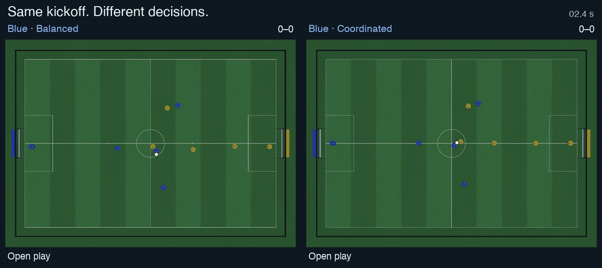

# Same kickoff, different decisions

Yellow runs Balanced on both sides of the recording. The robots, initial positions and velocities, skill implementations, and motion limits are shared. In the right replay, B1 passes to B3, B3 returns the ball, and B1 scores at 11.32 s. The left replay is still 0–0. This is one selected opening from a matched local-referee comparison. [MP4](matched-opening.mp4)

Webots recorded both views at simulation time 2.4–12.8 s from kickoff seed `38728000`. The ball marker and captions use the native position and event logs. Both recording reruns matched the corresponding benchmark runs across all 625 control frames.

## Matched pilot

Each challenger faced Balanced on four 25-second Webots starts, once as Blue and once as Yellow per start. All 16 comparisons started with identical positions and velocities to their corresponding Balanced versus Balanced match. The local referee controlled these runs.

| Challenger | Win–draw–loss | Goals for–against | Completed passes | Body contacts |
| --- | ---: | ---: | ---: | ---: |
| Local Priority | 1–4–3 | 1–3 | 9/20 | 0 |
| Coordinated | 3–3–2 | 4–3 | 10/16 | 0 |

Balanced completed 7/15 passes across the same color and kickoff assignments and scored zero goals. All four Balanced versus Balanced matches ended 0–0 with zero body contacts. [Per-start results](comparison.json)

In a separate viewer-launched match with two 30-second playing periods, Coordinated (Blue) and Local Priority (Yellow) drew 1–1. The SSL Game Controller reached full time with two approved goals. Webots recorded three body contacts and TIGERs AutoRef issued zero crash calls.

See [decision controller setup and benchmark instructions](../match-viewer/README.md#decision-controllers).
