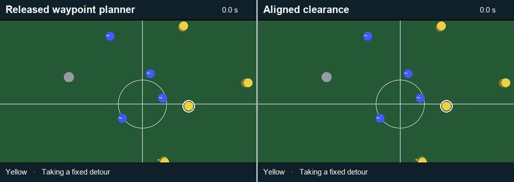

# Letting a stopped runner reopen clearance

On seed 38622023, the released runner stopped just outside the threshold for an outward step. It spent **6.12 s stalled** and missed the 8 s deadline. The updated runner took an outward waypoint at 1.92 s and reached the passing outlet in **3.32 s**. The smallest robot-to-robot gap was 12.55 cm in both runs.



The white ring follows the runner, the diamond marks its waypoint, and the gray disk marks the passing outlet. Both recordings preserve the preceding 23 resets from the earlier comparison.

The configured center-to-center clearance is 30.54 cm. The timed trajectory check adds 8 mm for interpolation, giving 31.34 cm. The outward-step trigger now uses that same buffered limit. It applies when the waypoint planner would otherwise brake and the robot is moving at 0.08 m/s or less. Each outward step still has to increase separation until the buffer is restored and pass the checks for other robots and field limits.

## 40 fresh crowded 5v5 starts

| Measurement | Released planner | Aligned clearance |
|---|---:|---:|
| Arrived by 8 s | 40/40 | 40/40 |
| Starts with a stall | 0 | 0 |
| Total time stalled | 0.00 s | 0.00 s |
| Mean time, charging 8 s per timeout | 3.14 s | 3.14 s |
| Median arrival on 40 starts both completed | 3.06 s | 3.06 s |
| Median of each start’s closest runner gap | 14.07 cm | 14.07 cm |
| Minimum robot-to-robot gap | 6.75 cm | 6.75 cm |
| Minimum board / goal-frame gaps | 53.00 cm / 41.50 cm | 53.00 cm / 41.50 cm |
| Starts with robot contact | 0 | 0 |
| Starts with board or goal-frame contact | 0 | 0 |

All 40 trial records matched, including clearance and planner decision counts.

Seeds 38642000–38642039 share the same ten robot states, ball state, runner, passing outlet and 8 s deadline across planners. The defense uses the same controller in both arms. A stall is at least 0.60 s below 0.08 m/s and over 15 cm from the outlet. Arrival requires five ticks within 10 cm. A body-edge gap of 1 mm or less counts as contact. Geometry is sampled every 2 ms. [Original waypoint experiment and trial protocol](../errt-waypoints/README.md)

## Four matched two-minute games

Both teams used the selected planner in each game, with ordinary role changes and the local referee. The pass measure uses the existing 5v5 audit. It counts the intended receiver gaining stable possession within two seconds, after at least 55 cm of ball travel and before a different player gains control or the play restarts. Robot contacts count contiguous samples within the 1 mm gap threshold for each pair.

| Measurement | Released planner | Aligned clearance |
|---|---:|---:|
| Pass attempts | 60 | 60 |
| Completed passes | 30 | 29 |
| Goals | 4 | 6 |
| Robot-to-robot contact episodes | 0 | 0 |
| Planner brake commands | 2397 | 3617 |
| Minimum robot-to-robot gap | 5.55 cm | 4.78 cm |

Each cell shows Blue–Yellow score, passes completed out of attempts, and robot contacts.

| Kickoff seed | Released planner | Aligned clearance |
|---|---:|---:|
| 38644000 | 0–1 · 12/21 · 0 | 0–1 · 5/10 · 0 |
| 38644001 | 2–0 · 5/15 · 0 | 2–2 · 16/31 · 0 |
| 38644002 | 0–0 · 7/15 · 0 | 0–0 · 5/12 · 0 |
| 38644003 | 0–1 · 6/9 · 0 | 0–1 · 3/7 · 0 |

Both extra goals came from seed 38644001. The updated planner completed fewer passes on the other three seeds. [Paired results](results.json) · [Raw trials, replay traces and match logs](trials.zip)

## Reproduce

Use the same Webots build and the project Python environment in both worktrees. The baseline planner is from commit `a858aec053a616a89b81bb678ff72dead47652b3`. For 2 ms contact telemetry on that worktree, copy the updated `roboturk_five_roles.py` controller into it. The planner modules remain from the baseline commit.

```sh
policy=policies/open_motion_v1/actor.json
python scripts/run_five_roles.py runs/outlets --trajectory-planner --errt-fallback --commit-waypoints --open-play-policy "$policy" --seed 38642000 --seconds 8 --crowded-trials 40
python scripts/run_five_roles.py runs/replay --trajectory-planner --errt-fallback --commit-waypoints --open-play-policy "$policy" --seed 38622000 --seconds 8 --crowded-trials 24 --film-seed 38622023
for seed in 38644000 38644001 38644002 38644003; do
    python scripts/run_five_roles.py "runs/matches/$seed" --trajectory-planner --errt-fallback --commit-waypoints --open-play-policy "$policy" --seed "$seed" --seconds 120 --motion-audit
done
```

Compare the outputs with `scripts/compare_crowded.py` and `scripts/compare_five_play.py`. The replay can be rendered with `scripts/render_waypoint_replay.py`.
