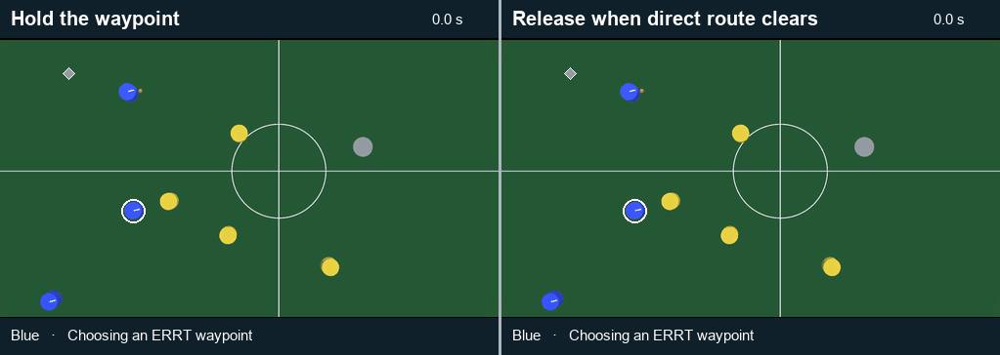

# Leaving an ERRT waypoint when the direct route clears

The gray disk is Blue’s passing outlet. The diamond marks the waypoint the runner is following. On the same Webots opening, Blue kept its waypoint and arrived in **5.84 s** on the left. On the right it released the waypoint at **0.48 s** and arrived in **4.00 s**.



## Where the extra braking came from

The two match seeds with the largest increase in brake commands went from 1,992 to 3,143 brake commands after the buffer fix. These replays reproduced the original poses, kick and goal events, and planner counts across all 120 seconds. Robot and role changes in parentheses compare the original threshold with the buffered threshold. In the current planner, 2,831 of the 3,143 brake commands had a target outside the timed planner’s legal region.

| Kickoff seed | Robots with largest increase | Roles with largest increase | Brakes while ball was loose | Brakes beginning a tick inside the buffered clearance | Brakes with an out-of-bounds target |
|---|---|---|---:|---:|---:|
| 38644000 | blue 2 (+1746), yellow 4 (+25) | Cover (+1560) | 1043 → 2083 | 664 → 65 | 788 → 2177 |
| 38644001 | blue 4 (+253), blue 1 (+70) | Cover (+224), Marker (+99) | 297 → 571 | 80 → 197 | 318 → 654 |

On seed 38644000, confirmed possession fell from 63.32 s to 21.20 s. The replay logs show each robot’s role, travel target, measured speed, selected route, and the player in confirmed possession.

Blue 2 contributed 1,746 additional brake commands on that seed. Its longest Cover stall lasted 72.48 s. The target settled at roughly (−3.47 m, −0.31 m), inside the planner’s own-penalty-area exclusion. The nearest robot was about 0.50 m away. The Cover target follows the ball, and the current tactical clamp only adjusts targets approaching the opponent’s box. The match stayed in the same prolonged Cover stall with early release enabled. [Previous clearance experiment](../errt-clearance/README.md)

## Early release in the same two-minute games

Both teams used the same planner within each game. The early-release arm used the same buffered clearance planner as the comparison arm. These are the two diagnostic kickoffs under the local referee.

| Measurement | Current planner | Early release |
|---|---:|---:|
| Brake commands | 3143 | 2630 |
| Sustained stalls | 18 | 10 |
| Seconds stalled, summed across robots | 92.92 s | 81.96 s |
| Completed passes | 21/41 | 15/28 |
| Goals | 5 | 2 |
| Confirmed possession, either team | 68.00 s | 103.96 s |
| Contacts | 0 | 0 |
| Minimum robot-to-robot gap | 4.78 cm | 7.29 cm |
| Early releases | 0 | 9 |

| Kickoff seed | Current score · completed passes · stalls | Early release score · completed passes · stalls |
|---|---:|---:|
| 38644000 | 0–1 · 5/10 · 7 | 0–1 · 5/10 · 7 |
| 38644001 | 2–2 · 16/31 · 11 | 1–0 · 10/18 · 3 |

The improvement in stall count came from seed 38644001. That game also had fewer completed passes and goals.

A sustained stall is at least 0.60 s below 0.08 m/s while more than 15 cm from the travel target, with the same role and restart. This measure covers robots assigned a timed route. The existing pass audit counts the intended receiver gaining stable possession within two seconds after at least 55 cm of ball travel. Contacts measure body-edge gaps of 1 mm or less sampled every 2 ms.

## Fresh crowded outlet starts

| Measurement | Current planner | Early release |
|---|---:|---:|
| Reached the outlet by 8 s | 16/16 | 16/16 |
| Starts with a stall | 0 | 0 |
| Mean arrival, charging 8 s per timeout | 2.97 s | 2.97 s |
| Median of each start’s closest runner gap | 14.02 cm | 14.02 cm |
| Minimum robot-to-robot gap | 13.41 cm | 13.41 cm |
| Robot contact starts | 0 | 0 |
| Board or goal-frame contact starts | 0 | 0 |

Seeds 38652000–38652015 were chosen before running the experiment. Each pair used the same starting poses, ball state, and outlet. Runs used the original eight-second deadline, five consecutive ticks within 10 cm for arrival, and the existing body-edge clearance audit. In separate checks, the historical Blue oscillation arrived in 4.00 s and Yellow’s clearance recovery arrived in 3.32 s. [Paired results](results.json) · [Raw runs, decision traces and match logs](trials.zip)

## How the planner releases a waypoint

Enable the experiment with `--release-waypoint-early` alongside `--trajectory-planner --errt-fallback --commit-waypoints`. The planner rechecks the next 1.2 s of the direct trajectory every 40 ms. It releases after four consecutive qualifying checks, with an extra 2 cm of predicted clearance and at least 0.20 s of estimated time savings over going through the waypoint. A failed check resets the counter. Outward clearance recovery follows its own waypoint until normal replanning resumes.

From the modern project root with Webots and the Python environment available:

```sh
policy=policies/open_motion_v1/actor.json
python scripts/run_five_roles.py runs/replay --trajectory-planner --errt-fallback --commit-waypoints --open-play-policy "$policy" --seed 38612012 --seconds 8 --crowded-trials 1 --frame-images
python scripts/run_five_roles.py runs/outlets --trajectory-planner --errt-fallback --commit-waypoints --open-play-policy "$policy" --seed 38652000 --seconds 8 --crowded-trials 16
python scripts/run_five_roles.py runs/matches/38644000 --trajectory-planner --errt-fallback --commit-waypoints --open-play-policy "$policy" --seed 38644000 --seconds 120 --motion-audit
```

Repeat each command with a new output directory and `--release-waypoint-early` for the candidate. Repeat the match with seed 38644001 for the second pair. To replay the original unbuffered trigger with per-player telemetry, set `threshold = clearance` inside `ERRTFallback.search` in an isolated checkout and run the match command. This restores the trigger used in commit `a858aec053a616a89b81bb678ff72dead47652b3`. Use `scripts/compare_five_play.py`, `scripts/compare_crowded.py`, and `scripts/render_waypoint_replay.py` to compare and render the runs.
