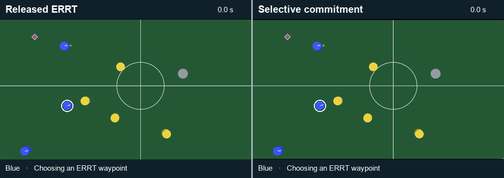
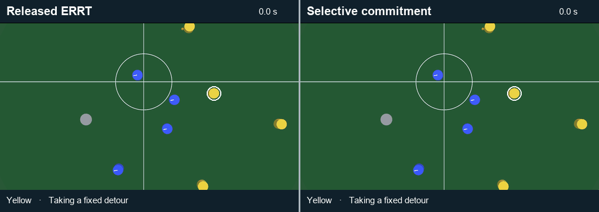

# When a 5v5 runner keeps switching routes

Follow the circled robot to the gray disk, its assigned passing outlet. A diamond marks the active waypoint. Each side shows native Webots frames from the same opening. The trail comes from the runner’s measured positions.

### Blue switched routes 100 times

On seed 38612012, Blue alternated between ERRT and a fixed detour, ending just 2 cm from where it started. The updated runner recognized the repeated switch, followed the waypoint for 44 additional ticks, and reached the outlet at **5.84 s**. Its closest body-edge gap went from 20.1 cm to 17.3 cm on this play.



### Yellow braked inside its planning buffer

On seed 38612039, Yellow first braked at 1.40 s. Once stopped, its nearest neighbor was 27.0 cm away center to center, inside the planner’s 30.5 cm buffer. The released planner issued 165 brake commands and never acquired a waypoint. Holding ordinary waypoints alone reproduced the timeout. At 1.60 s the updated runner chose a short outward waypoint, followed it for 13 more ticks, and reached the outlet at **3.32 s**. The closest body-edge gap rounded to 8.96 cm for both planners.



## Matched Webots results

Each cell reads **released ERRT → selective waypoint commitment**. The original starts contain the two investigated misses. The first fresh batch exposed the cost of immediate commitment. The selective rule was frozen before running either team on the independent batch.

| Measurement | Original 40 | First fresh 40 | Independent 40 |
|---|---:|---:|---:|
| Reached the outlet by 8 s | 38 / 40 → 40 / 40 | 38 / 40 → 39 / 40 | 37 / 40 → 40 / 40 |
| Starts with a stall | 1 → 0 | 2 → 1 | 3 → 0 |
| Time stalled across all starts | 6.44 s → 0.00 s | 12.48 s → 6.12 s | 19.12 s → 0.00 s |
| Mean time, charging 8 s for each timeout | 3.22 s → 3.10 s | 3.25 s → 3.17 s | 3.43 s → 3.10 s |
| Median arrival on starts both finished | 2.92 s → 2.94 s | 3.00 s → 3.04 s | 3.08 s → 3.08 s |
| Median of the runner’s closest gap per start | 14.0 cm → 14.0 cm | 14.3 cm → 14.2 cm | 13.8 cm → 13.8 cm |
| Minimum robot-to-robot gap across all starts | 8.96 cm → 8.96 cm | 10.52 cm → 10.52 cm | 7.17 cm → 7.17 cm |
| Starts with robot contact | 0 → 0 | 0 → 0 | 0 → 0 |
| Starts with board or goal-frame contact | 0 → 0 | 0 → 0 | 0 → 0 |

| Paired arrivals | Both finished | Selective only | Released only | Both missed |
|---|---:|---:|---:|---:|
| Original 40 | 38 | 2 | 0 | 0 |
| First fresh 40 | 38 | 1 | 0 | 1 |
| Independent 40 | 37 | 3 | 0 | 0 |

[Per-seed outcome lists and aggregate results](results.json) · [All native trial records, replay traces and match summary](trials.zip)

### When to keep the waypoint

The released planner tries the direct trajectory and four detours before calling ERRT. The first candidate committed immediately to every ERRT waypoint. It fixed the two historical timeouts but sometimes took a long route when the fixed detour was already making progress. The selective version watches what happens after an ordinary route takes over. If ERRT has to take over again with less than 7 cm of net motion since the previous ERRT entry, the runner commits to the selected waypoint. The outward maneuver described below commits immediately in both versions.

| Variant | Original 40, arrivals / starts with stalls / mean time | First fresh 40, arrivals / starts with stalls / mean time |
|---|---|---|
| Released ERRT | 38/40, 1 stall, 3.22 s | 38/40, 2 stalls, 3.25 s |
| Hold immediately | 39/40, 0 stalls, 3.82 s | 37/40, 1 stall, 3.77 s |
| Hold after an unproductive switch | 40/40, 0 stalls, 3.10 s | 39/40, 1 stall, 3.17 s |

On seed 38622015, immediate commitment missed the eight-second deadline in the batch, but reached the outlet in 4.52 s when the same logged state was run in a new Webots process. Replaying the preceding 15 resets reproduced the batch miss. The released planner arrived in 3.68 s. The comparison uses the original batch outcomes. [Watch the immediate-commitment miss with its reset history](immediate-timeout.gif)

### What the planner checks

Every 40 ms the planner rebuilds the acceleration-limited path to the held waypoint and checks the next 1.2 s against field limits, teammate reservations and opponents extrapolated from observed motion. It releases the waypoint when it gets within 7 cm, when the path becomes unsafe, when the role changes, or when the assigned target moves more than 50 cm from the target at selection.

For a runner below 0.08 m/s already inside the planning buffer, the planner tries 44 cm outward waypoints. For every encroaching robot, the relative distance along each predicted segment must be nondecreasing until nominal clearance is restored within the horizon. The check reserves an interpolation margin, checks all other robots and rejects starts within that margin of physical contact. If every extension fails, the runner brakes. The soccer policies were frozen.

On fresh seed 38622023 both planners spent 6.12 s stalled. The smallest center distance was 30.55 cm, just above the 30.54 cm threshold for initiating an outward step. The timed planner also reserves an interpolation margin there. This case remains unresolved.

### Trial protocol

Each pair shares the ten robot states, ball state, runner, outlet and eight-second deadline. Only the attacking side changes planner. Two supports and two markers shift during each play. Arrival requires five consecutive 40 ms ticks within 10 cm. A stall requires 0.60 s below 0.08 m/s while more than 15 cm from the target before arrival. Body-edge gaps are sampled every 2 ms through all eight seconds. A gap of 1 mm or less counts as contact. These controlled plays measure getting open for a pass using ideal observations and fixed roles. [Original fixture and released ERRT results](../crowded-errt/README.md)

A separate regular 30 s 5v5 match exercised changing roles on seed 38614000. The released team finished Blue–Yellow 1–0 and the selective version finished 0–0. Selective commitment issued 62 held-waypoint commands. This single run checks match integration.

## Reproduce

From the modern project root using the project Python environment and Webots:

```sh
policy=policies/open_motion_v1/actor.json
python scripts/run_five_roles.py runs/outlet-released --seed 38622000 --seconds 8 --crowded-trials 40 --trajectory-planner --errt-fallback --open-play-policy "$policy"
python scripts/run_five_roles.py runs/outlet-selective --seed 38622000 --seconds 8 --crowded-trials 40 --trajectory-planner --errt-fallback --commit-waypoints --open-play-policy "$policy"
python scripts/compare_crowded.py runs/outlet-released/crowded.json runs/outlet-selective/crowded.json
```

Use 38612000 for the original 40 and 38632000 for the independent 40. For immediate commitment, use `--commit-waypoints immediate`. To record a historical miss, run each planner in a new directory with its seed and `--crowded-trials 1 --frame-images`. To preserve a start’s batch history, use the batch’s first seed, include the required number of starts, and select the recorded seed with `--film-seed`. Combine the matched frames with `python scripts/render_waypoint_replay.py RELEASE_DIR COMMITTED_DIR replay.gif` (requires Pillow).
