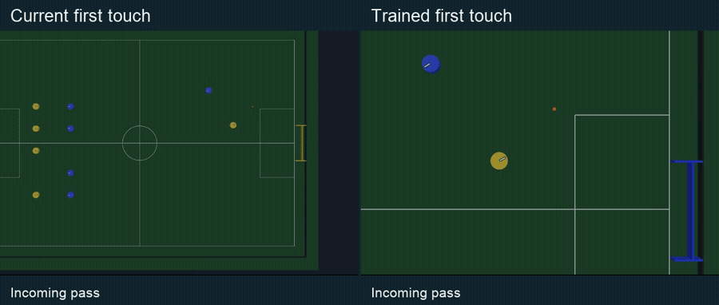

# A softer first touch in 5v5

Both colors use a raised white heading stripe with a dark border. The original stripe sat flush with the chassis top and could flicker or disappear. Open play reads both teams' headings from the shared Webots state. The SSL-Vision output publishes headings for both colors. The independent kickoff planners use opponent positions and velocities estimated from consecutive frames.

The fitted receiver moves with the incoming ball while it brings the roller onto the passing lane. When the expected contact point has a clear shot, it starts opening toward goal within the receiving angle the fit selected. The match uses softer short passes and a damped carry motor. The receiver and carry switches apply to the normal open-play path.

[](paired-reception.mp4)

## Matched native Webots results

| Receiver result on 30 fresh starts | Current | Fitted |
| --- | ---: | ---: |
| Clean first touches | 18 | 30 |
| Measured rebounds before securing the ball | 12 | 0 |
| Clean shots within 0.65 s of first touch | 9 | 12 |
| Goals | 27 | 27 |

The five candidate profiles were fitted by CPU rollout selection on nine separate starts. The paired held-out panel had ten forward passes, ten square passes, and ten cutbacks, with varied incoming speed, initial heading, and a scripted closing marker. Both arms used the damped carry motor during this reception comparison. Clean contact required 160 ms of continuous exclusive roller reach or a controlled shot after at least 78 ms, with no detected first-touch loss or rebound. The rebound check measures a ball approaching the chassis and then separating outward before stable control or a shot. The 26 pairs that shot in both arms had a median change of −45 ms from first touch to shot. For cutbacks the median was 0.218 s with the current receiver and 0.164 s with the fitted receiver. A forward pass commonly leaves a larger turn toward goal. [Receiver checkpoint and training selection](../../policies/five_receive_v1) · [Held-out results](results.json)

On 16 matched uncontested carries, the damped motor retained possession on 16 and the previous motor on 11. Median accumulated turn-command variation dropped from 7.81 to 4.09 rad/s. Median lateral roller error fell from 8.01 to 6.17 mm. The native carry fixture follows a varying heading under the same planar drive and roller physics as 5v5.

## One-minute 5v5 match

Yellow won 1–0 after a 0–0 halftime. Yellow 1 scored after receiving a free-kick pass from Yellow 3. The open-play receiver completed 5 of 9 open-play pass attempts across both teams. The Game Controller ran two 30-second halves and recorded no crash calls or physical body-contact episodes. The current referee preset logged three defense-area reports without stopping play. The uncut video includes kickoff setup, halftime, and the ball-out restart. [Full Webots match](official-match.mp4) · [Referee and pass audit](official-match-results.json) · [Training, testing, and native match evidence](evidence.zip)

Run the same preset from the modern stack directory with the [official referee setup](../autoref/README.md#run-the-experiment).

```sh
python scripts/autoref/run_placement.py media/five-receive/match-spec.json runs/new-five-receive-match
python scripts/autoref/film_league.py runs/new-five-receive-match runs/new-five-receive-film
```
