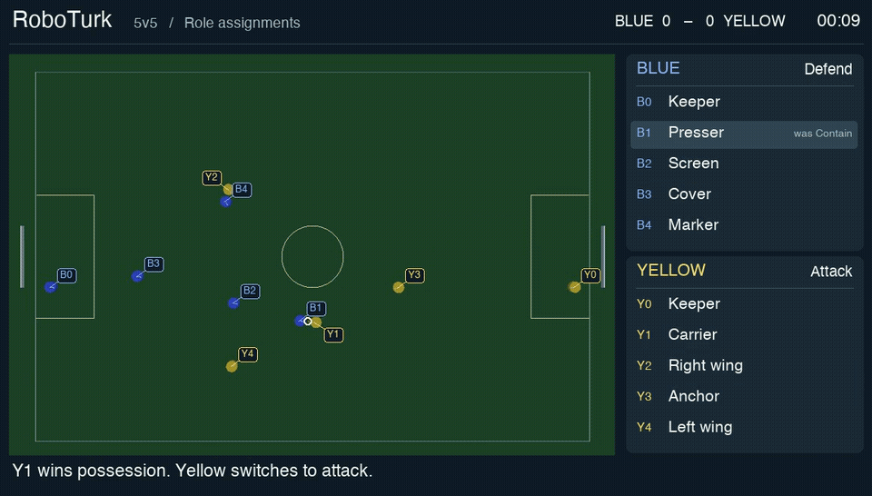

# Watching roles change in 5v5

[](five-roles.mp4)

Watch Yellow 2. At **14.64 s** it takes possession from Blue 1 and changes from presser to carrier. When Yellow 2 passes to Yellow 4, it moves to the right wing. Yellow 4 then passes back. Yellow 2 becomes the receiver and takes control again at **17.96 s**. The jersey numbers identify the same robots throughout. Yellow won the filmed match 2–1. [Full 60-second match](five-roles.mp4) · [Every role change, by timestamp and jersey](matches/20300000/role-changes.csv)

## How the assignment works

Each side fields a designated keeper (jersey 0) and four interchangeable field players. Both teams read the same physical world every 40 ms and compute their own assignments. Each available field role goes to exactly one player. The allocator considers all 24 arrangements and minimizes total travel distance, charging a 0.42 m switching cost per reassigned player. Three consecutive observations of sole roller control confirm possession. A confirmed field carrier and the intended receiver of an actual kick take priority over distance. A receiver keeps the assignment until reception, an opposing recovery, a stoppage, or the 1.65 s flight timeout.

| Situation | Four field responsibilities |
| --- | --- |
| Attacking | Carrier, left wing, right wing, anchor. The receiver takes the primary slot while a pass travels. An outlet takes it when the keeper controls the ball. |
| Defending | Presser closes down the ball, marker follows the most threatening off-ball field opponent, screen obstructs the route toward goal, cover stays deeper. |
| Loose ball | Chaser goes for the ball, two wings spread out, cover protects the space behind them. |
| Shared grip or ball in the goal area | One field player can drop into containment or block the outlet at the edge of the box. The keeper can step out to collect. |

Left and right are relative to the team’s attacking direction. The 5v5 assignment is rule-based. Passing reuses the earlier learned 3v3 recipient-scoring weights across eligible field teammates, with a forward-progress preference. The controller uses existing roller, movement, shooting-lane and separation code. The simulator models ideal body velocity and a spring dribbler on the 9 × 6 m field. [Role allocator](../../src/roboturk_core/roboturk/five_roles.py) · [Role execution](../../src/roboturk_core/roboturk/five_play.py) · [Native world](../../src/roboturk_ros/webots/worlds/ssl_five_roles.wbt)

## What the match traces show

| 60-second kickoff | Blue–Yellow | Confirmed changes of team possession in open play | Confirmed passes / kicks intended as passes |
| --- | ---: | ---: | ---: |
| [20300000, filmed](matches/20300000/audit.json) | 1–2 | 12 | 16 / 23 |
| [20300001](matches/20300001/audit.json) | 1–0 | 20 | 9 / 18 |
| [20300002](matches/20300002/audit.json) | 0–0 | 24 | 4 / 10 |

All ten assignments were present on every control step, for 45,000 checked player assignments across three starts. The pass count requires at least 0.55 m of ball travel and confirmed possession by the intended receiver. A change of team possession can include a loose-ball interval. Restarts are excluded. The scoreless third match involved repeated contests near the keeper. These three games demonstrate role behavior and its variation.

The independent recording reproduced all 1,500 control frames of the filmed match, including the role decisions, positions and events. The overlay reads the actual assignments. Matching 105 visible jersey centers against the trace gave a mean alignment error of 0.51 native pixels. [Recording receipt](recording.json) · [Raw match traces and assignments](matches/)

## Run it locally

From the modern project with the existing Python environment and Webots runtime, use a new output directory for each match. The watch command shows jersey numbers and both rosters in the running simulator. Pass `--webots /path/to/webots` to select a different executable.

```sh
python scripts/run_five_roles.py runs/my-five-live --watch
python scripts/run_five_roles.py runs/my-five-reference --seed 20300000 --seconds 60
python scripts/run_five_roles.py runs/my-five-movie --seed 20300000 --seconds 60 --record
python scripts/audit_five_roles.py runs/my-five-reference --replay runs/my-five-movie
python scripts/film_five_roles.py runs/my-five-movie runs/my-five-reference runs/my-five-media
```
