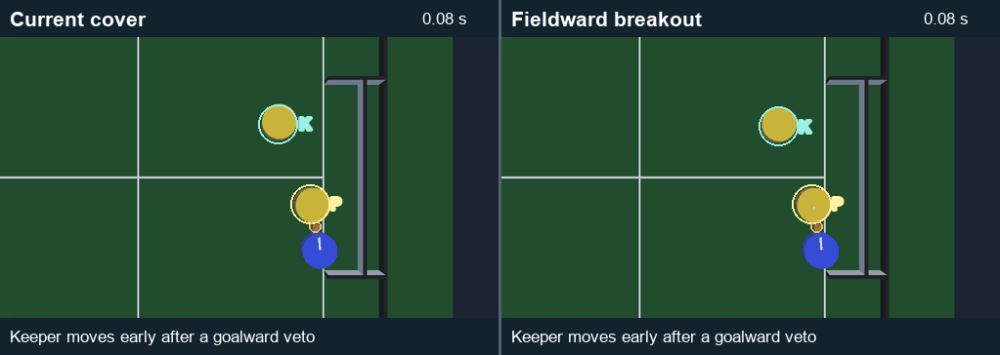
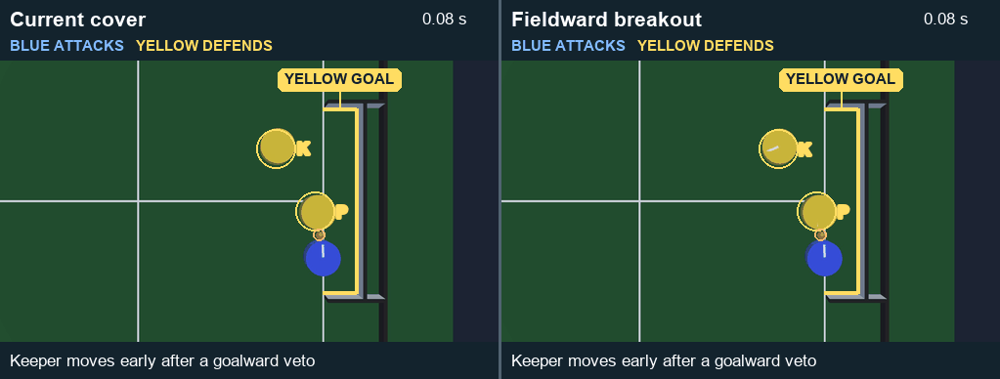

# Break a shared keeper grip toward the field

All five shared misses from the previous benchmark reached a two-roller contest. The keeper reached the ball but the opponent still controlled it. In each replay, the opponent kept its roller on the ball as it crossed the defending goal line.

The new cover keeps the timed handoff. When both rollers reach the ball, the keeper sweeps across the opponent's exposed flank toward the field. It selects the fieldward sweep using the carrier's observed orientation and keeps the existing collision steering and post limits. The presser clears the keeper's path and stays available on the field side of the box, with its roller off while the keeper breaks the shared grip. Ordinary possession and recovery take over after the release.

Blue attacks and Yellow defends in these six clips. The yellow outline and **YELLOW GOAL** marker identify the defended net. The replay measures goals conceded when the ball crosses that line. The archived `own_goal_s` field records this crossing without assigning the last touch. [Keeper pivot comparison on the same five starts](../keeper-pivot/README.md)

## Five archived misses

| Archived seed | Goal conceded with current cover | Fieldward breakout keeper recovery |
| --- | ---: | ---: |
| 38725035 | 1.134 s | 1.420 s |
| 38725059 | 1.368 s | 1.482 s |
| 38725067 | 1.286 s | 1.426 s |
| 38725083 | 1.452 s | 1.446 s |
| 38725091 | 1.586 s | 1.384 s |

The fieldward breakout retained possession cleanly on all five exact replays, with zero body-contact episodes.



[38725059 replay](miss-38725059.gif) · [38725067 replay](miss-38725067.gif) · [38725083 replay](miss-38725083.gif) · [38725091 replay](miss-38725091.gif)

## Fresh matched starts

The 32 varied starts mirror the goalmouth setups across both goals. The 16 additional near-line starts concentrate on the right-side scramble from the replay, with a turning opponent and added goalward drift. Each pair uses the same Webots robot and ball poses and velocities. The opposing carrier, presser, and keeper are active and the other seven players are parked.

A clean takeaway requires exclusive defending-team possession for the last 240 ms with no body contact or ball out. A body contact is a distinct robot-pair encounter, measured at each 2 ms physics step. Starts with contact are also counted so repeated contacts in one trial are visible.

| Fresh panel | Goals conceded with current cover | Goals conceded with breakout | Current clean takeaways | Breakout clean takeaways | Current body contacts | Breakout body contacts |
| --- | ---: | ---: | ---: | ---: | ---: | ---: |
| Varied, 32 | 1 | 0 | 7 | 5 | 7 | 7 |
| Near-line, 16 | 5 | 1 | 2 | 4 | 8 | 10 |
| **Combined, 48** | **6** | **1** | **9** | **9** | **15** | **17** |

The breakout prevented five of the baseline's six goals conceded and introduced none. It remains opt-in because contact episodes rose from 15 to 17. The regular 44-second 5v5 smoke run reached two keeper-cover ticks and recorded zero body contacts.

On fresh seed 38725675, current cover concedes at 0.984 s. The breakout version keeps the ball out and the presser secures it at 0.742 s.



The varied panel was run in batches of eight. Filming one varied seed in isolation changed the result. Repeating its full batch reproduced the goal, takeaway, and contact counts on all eight starts. The fresh GIF uses a near-line single-start fixture and matches its scored outcome.

[Summary](results.json) · [Varied starts](panels.json.gz) · [Near-line starts](near-line-panels.json.gz) · [Replay states and commands](replays.json.gz) · [5v5 integration trace](integration.json)

## Reproduce

Run from the modern stack root with Webots and the project Python environment.

```sh
for offset in 0 8 16 24; do
  python scripts/run_five_roles.py "runs/goal-lane-varied-$offset" \
    --tackle-panel keeper-lane --keeper-stress --seed "$((38725500 + offset))" \
    --tackle-trials 8 --open-play-policy policies/open_motion_v1/actor.json \
    --tackle-policy policies/ball_side_tackle_v1/actor.json
done

for index in $(seq 0 15); do
  seed="$((38725603 + 8 * index))"
  python scripts/run_five_roles.py "runs/goal-lane-near-$seed" \
    --tackle-panel keeper-lane --keeper-stress --seed "$seed" --tackle-trials 1 \
    --open-play-policy policies/open_motion_v1/actor.json \
    --tackle-policy policies/ball_side_tackle_v1/actor.json
done

python scripts/compare_keeper_cover.py media/goal-lane/{panels,near-line-panels}.json.gz
```

For a replay, use one of the five seeds in the table with `--tackle-trials 1 --frame-images --motion-audit`. Run `scripts/render_keeper_cover.py` on that replay directory to generate the corresponding GIF. Use `--tackle-selector --keeper-cover --keeper-lane` with both policy paths in ordinary play.
