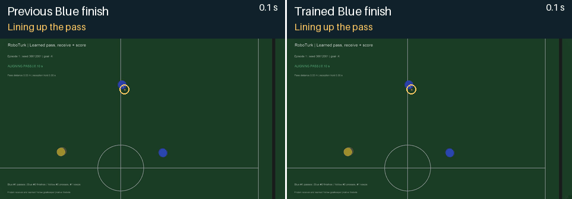
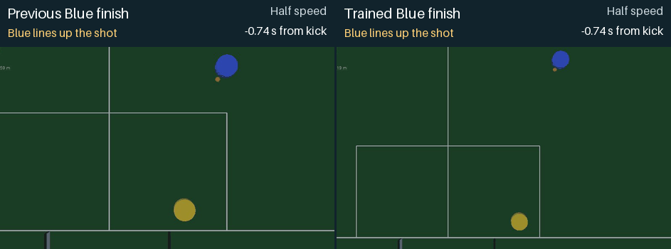
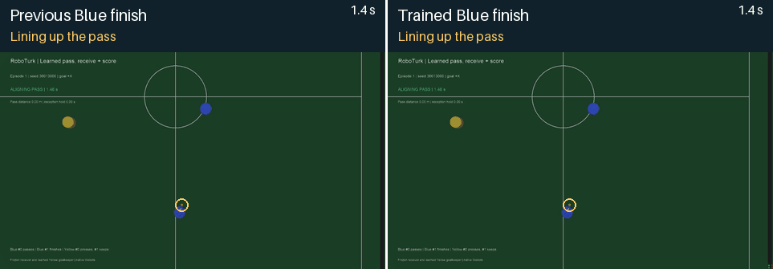

# Blue finishes against a Yellow defender and goalkeeper

Blue keeps its trained pressured receiver. Yellow fields the same scripted closing defender as in the 2v1 drill, plus the frozen neural goalkeeper from the opponent-training study. Both Yellow players run from the opening pass through the shot. The test uses ideal simulator state in native Webots. [Receiver](../secure-pass/README.md) · [Yellow goalkeeper](../../policies/learned_opponents_v1/README.md) · [Blue finishing policy](../../policies/guarded_finish_v1/README.md)

| Same 40 fresh openings | Stable receptions | Valid shots | Shots stopped by keeper | Goals |
| --- | ---: | ---: | ---: | ---: |
| Previous Blue finish | 37 | 32 | 8 | 22 |
| Trained Blue finish | 37 | 34 | 1 | 33 |

Blue gained 11 goals on previously unsuccessful openings and gave up 0 previous goals. In 7 cases, a shot the goalkeeper had stopped became a goal. The two arms disagreed on the reception outcome on 0 starts. The median distance from goal center at crossing was 0.02 m for the previous goals and 0.41 m for the trained goals. [Per-seed pairs and end reasons](paired.json) · [All training and evaluation records](trials.zip)

## One opening, two finishes

On opening 36012001, the previous team had its shot stopped by Yellow at 6.70 s and the trained team scored at 6.46 s. The selection rule was fixed in advance. We replayed the first qualifying opening in seed order where a saved shot became a goal, or the first new goal if there was no such save. Blue wears blue throughout and both Yellow players wear yellow. [Uncut previous finish](replay-baseline.mp4) · [Uncut trained finish](replay-trained.mp4)



At half speed, the close-up synchronizes both releases. Time zero is Blue’s own kick in each film.



## Independent demo

On opening 36013000, the previous team had its shot stopped by Yellow at 7.80 s and the trained team scored at 7.46 s. This opening was reserved before training and is separate from the 40 evaluated pairs. [Previous team film](independent-baseline.mp4) · [Trained team film](independent-trained.mp4)



## What was held fixed?

Both arms used identical initial poses for all four robots, the same ball, the same defender speed and the same keeper checkpoint, latency, acceleration, speed and style on each start. A pass counts after 0.40 s of stable control, observed at 2 ms physics intervals. Blue has to carry at least 0.50 m closer to goal before a valid 3.5 m/s shot from within 1.8 m. A goal requires a measured whole-ball crossing. A keeper save in the table means the skill monitor recorded ball contact or mouth possession after a valid shot. These are specialist trials with a passer initially in possession and one closing field opponent. The 5v5 match team requires separate integration and evaluation.

## Reproduce the figures

```sh
unzip media/guarded-finish/trials.zip -d runs/guarded-evidence
python scripts/compare_guarded_finish.py runs/guarded-evidence/baseline.json runs/guarded-evidence/trained.json
```

[Training, qualification and recording seeds](protocol.json)
