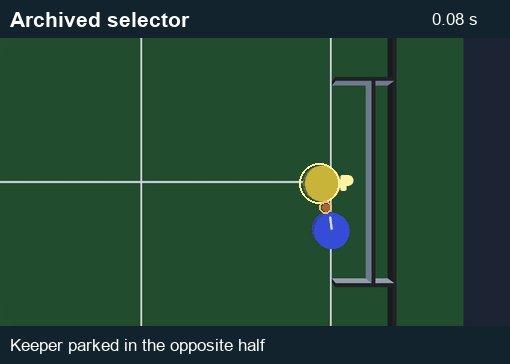
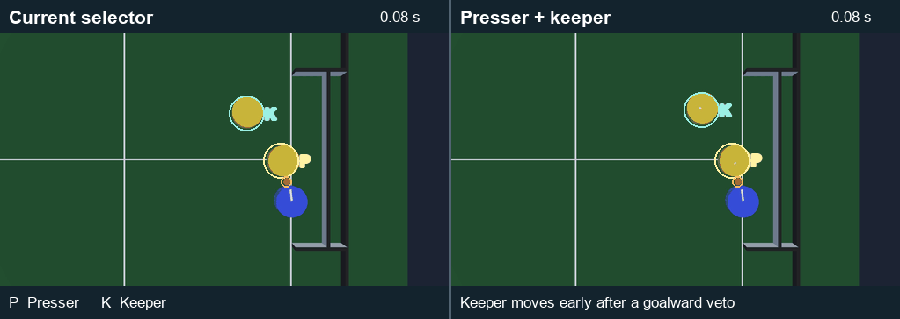
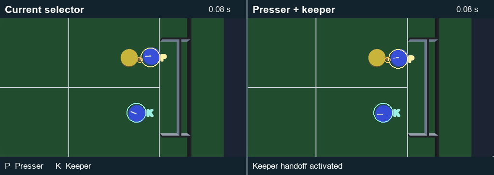

# Keeper cover after a tackle veto

The same ball-release selector still chooses the tackle. A goalward veto lets the keeper start tracking the ball while the presser tries an available tackle. When no tackle is available, the presser turns its roller off and moves upfield to clear the keeper's lateral approach, then screens the next passing lane. The keeper uses the observed ball motion to choose an interception point. Near the posts it has a geometry-limited goal-mouth lane. The presser and keeper still use the existing collision steering. The normal carrier controller takes over once either defender has sole possession.

## Replay of the own goal

The exact recorded initial state reproduced the goal at **1.03 s**. The historical fixture had Yellow's keeper parked in the other half. Its position, the other robots, and the initial ball velocity are preserved.



In a separate replay, the same duel was started with Yellow's keeper in position for both arms. The current selector conceded at **1.02 s**. With early keeper positioning enabled the ball stayed out. The sequence involved body contact and did not meet the clean-takeaway criterion.



## 24 fresh paired starts

The presser, keeper, and opposing carrier were active. Seven players stayed parked. Both versions used the same Webots initial poses and velocities, the same active keeper starting position, and the same carrier script. Half the starts added goalward drift to the ball while the rollers were already in reach. Starts were mirrored between the two goals. These are 1.8-second goalmouth challenges on the 5v5 field.

| Outcome | Current selector | With keeper cover |
| --- | ---: | ---: |
| Own goals | 1/24 | 1/24 |
| Clean takeaways | 6/24 | 6/24 |
| Starts with body contact | 4/24 | 4/24 |
| Starts with early keeper positioning | 0/24 | 16/24 |
| Starts with the full handoff | 0/24 | 15/24 |

Clean takeaways require a defending player to hold the ball exclusively for the final 240 ms, with zero detected body contacts and the ball staying in play. Both versions conceded on seed 38724515. On seed 38724508 below, Blue's coordinated version freed the ball and the presser kept it, while the current selector finished without clean possession. The joint controller remains opt-in because the aggregate fresh results tied.



The optional controller was also exercised in a normal 44-second match with all ten robots active. Its cover routine ran on two control ticks and the match recorded zero body contacts.

[Fresh results](results.json) · [Matched states and outcomes](panels.json.gz) · [Replay data](replays.json.gz) · [44-second integration record](integration.json)

## Reproduce

Run from the modern stack root with Webots and the project Python environment.

```sh
for offset in 0 6 12 18; do
  python scripts/run_five_roles.py "runs/keeper-panel-$offset" \
    --tackle-panel keeper-cover --keeper-stress --seed "$((38724500 + offset))" \
    --tackle-trials 6 --open-play-policy policies/open_motion_v1/actor.json \
    --tackle-policy policies/ball_side_tackle_v1/actor.json
done
python scripts/compare_keeper_cover.py runs/keeper-panel-*/tackle-panel.json
```

Use `--tackle-panel keeper-cover --seed 38724203 --tackle-trials 1 --frame-images` with the same policy paths for the replay. Add `--parked-keeper` to preserve the exact historical state. Use `--tackle-selector --keeper-cover` with both policy paths in ordinary play.
