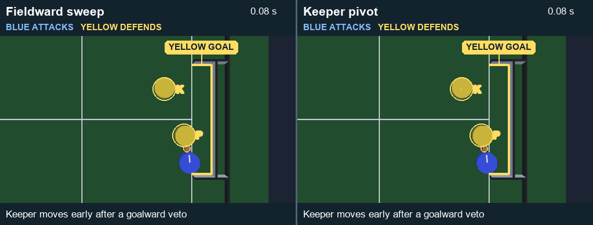

# Keeper pivot on the five shared goal-line starts

Blue attacks and Yellow defends in the replay. The yellow goal frame and label are overlays on native Webots footage. The earlier keeper breakout used the pivot controller's sweep translation with the keeper's current heading as its yaw target, so it could pull the ball sideways without a deliberate chassis turn.

The experimental pivot keeps the same presser outlet, post constraints, and collision steering. When both rollers reach the ball, the keeper turns up to 28° toward the field while moving its center to maintain roller contact. Yellow's goalkeeper reached **26.6–27.4°** of measured rotation across the five contests.



| Archived start | Fixed-heading sweep recovery | Keeper pivot recovery | Measured keeper turn |
| --- | ---: | ---: | ---: |
| 38725035 | 1.420 s | 1.420 s | 27.4° |
| 38725059 | 1.484 s | 1.372 s | 26.6° |
| 38725067 | 1.426 s | 1.392 s | 27.1° |
| 38725083 | 1.446 s | 1.386 s | 26.6° |
| 38725091 | 1.384 s | 1.368 s | 27.4° |

Both controllers conceded zero goals, made five clean keeper recoveries and recorded zero body contacts. Median clean recovery was **1.426 s** with the sweep and **1.386 s** with the pivot. The pivot was quicker on four starts. The repeat used the same archived poses and velocities across both versions. These five archived replays test the specific goal-line situation. The pivot is available in the test fixture, and the 48-start comparison of the fixed-heading sweep still describes the deployed optional keeper-lane controller.

[Results with measured turn angles](results.json) · [Matched native states, commands and outcomes](panels.json.gz) · [Goal-labelled sweep benchmark](../goal-lane/README.md)

## Reproduce

```sh
for seed in 38725035 38725059 38725067 38725083 38725091; do
  python scripts/run_five_roles.py "runs/keeper-pivot-$seed" \
    --tackle-panel keeper-pivot --keeper-stress --seed "$seed" --tackle-trials 1 \
    --frame-images --motion-audit --open-play-policy policies/open_motion_v1/actor.json \
    --tackle-policy policies/ball_side_tackle_v1/actor.json
done
python scripts/render_keeper_cover.py runs/keeper-pivot-38725035 pivot-replay.gif
```
