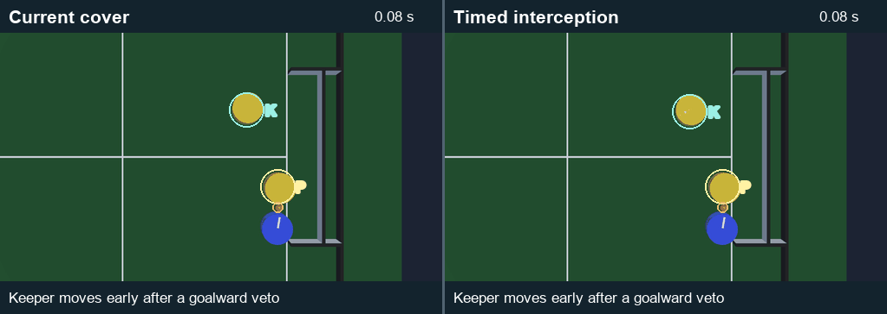
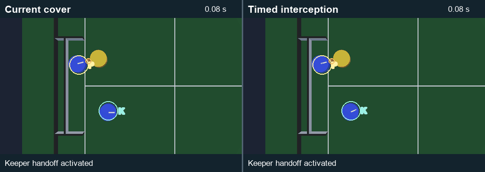

# Keeper arrival and presser handoff

The current cover sends the keeper toward the ball during a goalward veto and releases the presser once it contains. The timed version compares a deadline from the ball's observed motion with the keeper's lateral travel time. The presser keeps an available tackle while the keeper prepares. It yields early only when the keeper is predicted to reach the lane before the ball and the remaining margin is between one and three control ticks. When no tackle is available, the presser yields immediately.

The keeper approaches on the goal side of the presser's exit lane. The 0.32 m/s tackle-speed cap previously applied even when the keeper had plenty of room. The timed keeper can approach at up to 1.16 m/s, with a closing speed that still falls with the remaining stopping distance. It evaluates the yielding presser and the ball carrier on a 200 ms horizon and retains the existing clearance distances and goalpost limits. When its roller reaches a contested ball, it starts moving the ball upfield.

## Shared miss

Seed 38724515 uses the saved poses and velocities from the previous paired panel. Current cover hands off at 0.24 s and concedes at **1.026 s**. Timed cover hands off at 0.20 s, keeps the ball out and secures it with the keeper at 1.704 s. Body contact on the save excludes it from the clean-takeaway count.



## Fresh matched starts

Each pair starts from the same native Webots ball and robot poses and velocities. The presser, keeper, and opposing carrier are active, and seven robots are parked. The 32 varied starts use the earlier mirrored goalmouth protocol. The 16 additional starts put a turning opponent by the right goal line with stronger goalward drift. These starts were defined by opening geometry and carrier motion. A clean takeaway requires exclusive defending-team possession for the final 240 ms with no body contact or ball out. An own goal is a physical ball crossing through the defending goalmouth.

| Fresh panel | Current goals | Timed goals | Current clean takeaways | Timed clean takeaways | Current contact starts | Timed contact starts |
| --- | ---: | ---: | ---: | ---: | ---: | ---: |
| Varied, 32 | 0 | 0 | 6 | 6 | 6 | 8 |
| Near-line, 16 | 5 | 5 | 4 | 3 | 6 | 8 |
| **Combined, 48** | **5** | **5** | **10** | **9** | **12** | **16** |

Both policies conceded on the same five fresh starts. Timed cover stays opt-in. It saved the known replay but yielded one fewer clean takeaway and four more contact starts on the fresh panels. In the example below, the presser retains the ball after the early handoff, and the current cover finishes without clean possession.



An earlier version that scheduled a handoff before checking keeper reachability introduced one own goal on seed 38724819. Both controllers kept that replay out after the reachability check was added. The normal 44-second 5v5 smoke run recorded two coordinated cover ticks and zero body contacts.

[Summary and paired failures](results.json) · [Varied starts](panels.json.gz) · [Near-line starts](near-line-panels.json.gz) · [Replay traces](replays.json.gz) · [Normal match integration](integration.json)

## Reproduce

Run from the modern stack root with Webots and the project environment.

```sh
for offset in 0 8 16 24; do
  python scripts/run_five_roles.py "runs/timed-keeper-$offset" \
    --tackle-panel keeper-timing --keeper-stress --seed "$((38724900 + offset))" \
    --tackle-trials 8 --open-play-policy policies/open_motion_v1/actor.json \
    --tackle-policy policies/ball_side_tackle_v1/actor.json
done
python scripts/compare_keeper_cover.py runs/timed-keeper-*/tackle-panel.json

for index in $(seq 0 15); do
  seed="$((38725003 + 8 * index))"
  python scripts/run_five_roles.py "runs/timed-threat-$seed" \
    --tackle-panel keeper-timing --keeper-stress --seed "$seed" --tackle-trials 1 \
    --open-play-policy policies/open_motion_v1/actor.json \
    --tackle-policy policies/ball_side_tackle_v1/actor.json
done
python scripts/compare_keeper_cover.py runs/timed-threat-*/tackle-panel.json
```

Use seed `38724515`, `--tackle-trials 1`, and `--frame-images` with the same panel, stress flag, and policy paths to reproduce the shared miss GIF. Use `--tackle-selector --keeper-cover --keeper-timing` with both policy paths in ordinary play. Omitting the timing flag runs the previous keeper cover.
