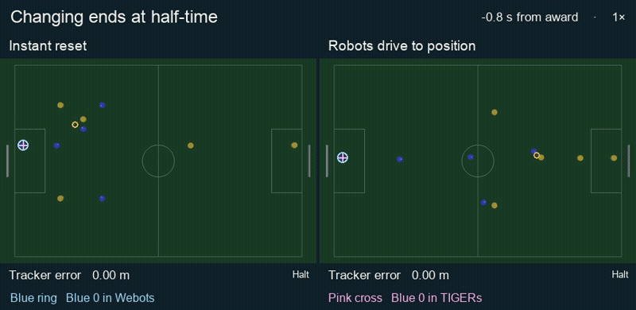

# Driving to the kickoff spot

At half-time Blue 0 has to reach the goal at the other end of the field. The blue ring follows the goalkeeper in the native Webots camera. The pink cross shows the position TIGERs returned for that same jersey and camera timestamp. Both panels start at the official second-half kickoff award in the first fresh pair. Once a panel reaches one second after its own kickoff, the film holds and labels that frame. [Changing ends](changing-ends.mp4) · [Uncut driven match](official-match.mp4)

[](changing-ends.mp4)

## Four paired openings under the official referee

| Across four fresh starts per procedure | Instant reset | Driven kickoff |
| --- | ---: | ---: |
| TIGERs crash reports | 5 | 0 |
| Officially accepted crashes | 3 | 0 |
| Accepted calls with named centers always over 30 cm apart in the preceding second | 3 | 0 |
| Of those, calls after the opening kickoff | 0 | 0 |
| Completed passes, including free kicks | 45 | 49 |
| Pass attempts | 54 | 62 |
| Official goals, both colors | 7 | 7 |
| Goals with a full-ball native sample inside the mouth | 6 | 7 |
| Native seconds in play | 233.8 | 233.72 |
| Kickoffs released | 15 | 15 |
| Median preparation after the first kickoff, simulation seconds | 0.6 | 28.4 |
| Longest preparation, simulation seconds | 0.6 | 41.8 |

| Opening | Reset score, Blue–Yellow | Driven score, Blue–Yellow | Completed passes, reset / drive | Accepted crashes, reset / drive |
| --- | ---: | ---: | ---: | ---: |
| 29300000 | 1–1 | 0–1 | 12 / 16 | 1 / 0 |
| 29300001 | 2–1 | 3–1 | 10 / 15 | 1 / 0 |
| 29300002 | 1–0 | 1–0 | 12 / 11 | 0 / 0 |
| 29300003 | 1–0 | 1–0 | 11 / 7 | 1 / 0 |

Both colors used the released observed-motion steering checkpoint throughout open play. The comparison changed only how the simulator initialized and prepared kickoffs. Each arm used two 30-second official halves, the same alternating kickoff colors, the same camera and referee configuration, and identical native first-action ball states, robot poses and velocities. Seeds were 29300000–29300003. Both games on the first seed had native camera recording. The other three pairs ran headless. The game clock paused during preparation. Scoring and pass totals include both teams. [Earlier official matches](../official-league/README.md) · [Frozen open-play policy](../../policies/open_motion_v1/README.md)

RoboCup introduced the SSL Game Controller in 2019 as the successor to the SSL Referee Box. This fixture runs the official Game Controller and feeds it live TIGERs AutoRef observations. [Original Referee Box](https://robocup-ssl.github.io/ssl-refbox/) · [League Game Controller](https://github.com/RoboCup-SSL/ssl-game-controller#ssl-game-controller)

The reset procedure relocates the ten robots to their seeded destinations in one physics step. The driven procedure initializes the first formation before the camera stream begins. Both arms share the first-action physics initialization. For every subsequent kickoff the simulator sends body-velocity commands to the same ten robot IDs. Robots take disjoint straight routes in groups. When a destination is blocked, a robot drives around its parked neighbors. A vacant staging spot allows two occupied destinations to swap. Translation is capped at 1 m/s and the roller and kicker are off. The simulator places the ball on the center mark once the players arrive. The table operator waits for the robots to settle at their assigned positions and headings before requesting NORMAL_START. The Game Controller supplies every award and the final score. [Kickoff controller](../../src/roboturk_core/roboturk/kickoff_drive.py) · [Table operator](../../scripts/autoref/league_table.mjs)

## What the tracker saw

In the first reset game, TIGERs reported a crash between Blue 1 and Yellow 2 at the opening kickoff. During the second before the crash report, their closest tracked separation was 0.136 m. Their closest native separation was 0.735 m. The Game Controller accepted the report. In the driven match on the same seed, both the raw and accepted crash counts were zero. Yellow won 1–0. [First goal](match-highlight.gif)

All three accepted reset calls followed the opening kickoff. The closest native separations in the preceding second were 0.74 m, 6.08 m and 4.80 m. TIGERs put all three pairs within 16 cm. On these starts, initializing the first formation before camera tracking began and driving to later restarts were tested together. The half-time film shows how the tracker responded at a later restart.

| First two seconds of each kickoff award | Instant reset | Driven kickoff |
| --- | ---: | ---: |
| Synchronized robot observations / expected | 7,498 / 7,500 | 7,500 / 7,500 |
| Robot observations with over 30 cm of error | 3,121 | 0 |
| Largest position error, m | 8.474 | 0.079 |

Counting every frame throughout preparation and the next two seconds of play, the driven games returned 89,270 of 89,270 requested robot samples. Of those, 0 had over 30 cm error. The largest error was 0.099 m. Every driven kickoff was released with all players within 4.0 mm of their assigned spots. The largest robot displacement across consecutive 40 ms frames anywhere in the driven games was 7.59 cm.

In the second reset game, the Game Controller credited a Blue shot close to the post. Interpolation between native samples puts the ball center at y = 0.461 m as it crossed the line. The 25 Hz record has no subsequent sample with the whole ball beyond the line and entirely within the goal mouth. The tables retain the official decision and give the stricter native count separately.

The diagnostic compares each returned TIGERs position to the same robot in Webots at the same camera timestamp, to within 1 ms. For each kickoff it includes every available robot sample in the first two native seconds after PREPARE. For each crash it separately compares the minimum native and tracked distance between the named pair over the preceding second. The 30 cm threshold identifies proximity in the sampled positions. Every raw report and official decision remains in the totals. Passing requires the ball to travel at least 0.55 m and the intended recipient to hold it exclusively for three consecutive samples before a whistle, another reception or the two-second deadline.

A separate short match used the previous open-play steering on a known collision opening, seed 28290000. The robots drove to kickoff positions, and TIGERs reported two crashes. The Game Controller accepted both. The named robots came within 22.0 cm and 21.5 cm respectively in Webots. This match is outside the four fresh pairs.

These are simulated Division B fixtures with ideal overhead detections, an ideal body-velocity drive, a spring dribbler and the previous experiment’s selected referee events. The kickoff controller is scripted. Open-play policy weights stayed frozen. [TIGERs AutoRef 1.7.1](https://github.com/TIGERs-Mannheim/AutoReferee/releases/tag/1.7.1) · [SSL Game Controller v3.23.1](https://github.com/RoboCup-SSL/ssl-game-controller/tree/v3.23.1)

## Reproduce

Use the existing Webots and official-referee environment. From the modern stack directory run the paired panel, its auditor and the film renderer. The runner accepts the same runtime-path arguments as the previous official fixture. [Environment setup](../official-league/README.md#reproduce-and-inspect)

```sh
python scripts/autoref/run_league.py runs/new-kickoff-pairs --compare-kickoffs
python scripts/autoref/audit_kickoff.py runs/new-kickoff-pairs runs/new-kickoff-pairs/results.json
python scripts/autoref/film_kickoff.py runs/new-kickoff-pairs/29300000 runs/new-kickoff-film
```

For one match, set `drive_kickoffs` and `track_kickoffs` to `true` in a `league_match` specification and run `scripts/autoref/run_placement.py SPEC OUTPUT`. The released archive contains every specification, the measured native and filtered trajectories, original AutoRef event packets, table actions, official state transitions and scoreboards. [Paired results](results.json) · [Development and positive-control matches](controls.json) · [Evidence archive](evidence.zip)

```sh
unzip media/kickoff-drive/evidence.zip -d runs/kickoff-archive
python scripts/autoref/audit_kickoff.py runs/kickoff-archive/fresh runs/kickoff-archive/results.json
python scripts/autoref/audit_kickoff.py runs/kickoff-archive runs/kickoff-archive/controls.json --controls
```
