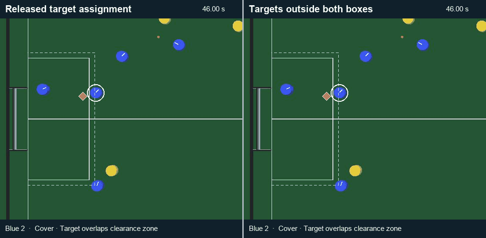

# Keeping 5v5 off-ball targets clear of both penalty areas

Blue 2 stalled from **47.52 s until the end of a 120 s game**. Its target was just outside the marked penalty-area line, but the robot’s 9 cm radius would have crossed it. The replay begins with identical native states and planner decisions. At **48.80 s** the right-hand run projects the target onto the legal edge. Blue 2 switches from braking to driving and settles into Cover **0.44 s later**.



The white ring follows Blue 2. The diamond is its assigned target. The dashed boundary shows the robot-center exclusion. The released target at (-3.467, -0.307) m moved to (-3.382, -0.307) m. [Full-field Webots replay](blue-2-full-field.gif)

## Two matched 120-second 5v5 games

The baseline uses the released buffered ERRT planner from `7c9e8b1` with the early-release experiment off. The correction is active from kickoff in both updated matches. Each pair shares the same native starting states, ball, kickoff team and clock. Both teams use the same settings within a game under the local referee.

| Measurement | Released | Projected targets |
|---|---:|---:|
| Timed target samples outside the buffered region | 3481 | 0 |
| Brake commands | 3143 | 1408 |
| Sustained stalls | 18 | 11 |
| Seconds stalled, summed across robots | 92.92 s | 42.72 s |
| Completed passes | 21/41 | 19/32 |
| Confirmed possession, either team | 68.00 s | 56.44 s |
| Goals | 5 | 2 |
| Robot contacts | 0 | 0 |
| Minimum robot-to-robot gap | 4.78 cm | 6.03 cm |

| Kickoff seed | Released score · completed passes · stalls | Projected targets score · completed passes · stalls |
|---|---:|---:|
| 38644000 | 0–1 · 5/10 · 7 | 0–0 · 3/6 · 0 |
| 38644001 | 2–2 · 16/31 · 11 | 2–0 · 16/26 · 11 |

The longest remaining stall was 20.16 s for Yellow 3 in Cover on seed 38644001. Its target was legal. Its center had stopped at x = −3.405 m, inside the planner’s interpolation margin, so the planner rejected routes from that starting pose. Stalls require at least 0.60 s below 0.08 m/s while more than 15 cm from the target with the same role and restart. The intended receiver must confirm possession within two seconds after at least 55 cm of ball travel for the pass audit. The contact threshold is a body-edge gap of 1 mm or less, sampled at 2 ms. [Per-match results](results.json) · [Raw match logs and replay data](trials.zip)

## Where targets are placed

Cover, the wings, and the other off-ball positioning roles project a target to the nearest legal front or side of either box before the role allocator compares travel costs. The goalkeeper and the active ball chase, carry, press, and reception roles use their own ball-handling targets. The protected region accounts for robot radius, the 8 mm interpolation allowance, and a 2 cm tracking margin.

The first version used 2 mm of tracking room. It removed the invalid targets, yet the changed play on seed 38644000 let Blue 2 coast to x = −3.404 m while braking. That position was inside the planner’s interpolation margin, and produced a separate 64.52 s Cover stall with a legal destination. The final version moves the projected center to x = −3.382 m at the front edge. Both versions and the release are in the trial archive.

## Reproduce

Run from the modern project root with Webots and the project Python environment. Use a fresh output directory for each run.

```sh
policy=policies/open_motion_v1/actor.json
python scripts/run_five_roles.py runs/cover-updated/38644000 --trajectory-planner --errt-fallback --commit-waypoints --open-play-policy "$policy" --seed 38644000 --seconds 120 --motion-audit
python scripts/run_five_roles.py runs/cover-baseline/38644000 --trajectory-planner --errt-fallback --commit-waypoints --open-play-policy "$policy" --seed 38644000 --seconds 120 --motion-audit --legal-off-ball-from-tick 3000
python scripts/compare_five_play.py runs/cover-baseline runs/cover-updated
```

Repeat with seed 38644001 for the second pair. For the GIF, use seed 38644000 in 60-second matches with `--frame-images --frame-window 46 58`. Set `--legal-off-ball-from-tick 1500` for the released arm and `1220` for the mid-match correction. Pass the directories to `scripts/render_cover_replay.py`. Add `--full-field` for the wider view.
