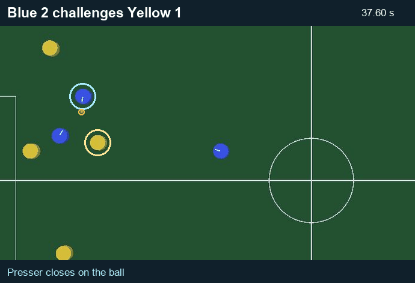
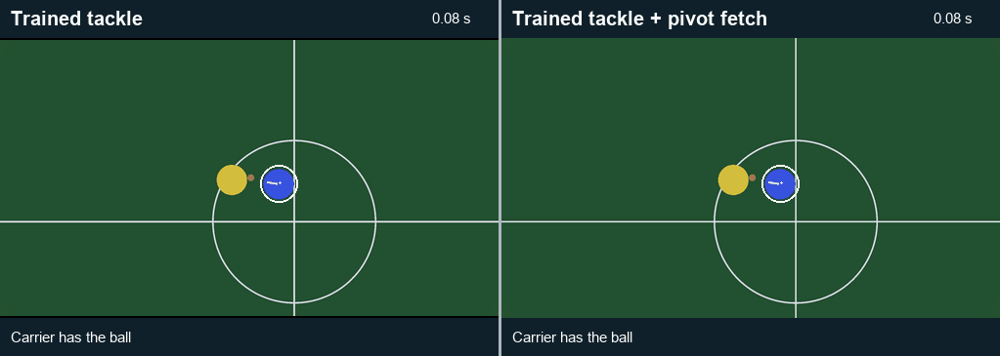

# Ball-side tackle in longer 5v5 Webots matches

Four fresh paired starts ran for 90 seconds per match with all ten players active. Both teams shared the configuration assigned to their match. The comparison enabled the existing frozen tackle in one set and kept the current Presser in the other. The steering checkpoint, trajectory planner, extended RRT fallback, waypoint commitment, role assignment, and opening positions were identical at kickoff.

| Six simulated minutes per configuration | Current Presser | Trained tackle |
| --- | ---: | ---: |
| Clean takeaways | 0 | 19 |
| Robot-to-robot body-contact episodes | 0 | 0 |
| Passive TIGERs AutoRef crash calls | 0 | 0 |
| Closest body clearance | 5.8 cm | 3.9 cm |
| Goals by either team | 0 | 4 |

The trained Presser recorded 6, 6, 7, and 0 clean takeaways on seeds 38722000–38722003, respectively. Each takeaway requires established opponent control, roller reach during the challenge, and at least 240 ms of subsequent exclusive control. Kicks, restarts, participant body contact, and coincident AutoRef crash calls exclude an event. Webots sampled roller geometry and inter-robot clearance every 2 ms. A body-contact episode begins when a pair crosses the 1 mm clearance threshold. TIGERs AutoRef 1.7.1 independently replayed the 25 Hz vision trace, restarting its tracker at each native reset. The local referee handled game progression. AutoRef calls are passive detector reports.

Blue 2 takes the ball from Yellow 1 and confirms possession at 40.30 s. The annotated playback uses native frames from a rerun that matched the position and physics-rate possession and contact traces through the clip.



## Pivot fetch

The optional scripted fallback waits for eight shared-roller control ticks at 25 Hz. It turns the chassis toward a 48° yaw offset and counter-translates the roller so it can sweep the ball sideways. It can try the opposite yaw direction once within the same challenge. Normal containment and clearance checks still apply. If the ball rolls free nearby, the same Presser or Chaser can pursue it for up to 280 ms after its last sweep command. The Webots chassis uses an idealized drive. The sweep acts through the simulated dribbler spring and uses neither a wheel strike nor a kick command.

In the close-up, the Blue Presser turns about 46° and moves the ball 4.8 cm sideways relative to Yellow before Yellow's roller releases. Blue maintains roller reach and confirms possession. This development replay shows the different paths both ways of taking the ball produce.



### Fresh close-range challenges

These paired starts used one controlled carrier and one active challenger, with eight parked players. The carrier was stationary, reversing, sliding, or turning. From 16 fresh matched starts, both variants won all 16 cleanly. Neither made body contact or drew a crash call. The pivot swept the ball beyond the carrier's lateral roller boundary while retaining its own roller reach on 12 starts. Median confirmed capture was 0.95 s for the direct tackle and 1.15 s with the pivot enabled. A separate 18-second 5v5 integration run recorded two sweeps, zero body contacts, and zero crash calls. The pivot remains opt-in because it added no wins on the matched starts and increased capture time.

[Per-match and per-takeaway results](match-results.json) · [Pivot measurements per start](pivot-results.json) · [Raw native traces and referee reports](evidence.zip)

## Reproduce

Run from the modern stack root with Webots and the environment described in the [project README](../../README.md). The referee scripts use the existing [pinned TIGERs installation](../autoref/README.md).

```sh
for seed in 38722000 38722001 38722002 38722003; do
  for arm in current trained; do
    set --
    if [ "$arm" = trained ]; then
      set -- --tackle-policy policies/ball_side_tackle_v1/actor.json
    fi
    out="runs/tackle-match/$arm/$seed"
    python scripts/run_five_roles.py "$out" --seed "$seed" --seconds 90 \
      --possession-audit --open-play-policy policies/open_motion_v1/actor.json \
      --trajectory-planner --errt-fallback --commit-waypoints "$@"
    PYTHONPATH=src/roboturk_core python scripts/autoref/judge_open_motion.py "$out"
  done
done
python scripts/compare_live_takeaways.py runs/tackle-match/current runs/tackle-match/trained
```

The close-range fixture uses `--tackle-trials 16 --tackle-duel --motion-audit --seed 38722600` along with the same two policy paths. Run with and without `--pivot-fetch`, adjudicate `tackle/trials.jsonl.gz` with `scripts/autoref/judge_tackle.py`, and compare them with `scripts/compare_tackle.py --duel`. The pivot flag can also be enabled in a regular 5v5 match with the tackle checkpoint.
