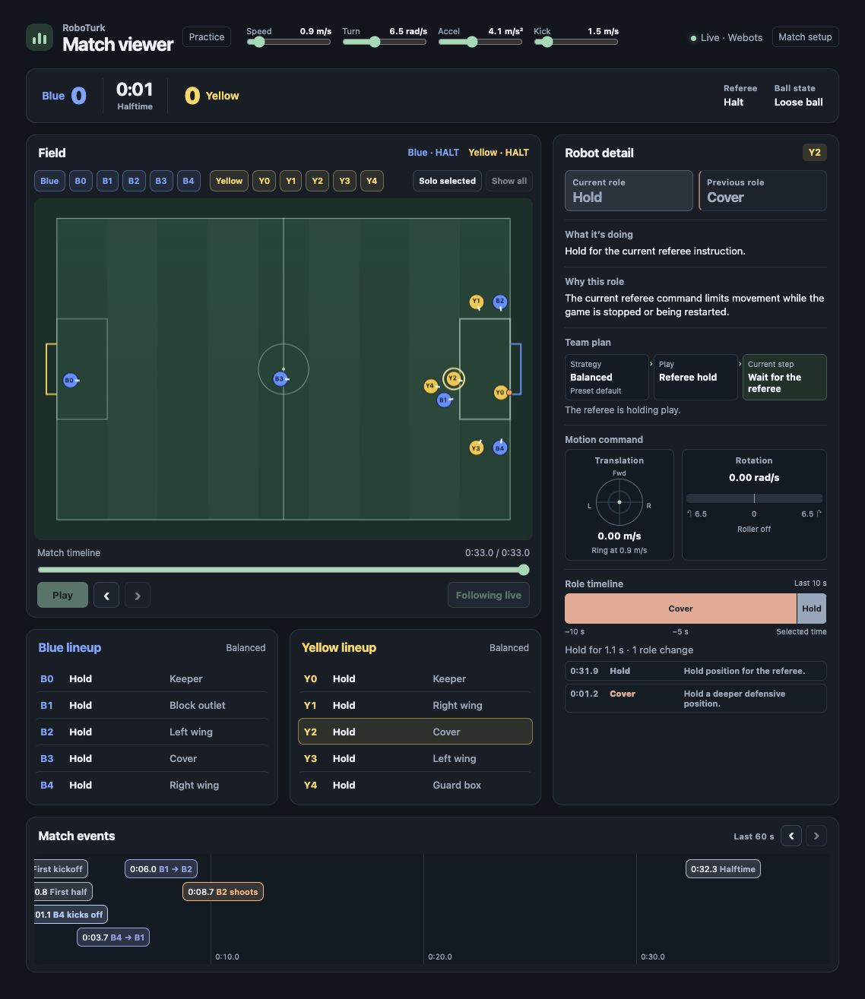

# RoboTurk Match Viewer



## Start a live match

Run this from the RoboTurk stack root in the project's Python environment. Use the Webots and AutoRef setup in the [project README](../../README.md#watch-the-official-referee-control-a-5v5-match).

```sh
python scripts/role_viewer.py --setup media/match-viewer/match-spec.json runs/viewer-sessions
```

Open [the local setup page](http://127.0.0.1:8765/). Use **Match timing** to choose one period or two halves and set the playing time per period before launch. Both modes use the SSL Game Controller and TIGERs AutoRef for 5v5 Webots play. The session saves a replay under its `run/viewer.html` path. Use `--port` to pick a different port and Ctrl-C to stop the service. Set `"realtime": true` in the preset to also show the native Webots window.

| Mode | Match setup |
| --- | --- |
| Practice | Choose each team's decision controller, playbook, and passing preference. The four top-bar sliders control all ten robots. |
| Game | Choose your team color. Both teams use the Balanced playbook and fixed limits. |

Set **Speed**, **Turn**, **Accel**, and **Kick** in the top bar before kickoff or while following a live Practice match. Slider changes take effect together for both teams on the next control tick that reads them. The motion gauges and replay use the limits recorded for the selected moment. Game and replay controls are read-only.

| Setting | Practice range | Game |
| --- | ---: | ---: |
| Planar top speed | 0.5–5 m/s | 3 m/s |
| Top rotation | 1–16 rad/s | ±8 rad/s |
| Acceleration and braking | 0.5–10 m/s² | 5 m/s² |
| Flat kick speed | 0.5–10 m/s | 6.5 m/s |

Practice starts with the Game limits. The open-play planner uses the selected speed and acceleration for travel and braking. Clear, lined-up shots request the selected kick speed. Passes keep their reception-tuned speeds, and restarts, close challenges, and ball control still use slower approaches. The SSL rulebook sets the 6.5 m/s ball-speed cap. The 5 m/s² drive setting comes from RoboTurk's motion model. [SSL ball-speed rule](https://robocup-ssl.github.io/ssl-rules/sslrules.html#_ball_speed) · [RoboTurk drive and kicker tests](../ssl-physics/README.md#drive-and-kicker)

Each lineup shows its team's strategy, play, and current step, plus every robot's role and task. Select a robot on the field or a lineup to inspect its assignment. The inspector stacks the current and previous roles beside a square gauge with the rotation bar above the translation vector. The gauge also shows measured speed when available. The **10-second role timeline** lists every assignment change in the window. Click a role change or an entry in the **60-second match-event timeline** to jump to that moment. **Go live** catches up. Team and player filters control which robots the viewer draws.

Click any number of robot IDs in the lineups to show their movement targets and kicks. Click **Blue** or **Yellow** above its lineup to switch the whole team's overlays on or off. Solid trails show flat kicks. Dotted, raised trails show chips. The trail clears when the kick ends or a new kick starts. The goal-mouth marker and crossing speed stay visible briefly after the trail clears. Use the match events to revisit a kick or goal. Goal-line markers record a physical crossing. The scoreboard uses the referee's decision. Older replays can still show assigned movement targets.

## Decision controllers

| Controller | Role assignment and ball decisions |
| --- | --- |
| Balanced allocator | Minimize total lineup travel with a role-switch penalty. Use the playbook's pass and shot triggers. |
| Local Priority | Fill roles in order with the lowest-cost eligible player. Use the same ball decisions as Balanced. |
| Coordinated | Keep the minimum-cost assignment. Search for two complementary outlets, rank passes using observed defender motion, and carry when the available passing lanes are blocked. |

The decision controllers use the same Webots world, skills, motion planner, and referee. Each side can use its own controller with the same playbook and passing settings. The lineup identifies the controller, and the selected robot's inspector can show why Coordinated chose to pass, carry, or shoot. Both new controllers are rule-based and reuse the existing learned pass-ranking features and weights where applicable. [Matched Webots replay](../decision-controllers/README.md)

The Python [`TeamController`](../../src/roboturk_core/roboturk/five_decision.py) interface accepts a world snapshot, eligible lineups, and the current active player. It returns a lineup, support targets, and a ball intent. The match owns the goalkeeper, carrier, and receiver reservations plus kick construction and movement constraints. In-process experiments can supply a separate controller instance for each color through `open_play(..., controllers=...)`. Register a named controller in `CONTROLLERS` and add its viewer label in `DECISION_CONTROLLERS` to expose it in Practice.

Run the decision benchmark with the same kickoff state and motion settings for each controller, testing each challenger as Blue and Yellow against Balanced. The runner verifies identical initial poses and velocities, and saves goals, pass results, and body-contact counts with the underlying native match traces. It uses Webots and the local referee for fixed-duration runs.

```sh
python scripts/benchmark_five_decisions.py runs/decision-benchmark --starts 4 --seconds 25
```

## Initial 5v5 playbooks

| Strategy | On-ball attack play | Effect |
| --- | --- | --- |
| Balanced | Build the attack | Uses the existing two wing outlets, anchor, pass triggers, and shot range. |
| Wide build-up | Work the wings | Moves outlets farther apart and makes the carrier pass earlier. |
| Direct attack | Drive to goal | Pushes outlets upfield, favors carrying longer, and considers open shots from farther away. |

**Passing preference** adjusts when an eligible receiver is used relative to the selected playbook. The shot-opening requirement, receiver eligibility checks, referee restrictions, and motion planner still apply.

During open play a carrier can chip to its chosen teammate when an opponent blocks the flat pass and the predicted arc clears the players in the lane. The controller picks the launch speed for a bounce short of the receiver. Webots applies the upward velocity and simulates gravity, contact, and bounce. The receiver moves to its outlet while the ball is airborne. This is a rule-based skill.

The 2026 SSL rules cap ball speed at 6.5 m/s in 3D and disallow a normal goal if the ball exceeded 0.15 m after the scoring team's last touch. The penalty-kick and shoot-out procedures have separate scoring conditions. A robot may not use its dribbler to lift the ball or chip the ball over the field boundary. [Ball speed](https://robocup-ssl.github.io/ssl-rules/sslrules.html#_ball_speed) · [Scoring goals](https://robocup-ssl.github.io/ssl-rules/sslrules.html#_scoring_goals) · [Boundary crossing](https://robocup-ssl.github.io/ssl-rules/sslrules.html#_boundary_crossing) · [Dribbling device](https://robocup-ssl.github.io/ssl-rules/sslrules.html#_dribbling_device)

The CMDragons system selects team plays using applicability conditions and fills the play's robot roles dynamically. Its Skills, Tactics and Plays paper calls the coordinated actions *steps* in a sequence of role tactics. RoboTurk uses possession and referee state to select a play, and shows the observed step such as lining up a pass or receiving it. The initial strategy presets are rule-based and use the existing skill controllers. Full synchronized tactic sequences are a future extension. [Original STP paper](https://www.cs.cmu.edu/~mmv/papers/05STP-IEEE.pdf) · [CMDragons 2016 team description](https://ssl.robocup.org/wp-content/uploads/2019/01/2016_ETDP_CMDragons.pdf)

## Play a recording

[Download the goal replay](https://raw.githubusercontent.com/kadiru/metu-ros-pkg/codex/roboturk-ros2/ros2/roboturk/media/match-viewer/index.html) or the [blocked-lane chip replay](https://raw.githubusercontent.com/kadiru/metu-ros-pkg/codex/roboturk-ros2/ros2/roboturk/media/match-viewer/chip.html) and open it in a browser. Both are native Webots recordings. The chip replay starts with B1's pass over Y1 and B4 securing it shortly afterward.

```sh
python scripts/role_viewer.py runs/viewer-sessions/SESSION/run runs/viewer-sessions/SESSION/run/viewer.html
```

Older recordings with `roles.json.gz` and `positions.npz` also export. For older asymmetric limits, the top bar shows Blue / Yellow values. Detailed assignment reasons and motion commands require a role audit. The team-plan visualization uses play data recorded by the current controller.
