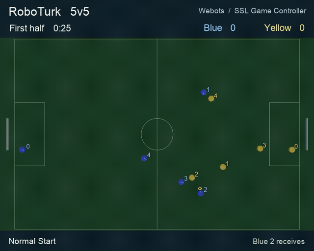

# Two halves with the official SSL Game Controller

Blue scores twice in the first evaluation match with learned steering. Watch the clock stop for the kickoff, the teams change ends at half-time, and the referee broadcast the 2–0 final score. The film shows the native Webots camera at simulation speed. [Uncut match](official-match.mp4) · [First goal](match-highlight.gif)

[](official-match.mp4)

## The paired matches

| Four fresh openings per policy | Previous steering | Learned steering |
| --- | ---: | ---: |
| Game Controller crash calls | 7 | 3 |
| TIGERs crash reports | 8 | 4 |
| Reports with the named players within 30 cm | 2 | 0 |
| Completed passes, including free kicks | 43 | 51 |
| Completed free kicks | 5 | 7 |
| Attempted passes, including free kicks | 62 | 64 |
| Official goals, both colors | 8 | 6 |
| Native seconds under running commands | 234.12 | 233.56 |

| Opening | Previous score, Blue–Yellow | Learned score, Blue–Yellow | Previous / learned passes | Previous / learned accepted crashes |
| --- | ---: | ---: | ---: | ---: |
| 28300000 | 2–1 | 2–0 | 17 / 17 | 2 / 1 |
| 28300001 | 1–2 | 1–1 | 12 / 10 | 2 / 0 |
| 28300002 | 0–1 | 0–1 | 6 / 14 | 1 / 0 |
| 28300003 | 1–0 | 0–1 | 8 / 10 | 2 / 2 |

Each team used the same choice of steering policy as its opponent. The four fresh seeds were 28300000–28300003. The teams alternated the first kickoff color across seeds and changed ends at half-time. The simulator set up a seeded formation for each awarded kickoff. The auditor checked the ball, all ten robot poses and their velocities for exact equality between policies at the first authorized action. The first pair ran with native image capture on both arms. The remaining pairs ran headless. The official clock runs in wall time and pauses for stoppages. Image capture slows the simulation, so the report also gives native playing seconds for each half.

The Game Controller used its group-phase Division B configuration with five players and two shortened 30-second halves. An automated table operator watched its clock, pressed Continue for restarts and changed ends at half-time. The table waited for the first negative second on its rounded display before ending each half. All sixteen halves crossed zero on the higher-precision referee broadcast. TIGERs AutoRef used ideal overhead camera measurements at 25 Hz. The active event configuration handled goals, balls out, placements, placement interference, aimless kicks and robot crashes. Other detector reports were retained for inspection. The previous 16-start comparison used a practice referee and a passive observer. [Earlier practice results and checkpoint](../../policies/open_motion_v1/README.md) · [League Game Controller](https://github.com/RoboCup-SSL/ssl-game-controller/tree/v3.23.1) · [TIGERs AutoRef](https://github.com/TIGERs-Mannheim/AutoReferee/releases/tag/1.7.1)

The pass count requires an actual kick, at least 0.55 m of travel and three consecutive 40 ms samples of exclusive control by the intended receiver within two seconds. A whistle or another player's reception ends the attempt. The total includes completed free kicks. Each credited goal has a native goal-mouth crossing, a TIGERs possible-goal report, automatic approval in the official event stream and a matching score increment on the robots' broadcast.

## Checking a crash call against the camera

The observer called a collision between Yellow 3 and Blue 0 after the first goal. The rings follow the two named robots. Their closest sampled separation in the second ending at the detector callback was 3.99 m. Webots moved the robots to their kickoff positions in one reset and kept sending frames to the same tracker. The replay runs at half simulation speed. [Watch the reported pair](kickoff-call.gif)

The first pair was repeated with the same seed, both policies frozen and a three-second minimum before each kickoff. The original minimum was 450 ms. Camera capture stayed on in both runs. This replay was selected after inspecting the first pair and is reported separately.

| First opening | Previous, 450 ms | Previous, 3 s | Learned, 450 ms | Learned, 3 s |
| --- | ---: | ---: | ---: | ---: |
| TIGERs crash reports | 2 | 4 | 1 | 4 |
| Accepted crashes | 2 | 2 | 1 | 1 |
| Calls with centers within 30 cm | 0 | 2 | 0 | 0 |
| Completed passes | 17 | 17 | 17 | 19 |
| Official goals | 3 | 3 | 2 | 2 |

The longer wait left the accepted totals at two and one. In the learned replay, the controller accepted a call against Blue 4 during preparation for a Blue kickoff. Blue 4 and Yellow 0 stayed at least 4.29 m apart in the preceding second. A fixed pause alone failed to resolve the discrepancy. The native opening states matched across all four recordings.

For each call, the diagnostic measures the smallest native center-to-center distance between the two named players in the second up to the callback, at 25 Hz. The 30 cm column describes proximity. Physical contact requires closer alignment than that. All raw and accepted calls count in their respective totals.

## Reproduce and inspect

The original event protobufs, Game Controller state transitions, table actions, fixture specifications, role traces and native trajectories for all ten games are in the archive. Each observer log in the archive contains the readiness marker and every original event packet. [Evidence archive](evidence.zip) · [Four paired openings](paired-results.json) · [Kickoff timing replay](settling-replay.json)

From the modern stack directory, install the core Python package, configure Webots and compile the TIGERs observer as described in the existing official-referee setup. Node with WebSocket support runs the match table. FFmpeg and Pillow render the film. The match runner accepts paths to Webots, Java, the Game Controller, the TIGERs distribution and its compiled observer. [Referee setup](../autoref/README.md#run-the-experiment)

```sh
python scripts/autoref/run_league.py runs/new-official-pairs \
  --webots "$WEBOTS" --game-controller "$GC" --distribution "$TIGERS_DIST" \
  --classes "$OBSERVER_CLASSES" --java "$JAVA"
python scripts/autoref/audit_league.py runs/new-official-pairs runs/new-official-pairs/result.json
python scripts/autoref/film_league.py runs/new-official-pairs/28300000/steering runs/new-official-film
```

To verify the published data independently, unpack the archive in a new directory and run the same auditor.

```sh
unzip media/official-league/evidence.zip -d runs/official-evidence
python scripts/autoref/audit_league.py runs/official-evidence/paired runs/official-evidence/result.json
python scripts/autoref/audit_league.py runs/official-evidence/settled runs/official-evidence/replay.json --seeds 28300000
```
