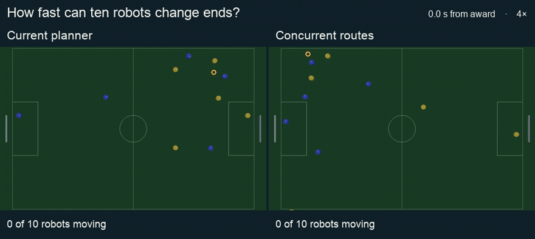

# How fast can ten robots change ends?

At half-time on the filmed opening, the referee released the current team after 46.56 seconds and the concurrent team after 12.48 seconds. The camera views start at their respective official kickoff awards and play at four times native speed. Short trails show translating robots. The faster panel holds its final frame once the referee releases the formation. [Side-by-side MP4](kickoff-race.mp4) · [Uncut concurrent match](official-match.mp4)

[](kickoff-race.mp4)

## Four fresh paired matches

The “current” column is the driven kickoff planner released in commit 5d8a02f. Every match used two 30-second official halves in Webots. Each pair had identical robot poses and velocities and ball state at the first authorized action. The teams kept their learned open-play steering, jersey assignments, kickoff target generator, 1 m/s travel limit and readiness checks. The table waited for the robots to settle and the ball to be centered. The official SSL Game Controller v3.23.1 and TIGERs AutoRef 1.7.1 stayed active throughout. Seeds 30300000–30300003 alternated the first kickoff color and run order.

| Total across four matches per planner | Current | Concurrent |
| --- | ---: | ---: |
| Released kickoffs / awards | 12 / 12 | 14 / 14 |
| Restarts requiring travel | 8 | 10 |
| Median setup after the opening, seconds | 31.42 | 7.42 |
| Median half-time setup, seconds | 38.96 | 13.14 |
| Longest setup, seconds | 46.56 | 16.88 |
| Robots moving during setup, time-weighted mean | 1.14 | 3.90 |
| Most robots moving at once | 6 | 9 |
| Closest two sampled robot centers in setup, metres | 0.286 | 0.284 |
| TIGERs crash reports during setup / whole match | 0 / 0 | 0 / 0 |
| Accepted crash calls during setup / whole match | 0 / 0 | 0 / 0 |
| Completed passes / attempts | 69 / 86 | 67 / 84 |
| Official goals, both colors | 6 | 6 |

Setup runs from the first received PREPARE_KICKOFF to NORMAL_START, in simulator seconds. The initial kickoff starts in formation and is excluded from travel times and movement counts. The table counts a robot as moving when its measured translational speed exceeds 0.2 m/s over a 40 ms step. Later goals can create different restart opportunities even on the same match opening. All eight live matches contribute to the crash counts. They cover ideal overhead vision and the selected official event types enabled in this fixture. [Per-match results and crash calls](results.json) · [Referee configuration and baseline](../kickoff-drive/README.md)

The filmed concurrent match paused in the first half on a goal-line ball placement. Blue’s official placement timer was already 111 seconds overdue when the table submitted BALL_PLACEMENT_FAIL. Yellow then completed the placement. Later matches use the same failure action once the official placement timer is more than two seconds overdue. The uncut film retains the delay. That dead-ball interval is outside kickoff setup time. Per-match records include every official placement failure.

## The same restart positions in both planners

We took every non-opening kickoff from the current team's four fresh matches and replayed it twice in native Webots. Each pair restored the same planar robot poses, linear and angular velocities, ball state and jersey targets. The replay clock ends when all ten robots first satisfy the existing robot position, heading and velocity tolerances. The live table's ball-placement and release delay is measured only in the live matches.

The concurrent planner finished sooner on 8 of 8 paired restarts. The median fell from 31.28 s to 9.88 s. The measured initial states were identical in every pair. The replayed robot and ball positions also matched the source match samples exactly.

| Seed | Restart | Occasion | Current, s | Concurrent, s |
| ---: | ---: | --- | ---: | ---: |
| 30300000 | 2 | half-time | 46.44 | 18.84 |
| 30300000 | 3 | after goal | 19.24 | 7.24 |
| 30300001 | 2 | after goal | 24.92 | 7.0 |
| 30300001 | 3 | half-time | 38.76 | 12.72 |
| 30300001 | 4 | after goal | 26.4 | 6.44 |
| 30300002 | 2 | half-time | 38.96 | 12.36 |
| 30300003 | 2 | after goal | 21.72 | 7.4 |
| 30300003 | 3 | half-time | 36.16 | 13.68 |

The 25 Hz native traces and the per-start measurements are included in the archive. No referee was attached to these timing-only replays.

## How routes overlap

The current planner reserves an entire path until its group finishes. The concurrent planner forecasts each moving robot's position at each control tick, including waypoint stops and the time it will remain at its destination. It checks the closest approach along the relative motion between ticks. This lets two robots cross the same patch of grass at different times. The planner considers waiting robots again every 0.32 s, gives longer trips priority, and can stage a robot beside an occupied destination. Both teams share the kickoff planner in this simulation. Open-play decisions still use the existing team policies. [Planner and speed limits](../../src/roboturk_core/roboturk/kickoff_drive.py)

## Reproduce

The five-role Webots runner selects concurrent routes with `--drive-kickoffs`. Add `--no-parallel-kickoffs` to select the previous planner. For a serialized official match specification, set both `drive_kickoffs` and `parallel_kickoffs` to true. Older saved specifications continue to select the original planner.

Use the existing native Webots and referee environment. Run from the modern stack directory with the core package installed. [Environment setup](../official-league/README.md#reproduce-and-inspect)

```sh
python scripts/autoref/run_league.py runs/parallel-trials --compare-parallel
python scripts/autoref/audit_parallel.py runs/parallel-trials runs/live.json --write-replay-cases runs/restarts.json
python scripts/run_five_roles.py runs/replays --replay-kickoffs runs/restarts.json
python scripts/autoref/audit_parallel.py runs/parallel-trials runs/parallel-results.json --replays runs/replays
python scripts/autoref/film_parallel.py runs/parallel-trials/30300000 runs/parallel-film
```

The archive includes the eight live specifications, referee decisions, tracker and native trajectories, replay inputs, and the two native traces for every matched restart. To reproduce the published numbers directly, extract it and run the auditor. [Download the evidence](evidence.zip) · [Native match highlight](match-highlight.gif)

```sh
unzip media/parallel-kickoff/evidence.zip -d runs/parallel-evidence
python scripts/autoref/audit_parallel.py runs/parallel-evidence/fresh runs/verified.json --replays runs/parallel-evidence/replays
```
