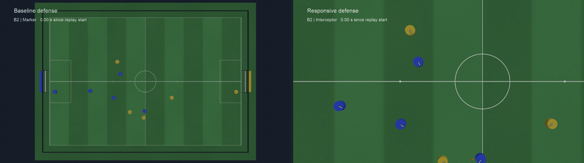

# Reactive pass interception

A detected ground pass can change the defending team's play from **Press and cover** to **Intercept the pass**. The controller projects the observed ball motion with carpet resistance and checks when each field player can arrive and face the ball. It chooses one reachable interception pose outside the penalty areas and checks the approach against observed robot motion. The goalkeeper keeps its role, and the role allocator fills the remaining defensive assignments. Existing steering keeps applying clearance each tick. A change in the ball's motion can cancel the response. Confirmed possession feeds back into the usual attacking play.

## The 45-second-halves replay

The original game recorded 23 open-play ground passes. The defending playbook showed **Cover the pass** on all 23 while continuing its ordinary role assignments. A causal analysis of the recorded positions and velocities identified a reachable interception on 10 passes. It used neither the receiver's intended target nor future samples to decide whether to react.

For the native comparison, each arm started from the same reconstructed state just after each of the 23 releases. Robot and ball positions and velocities came from the recording, with an estimate of the ball's spin. These are local Webots replays from matched starts. Each trial ends at first confirmed possession or the replay horizon. Robot contacts use the 2 ms center-separation check.

| Measure | Previous controller | With pass response |
| --- | ---: | ---: |
| Opposing passes secured by a defender | 5 / 23 | 9 / 23 |
| Passes that triggered the response | 0 / 23 | 11 / 23 |
| Trials with robot body contact | 0 / 23 | 0 / 23 |

At 0:15.08 in the original match, Y4 passed toward Y1 while B2 was assigned Marker. In the paired clip, Y1 receives with the previous controller. B2 secures the ball first when the new response is enabled. The modified controller uses a fixed reachability calculation and the existing reception controller. Use `--no-pass-intercepts` with the five-player Webots CLI to run the previous policy for comparisons.

A full two-half game from the same seed reached official full time at 0–0 with 20 intervals of `Interceptor` assignment and zero robot contact episodes in the match audit. The first response was B2 at 0:04.0 in the viewer. The full match verifies the play and role transitions alongside kickoff and restart handling. The matched pass replays above measure recoveries from the same starts.
