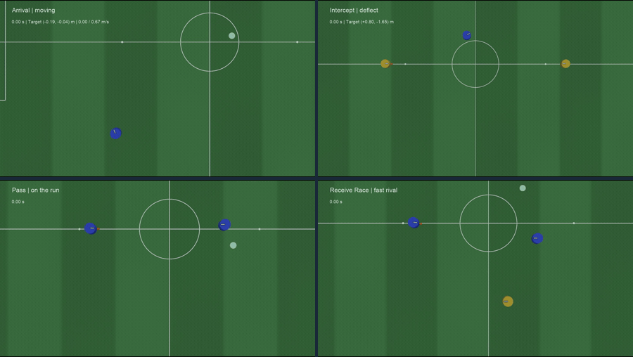
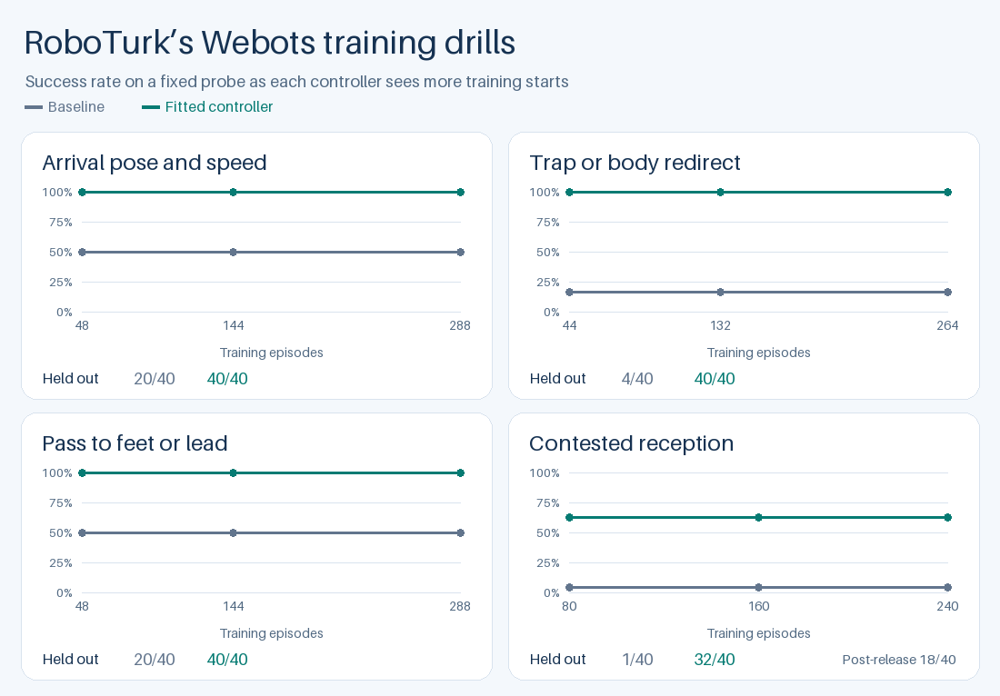

# Primitive skills in native Webots

Four drills isolate the handoffs used in a pass and reception. All use observed world pose and velocity, the existing Division B carpet, acceleration-limited body commands, native contacts, and applied kick feedback. The fixed world uses a 40 ms controller tick and 2 ms physics samples.



[Eight full-size replays](webots-drills.mp4) · [Replay seeds and event timings](replays.json)

## Held-out results

| Skill | Baseline | Fitted | Breakdown |
| --- | ---: | ---: | --- |
| Arrival | 20/40 | **40/40** | 20 stops and 20 arrivals at commanded speed |
| Intercept | 4/40 | **40/40** | 20 trap-and-carries and 20 circular-body redirects |
| Pass | 20/40 | **40/40** | 20 passes to feet and 20 lead passes |
| Contested reception | 1/40 waiting, 18/40 moving after release | **32/40** | 16/20 against each rival speed range |

The arrival baseline brakes to a stop. The interception baseline reacts to the ball's current position. The passing baseline aims at the receiver's current position. In the race all three receivers use the same passer and same opponent on each start. Against the fast rival, coordinating before release increased stable receptions from 6 to 16 out of 20. Across both rival groups the number of starts with body contact fell from 35 to 24 compared with the post-release receiver. Both receivers succeeded on 17 of the same starts, and pre-release coordination took a median 0.148 s less from launch to control on those pairs.

The relay audit applied four alternating kicks between Y2 and Y3 over 9.28 seconds with one reset at the start. The arrival run-up reached the target velocity window on 12 of 12 off-axis starts. The direct approach reached it on zero of those 12. On fitted lead passes, B2 traveled a median 0.73 m from release to stable possession along the intended running direction.



The first three drills reached 24/24 on the fixed probe at their first checkpoint and stayed there. The final race fit scored 15/24 at each checkpoint. The earlier post-release model scored 14/24 on its own fixed probe and 22/40 on its separate held-out panel. The last row above gives the fresh same-start comparison. [Fitted parameters](fitted-profiles.json) · [Every held-out result](results.json) · [Earlier reception fit](post-release-receiver.json)

## Tasks and measurements

| Drill | Inputs and episode setup | Success |
| --- | --- | --- |
| Arrival | One robot, randomized start and yaw. Supply a field target, terminal yaw, and field-frame velocity. Moving cases approach from upstream with lateral error. | Within 9 cm, 0.12 rad and 0.24 m/s of the requested state. Hold the tolerance for 0.12 s for a stop. A moving arrival is a single valid crossing. |
| Intercept | Two stationary servers can kick the ball back and forth. A learner starts off the serve line and either aims its roller to trap the ball or chooses a circular-body contact normal toward a marked outlet. | Trap and carry at least 0.22 m after securing the ball. For a redirect, measure an actual collision, then measure the ball's direction after 0.28 m of displacement. Allow 28° error toward the outlet. Both ball actuators are off for redirects. |
| Pass | A passer starts with the ball at the roller. The partner starts stationary or moving laterally. The passer selects power and lead from the observed partner state. | The teammate settles the ball within 0.46 m of the planned receiving point. A lead pass also requires the receiver to travel at least 0.42 m in the original running direction after release. |
| Contested reception | The moving-pass pair uses the fitted lead-pass profile. An opponent at one of two randomized speed ranges tries to intercept the same release. Compare waiting at the rendezvous with meeting the ball on its path. | The receiver settles the ball before the rival. Count opponent first touches and robot body contacts separately. |

Settled ball control requires 0.20 seconds of exclusive possession with ball–robot relative speed of at most 0.35 m/s, sampled at 2 ms. A kick counts from Webots' applied event. Trap and redirect outcomes are isolated from goals. The contested rival runs a fixed feedback controller with sampled speed caps of 0.64–0.92 m/s or 1.20–1.55 m/s. The trained receiver uses one shared profile across both groups. Mouth proximity and robot center separation provide the first-touch and body-contact diagnostics.

## Call a skill

`Arrival.at_speed((x, y), yaw, speed, travel_heading=...)` separates facing direction from the field direction of travel. `ArrivalRoute.from_pose(robot, goal)` can insert a run-up for an off-axis start. `route.command(robot)` returns robot-frame forward, left and yaw velocities. A future chip play can use the predicted meet point and contact-speed requirement to build this same goal.

`intercept(world, robot, profile)` returns drive and dribbler commands from a rolling-ball observation. `deflection_station(world, robot, outlet, ...)` returns a pose for a body rebound. `pass_plan(ball, teammate, profile)` returns a receiving point and launch speed. `pass_command(world, passer, point, speed)` turns on the roller, aligns at the ball and requests the release. The race uses the applied kick event to hand execution to the receiver's interception policy. These APIs are available to higher layers through the core package. The drills call them directly through Webots.

## Fit and data

The policies are context-conditioned feedback controllers. A small candidate grid varies position gain and speed, contact prediction and braking, lead and pass power, or receiver urgency. Fit by selecting the profile with the highest mean native episode return per context. The return search fits controller parameters directly. It uses no neural network, demonstration labels, gradients or GPU.

- Every episode starts with a seeded reset. Each candidate sees the same starts and the runner checks the observed reset states. Run order alternates across starts.
- Each return begins with `2 × success − 0.08 × elapsed seconds`. Arrival subtracts capped position, yaw and velocity error with weights 0.2, 0.1 and 0.3. Redirect subtracts 0.25 times angular error capped at 2 rad. Other drills add 0.15 for touching the ball, subtract 0.45 when the opponent secures it, and subtract 0.25 for robot contact. A ball out costs 0.25.
- The growth curve uses cumulative prefixes of the same training seeds. Each checkpoint is scored on the same disjoint 24-start probe. Held-out qualification uses another 40 starts for both the baseline and frozen fit. Each task in the results records its seed ranges.
- Each compressed training log contains the scenario, requested and observed initial state, candidate parameters, field pose/velocity/height and commands at 40 ms, applied kicks, outcome and scalar return. Each qualification case records its terminal state. Compressed trajectories stay in `runs/` and are regenerated by the command below.
- The five reported fitting panels total 1,464 episodes and 85,847 control frames. The example archive includes one successful fitting trajectory per scenario context from each panel. [Dataset counts and hashes](datasets.json) · [Example trajectories](training-examples.jsonl.gz)
- The fitted pass is reused in the reception race. The receiver uses the same interception primitive with its own fitted parameters. The coordination experiment lets the receiver move along the agreed lane while the passer aligns. The passer locks its aim and power before the receiver changes its approach. This tests transfer between the drills with a fixed opponent. Self-play and an airborne chest connection are subsequent experiments.

## Reproduce

Run from the RoboTurk ROS 2 project using its Python environment.

```sh
python scripts/run_webots.py --webots /path/to/webots --mode primitive-dojo --dojo-task arrival \
  --dojo-stages 8,24,48 --seed 12600 --episodes 40 --timeout 3600 \
  --output runs/primitive-dojo/arrival.json
python scripts/run_webots.py --webots /path/to/webots --mode primitive-dojo \
  --dojo-task intercept --dojo-stages 8,24,48 --seed 22600 --episodes 40 \
  --timeout 2400 --output runs/primitive-dojo/relay-v2.json
python scripts/run_webots.py --webots /path/to/webots --mode primitive-dojo \
  --dojo-task pass --dojo-stages 8,24,48 --seed 12600 --episodes 40 \
  --timeout 2400 --output runs/primitive-dojo/pass-panel.json
python scripts/run_webots.py --webots /path/to/webots --mode primitive-dojo \
  --dojo-task receive_race --dojo-stages 8,16,24 --seed 42600 --episodes 40 \
  --checkpoint runs/primitive-dojo/pass-panel.json --timeout 2400 \
  --output runs/primitive-dojo/premeet-race-v3.json
python scripts/run_webots.py --webots /path/to/webots --mode primitive-dojo-demo \
  --checkpoint media/primitive-dojo/results.json --timeout 600 \
  --output runs/primitive-dojo/demo/replays.json
python scripts/run_webots.py --webots /path/to/webots --mode primitive-dojo-transfer \
  --checkpoint media/primitive-dojo/results.json --seed 17600 --episodes 12 \
  --timeout 600 --output runs/primitive-dojo/transfer.json
```

Use `--dojo-task arrival`, `intercept`, `pass` or `receive_race` to focus on one drill. Pass the completed pass report with `--checkpoint` to reuse that passer in a standalone race fit. The full sequence reuses it automatically.

## Flat-chest transfer prototype

The optional chassis uses the historical wheel placements at 60°, 135°, −135° and −60°, 25 mm wheel radii and an 85 mm wheel-center offset. Its 90 mm front roller sits on a clipped chassis. An ideal inverse kinematic envelope caps shaft speed at an assumed 90 rad/s and preserves the ratio of the three body velocity components. The golf-ball mass and radius, carpet friction, and modelled release commands remain part of the test fixture. A simulated beam reads the ball at the roller. A 3.2 m/s chip at 36° reached a 0.200 m ball-center height. The same-speed ground kick stayed near 0.0215 m. The beam cleared after both releases. Wheel torque, individual motor dynamics, roller compliance, beam latency and hardware striker behavior require calibration and further simulation. [Historical wheel geometry and equations](https://github.com/kadiru/metu-ros-pkg/tree/master/stacks/robocup_ssl/ssl_player) · [Webots collision geometry reference](https://www.cyberbotics.com/doc/reference/indexedfaceset)

Both bodies passed 12/12 arrival, 12/12 interception and 12/12 passing on independent matched starts with the frozen controllers. The original body passed 10/12 contested receptions and the flat chest passed 9/12. Webots applied its usual cap of ten floor contact joints on the mesh during transfer. [Transfer results and actuator traces](chassis-transfer.json)
