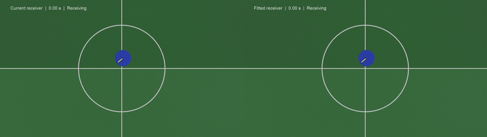

# Ground reception dojo

One robot receives a rolling ball at midfield in native Webots. The drill varies serve speed from 1.4 to 4.4 m/s, incoming direction, lateral offset, and initial heading. A clean catch requires 250 ms continuously in the roller's capture region while the ball moves within 0.35 m/s of the robot. A first-touch loss records the ball moving out beyond 0.175 m from the center after contact and before a stable catch. The trial has a three-second limit.

The drill fits timing and speed parameters for the existing receiver on 15 development serves. It then compares the selected profile with the current 5v5 profile on 40 fresh serves, verifying identical initial states for each pair. The setup uses Webots ground-truth state, carpet physics, and the same acceleration-limited drive and spring-damper dribbler as 5v5. Each episode starts with a straight ground serve and no defenders. The live match still uses its current receiver.

| Held-out serves | Current receiver | Selected profile |
| --- | ---: | ---: |
| Clean catches below 3 m/s | 26/26 | 26/26 |
| Clean catches at 3–4.4 m/s | 2/14 | 2/14 |
| First-touch losses | 12 | 12 |
| Median first touch to secure hold, successful catches only | 0.328 s | 0.250 s |

Trial selection favored a gain change over starting the cushion earlier at a higher speed. Every earlier and faster variant reduced clean catches on the development serves. On the held-out panel, the gain change recovered one fast serve and lost another. [All matched results](comparison.json)



The film shows the recovered 3.68 m/s serve. The trial tracks the original first touch even if the robot gets another chance to collect the ball later in the clip. [Verified filmed starts and outcomes](filmed-trial.json)

Run the drill from the modern stack directory using the project Python environment. Add `--webots /path/to/webots` to either command if needed.

```sh
python scripts/run_webots.py --mode receive-dojo --seed 40300000 --episodes 40 \
  --output runs/receive-dojo/comparison.json
python scripts/run_webots.py --mode receive-dojo-demo \
  --checkpoint runs/receive-dojo/comparison.json --output runs/receive-dojo/demo/verified.json
```

The demo records native Webots frames for both receivers on the same serve and checks their outcomes against the comparison. The first clean catch recovered by the fitted profile is selected when present.
