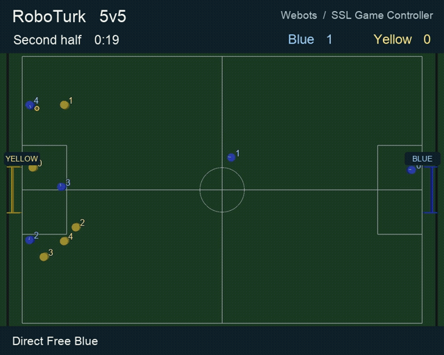

# Automatic restarts with painted goals

Blue won 2–0 in the 5v5 Webots match. Both goals were detected by live TIGERs AutoRef and approved by the official SSL Game Controller. After each goal both teams drove into formation, the virtual referee placed the stationary ball on the center mark, and Yellow kicked off after the official start. The goal walls are painted blue and yellow in the Webots world and switch colors with the defending teams at halftime. Team paint is a simulator spectator aid. The rulebook specifies white inner faces and black exterior surfaces for competition goals. [Uncut match](official-match.mp4) · [SSL rulebook, sections 2.1.4, 4.1, 5 and 6](https://robocup-ssl.github.io/ssl-rules/sslrules.html)

[](official-match.mp4)

| Award | Ball placement | Restart |
| --- | --- | --- |
| Goal | Stationary on the center mark | One robot from the conceding team kicks after `NORMAL_START`. The other robots start in their own halves outside the center circle. |
| Touchline exit | 0.20 m inside the touchline at the crossing, at least 0.20 m from the goal line | The team that did not touch it last takes a free kick. |
| Corner | 0.20 m inside the nearest touchline and goal line | The attacking team takes a free kick after a defending touch. |
| Goal kick | 0.20 m from the nearest touchline and 1.00 m inside the goal line | The defending team takes a free kick after an attacking touch. The Division B aimless-kick rule can override the award. |

TIGERs observes SSL-Vision and reports what happened. The Game Controller assigns the team and target. The automated table advances the official commands. The Webots referee stands in for the person placing the ball. For a free kick, it reads the designated position from the referee broadcast and waits until the placement spot is clear. TIGERs confirms the settled placement before the Game Controller releases the kick. At kickoff one robot serves and waits for a second robot to touch the ball before joining play again. [SSL restart rules](https://robocup-ssl.github.io/ssl-rules/sslrules.html) · [IFAB kickoff for field soccer](https://theifab.com/laws/latest/the-start-and-restart-of-play/)

The match audit measured both post-goal kickoffs at `(0, 0)` and the touchline placement at `(-4.30, -2.80)` m. It recorded zero body contacts and zero crash reports. A separate controlled match supplied two goal-line decisions through the official table interface. Yellow took a corner from `(-4.30, 2.80)` m. In the goal-kick case a natural ball-out report updated the requested spot before play resumed. Blue restarted from the updated spot at `(3.50, 2.80)` m. TIGERs confirmed both completed placements. [Match audit](results.json) · [Goal-line verification](goal-line-results.json) · [Raw evidence](evidence.zip)

## Reproduce

Use the [official referee setup](../autoref/README.md#run-the-experiment). From the modern stack directory run the match, audit the restart traces, and render the replay.

```sh
python scripts/autoref/run_placement.py media/referee-restarts/match-spec.json runs/new-referee-match
python scripts/autoref/audit_restarts.py runs/new-referee-match runs/new-referee-match/results.json
python scripts/autoref/film_league.py runs/new-referee-match runs/new-referee-film
```
