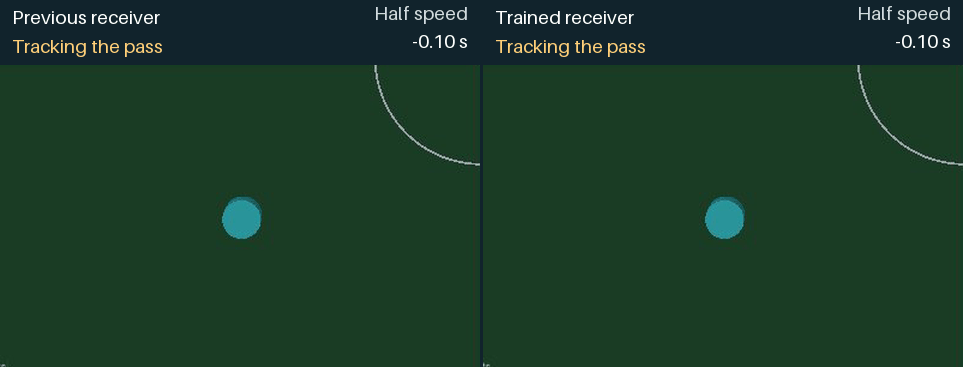
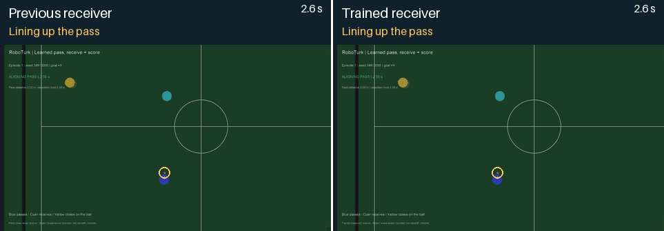

# Securing a pass under pressure

The yellow defender left the previous receiver little time to settle the ball. In the preceding study, 14 of 38 first touches ended before stable possession. Ten ended in interceptions and four at the robot-proximity threshold. The median defender distance at first touch was 0.45 m on those 14 openings and 1.03 m on secured passes. The median time from touch to loss was 0.33 s. The task requires 0.40 s of continuous control. [Previous Webots study](../closing-press/README.md)

The new receiver moves toward the oncoming pass after release, lines up with the passer’s release axis and yields to the ball’s velocity as it enters the roller. The handoff requires 20 consecutive 20 ms control ticks with the ball inside the mouth at every 2 ms physics sample and relative speed below 0.2 m/s at each tick boundary. Afterward the published escape carry and neural scorer take over. Selection used 12 separate training starts. [Policy and training returns](../../policies/secure_receive_v1/README.md)

## Forty fresh paired starts

| Receiver | First touches | Stable receptions | Touched then lost before securing | Goals |
| --- | ---: | ---: | ---: | ---: |
| Previous | 38 | 24 | 14 | 17 |
| Trained | 40 | 35 | 5 | 32 |

The trained receiver secured 13 passes the previous receiver missed and missed 2 that the previous receiver secured. It gained 17 goals and lost 2 on the matched openings. Across the 38 openings where both receivers touched the pass, the median paired change in flight time to first touch was -0.72 s and the median change in marker distance at that instant was +0.47 m (trained minus previous). The two arms shared the same initial ball and robot state, robot roles, defender speed, 1.8 m/s pass, carry and 3.5 m/s shot. The comparison includes every seed from 34912000 through 34912039, including any failures before first touch. This is 2v1 on an open goal using ideal simulator state and a scripted closing defender. Robot-proximity endpoints come from the skill monitor. [Paired outcomes and loss seeds](fresh.json) · [Native episode records](trials.zip)

On a separate replay of the 40 previously diagnosed openings, the trained receiver secured 14 of the original 14 first-touch losses and converted 9 of those losses into goals. This replay is separate from the fresh comparison. [Historical replay](historical.json)

## A first-touch loss replayed

On opening 34912003, the previous receiver lost the ball to Yellow at 4.00 s and the trained receiver scored at 8.08 s. This was the first qualifying seed in ascending order where the previous receiver touched the ball without securing it and the trained team scored. Each film starts from the saved opening in a clean simulator. The close-up tracks Cyan and synchronizes the two films at release. Its clock shows simulated seconds since the pass.



[Full-speed paired GIF](replay.gif) · [Previous receiver film](replay-baseline.mp4) · [Trained receiver film](replay-trained.mp4)

## Independent demo

On opening 34913000, the previous receiver scored at 8.48 s and the trained receiver scored at 8.44 s. The demo seed was reserved before training. Yellow tracks the moving ball through the entire play.



[Previous receiver film](independent-baseline.mp4) · [Trained receiver film](independent-trained.mp4) · [Seed protocol](protocol.json)

To reproduce the paired counts, extract the trial archive and run the comparison script from the RoboTurk project directory.

```sh
unzip media/secure-pass/trials.zip -d runs/secure-evidence
python scripts/compare_secure_receive.py runs/secure-evidence/fresh-baseline.json runs/secure-evidence/fresh-trained.json
```
