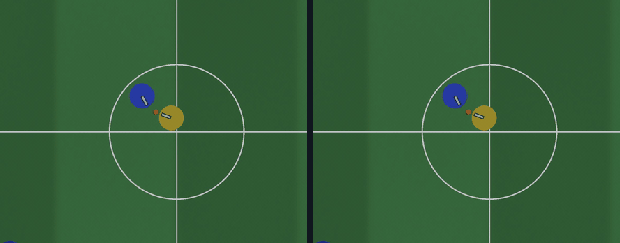

# Pivot fetch during a shared grip

The Presser tries a direct draw first. If two rollers still hold the ball after
about 0.4 seconds, the selector can switch to a left or right pivot even when
the draw is moving the ball toward the edge of a roller. The 33° turn pulls the
ball diagonally away. The existing release checks veto unsafe paths toward
touchlines, endlines, and the robot's own goal.

When the tackling robot has sole possession, it pulls clear on the roller before
resuming normal play. The same opponent observes standard robot clearance during
that short recovery. If the duel times out with both robots still holding the
ball, the challenger drops toward its own goal.

## Matched Webots replays

Eight starts from the November 25 two-half game were run for four seconds each
with the same robot and ball states and both 5v5 teams active. An exclusive hold
counts after one of the original two robots keeps sole roller contact for at
least 0.8 seconds. The table measures the start of that hold.

| Outcome | Previous selector | Revised selector |
| --- | ---: | ---: |
| Exclusive hold begins within 1 second | 3/8 | 7/8 |
| Pivot selections | 1 | 14 |
| Robot body-contact episodes | 0 | 0 |
| Total time with a shared grip over all four-second runs | 10.02 s | 10.15 s |

The revised controller settled more of the original contests early. Both teams
could challenge again during the rest of each replay. These tests used native
physics without the external match referee.

The separate close-up rerun starts from B4 and Y1's shared grip at 49.594 s
in the archived match. The previous selector is on the left. On the right B4
starts its pivot at 0.36 s and gains a sustained hold at 0.58 s.

