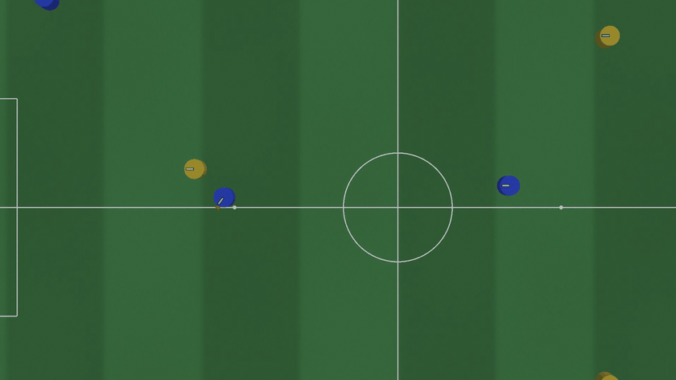
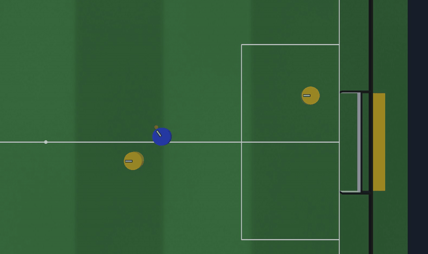

# Reverse-spin passes and shots

The 5v5 carrier can hold the ball on the dribbler and rotate around it before a flat
pass or shot. It tries the shorter turn first and takes the longer turn in the
opposite direction if the short path is blocked. It rechecks robot clearance,
possession, dribble distance and the kick lane while turning. For a pass, the
receiver holds the selected outlet and faces the ball. The move uses a rule-based
controller and the existing 5v5 pass and shot selection.

CMDragons used dribbler backspin to keep the ball while turning the robot. Their
2015 team description shows turning shots, and their 2016 paper explains how the
team picked between the short and long arcs. RoboTurk models that motion with its
existing simulated dribbler and releases with the flat kicker.
[CMDragons 2015 ETDP, §4 and Figures 5–6](https://www.cs.cmu.edu/~coral/cmdragons/multimedia/cmdragons2015_etdp.pdf) · [CMDragons 2016, §4.1 and Figure 4](https://www.cs.cmu.edu/~mmv/papers/16aaai-cmdragons.pdf)

## Native Webots results

| Controlled start | Measured turn | Launch speed | Result |
| --- | ---: | ---: | --- |
| Reverse-spin pass | 232° right | 2.32 m/s | B4 held the ball at 3.36 s, 2.04 s after the kick |
| Reverse-spin shot | 226° left | 4.00 m/s | Blue scored at 1.80 s. The ball crossed 0.13 m from the center at 2.70 m/s |
| Moving defender closes the turn path | Aborted at 0.08 s | — | B1 held the roller on and withheld the kick |

The pass and shot used controlled Yellow positions through the release. The roller
contact log showed uninterrupted possession before each kick at 2 ms resolution.
The ball moved at most 4.1 cm from its initial spot during either turn. None of the
three trials recorded a robot body contact. A separate 20-second 5v5 smoke test
with both teams active produced two shorter spin passes (114° and 116°). Both
reached their nominated receivers. The match finished 0–0.

The skill is enabled in native 5v5 open play. Run `scripts/run_five_roles.py` with
`--no-spin-releases` to compare against the regular carrier. The spin controller
tracks a conservative 0.85 m ball-displacement budget from the start of the grip.
[SSL excessive-dribbling rule](https://robocup-ssl.github.io/ssl-rules/sslrules.html#_excessive_dribbling)

## Replays

Press Play in either offline HTML replay. B1's overlay is on, and its kick and the
goal are clickable in the match events timeline. Save and open the HTML in a browser.
[Pass replay](reverse-spin-pass.html) · [Shot replay](reverse-spin-shot.html)

