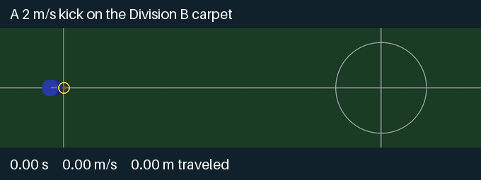
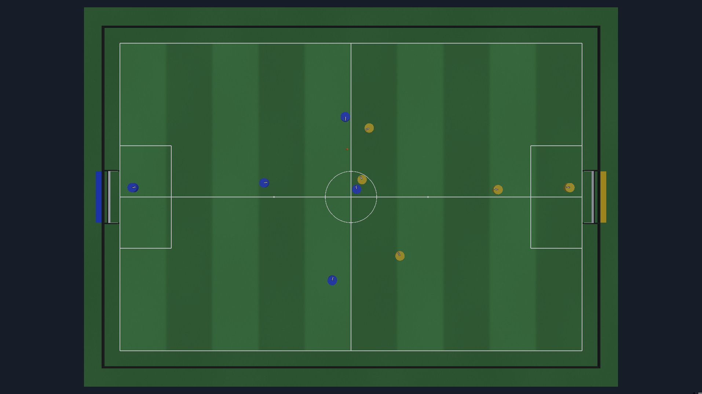

# Ball, drive and field measurements



The ring follows the ball in native Webots footage at real time. A 2 m/s release travels 3.98 m and stops after 5.48 s. On the previous published build, a 1 m/s release was still moving at 0.551 m/s after 5 s and had traveled 3.176 m. On this build it stops in 2.75 s after 0.994 m. Both checks start the ball at the same spot, with zero spin, at the mouth of a stationary robot. [Previous simulator revision](https://github.com/kadiru/metu-ros-pkg/tree/943ff2f8259bd7022737d198db2a3b4f8a850ba7/ros2/roboturk) · [Previous native samples](old-roll.json) · [Current native measurements](roll.json)

| Flat kick | Distance to rest | Time to rest |
| ---: | ---: | ---: |
| 0.5 m/s | 0.249 m | 1.376 s |
| 1.0 m/s | 0.994 m | 2.746 s |
| 2.0 m/s | 3.975 m | 5.484 s |

## Carpet

Each 2 ms physics step uses the measured velocity and spin of the 46 g, 43 mm diameter ball. Contact slip sets the direction of a tangential friction force. A rolling-resistance torque slows the spinning ball, and static traction couples the resulting change in spin back into translation. The solver limits the final impulse as the ball reaches rest. Airborne motion and impacts with players and goals use native Webots dynamics.

The sliding coefficient is 0.30 and the rolling-resistance length is 0.80 mm. They give 2.943 m/s² deceleration during the slide and 0.261 m/s² during the roll. The TIGERs 1.7.1 Division B configuration uses 3.0 and 0.26 m/s². The simulator derives its own slide-to-roll transition from the sphere inertia. It publishes that model in SSL-Vision and uses its straight-ball prediction in the synthetic training backend. A 1 m/s release at 0°, 45°, 90° and 180° stopped within 1 mm across headings. All three axial releases stayed at rest through a further one-second observation. These parameters approximate SSL carpet. Hardware measurements would be needed to identify a particular pitch. [TIGERs AutoRef distribution](https://github.com/TIGERs-Mannheim/AutoReferee/releases/tag/1.7.1) · [Carpet model](../../src/roboturk_core/roboturk/carpet.py)

## Drive and kicker

| Setting | Value | Basis |
| --- | ---: | --- |
| Planar speed magnitude | 3 m/s | MCT Susano Logics report selecting this maximum experimentally in section 2.2 of their 2019 TDP. [Team paper](https://ssl.robocup.org/wp-content/uploads/2019/03/2019_TDP_MCT_Susano_Logics.pdf) |
| Planar acceleration and braking magnitude | 5 m/s² | Stanford Robotics Club describe this as a design target for their 2.5 kg SSL robot in section 2.3. RoboTurk uses the same simulated mass. [Team paper](https://ssl.robocup.org/wp-content/uploads/2019/01/2013_TDP_Stanford_Robotics_Club.pdf) |
| Simulator flat-kicker capacity | 10 m/s | Available in standalone tests and via the shared kick slider in viewer Practice. With a 10 m/s cap, the first sample after 2 ms of carpet contact measured 9.994 m/s. |
| Official match kick limit | 6.5 m/s | Applies to viewer Game mode and the referee-connected ROS path. The first sample on the limited actuator test measured 6.494 m/s. [SSL ball-speed rule](https://robocup-ssl.github.io/ssl-rules/sslrules.html#_ball_speed) |

The drive approaches the requested velocity from the measured world-frame velocity on each step. The bound applies to diagonal requests, turns, reversals and braking. Contact impulses remain part of native physics. A diagonal sprint, reversal and stop reached 3.000 m/s and 5.000 m/s². Skills can request gentler passes, shots and kickoff movement. The published specialist networks keep their original action and observation scales. Their historical success rates apply to the revisions recorded in their releases.

A two-team probe measured Blue at 2.2 m/s, 6 rad/s, 3 m/s² for both acceleration and braking, and a 9.994 m/s first ball sample. Yellow measured 1.4 m/s, 4 rad/s, 4 m/s² for both acceleration and braking, and a 1.494 m/s first ball sample. [Practice limit controls](../match-viewer/README.md)

## Division B geometry



All 25 source worlds use one field PROTO. The generator and the SSL-Vision geometry packet share the nominal league dimensions. The native probe reads the collider faces on both goals, the carpet size and every straight painted marking, then checks them against the specification or the wire packet. A full-power ball crossed the goal line and hit the back of each goal. [Official field and goal drawings, sections 2.1.1–2.1.4](https://robocup-ssl.github.io/ssl-rules/sslrules.html#_field_setup) · [Generator](../../scripts/build_ssl_field.py)

The rendered carpet has subtle alternating green bands, a darker runoff, and high-contrast white markings. The two goals have black exterior panels and white inner liners. Separate blue and yellow strips behind the boundary boards follow the defending team when ends switch. The carpet texture and team strips are visual surfaces. [Native goal close-up](division-b-goal.jpg)

| Feature | Nominal simulated dimensions |
| --- | --- |
| Playing lines and carpet | 9 × 6 m between line centers on 10.4 × 7.4 m of carpet |
| Boundary | Inside board face 0.30 m from each field line center |
| Goals | 1.00 m clear mouth, 0.18 m clear depth, 0.16 m height, 0.02 m wall thickness |
| Goal mounting | Leading edge touches the outside edge of the 10 mm goal stripe. Side walls extend to the outside board. Black solids with white inside faces and low-rebound ball contact. |
| Defense areas | 2.00 m wide and 1.00 m deep |
| Markings | 10 mm lines, 0.50 m center-circle radius, halfway and goal-to-goal lines, and penalty marks 6.00 m from the target goal |

## Match and reproduction

One 5v5 match with independent kickoff planners, two 15-second official halves and seed 32300001 reached POST_GAME. Blue won 1–0. All three awarded formations reached readiness. TIGERs reported a possible goal and a double touch during this smoke test. The Game Controller awarded the goal. The archive contains the input specification, original event packets, official state changes, and robot and ball traces. [Match evidence](match-evidence.zip)

From the project root with the project Python environment active and Webots on PATH, run:

```sh
python scripts/run_webots.py --mode physics-check --render --output runs/physics/roll.json
python -m pytest -q
```

The first command saves the measurements and a real-time GIF next to the output JSON. [Native measurement controller](../../src/roboturk_ros/webots/controllers/roboturk_supervisor/physics_check.py)
