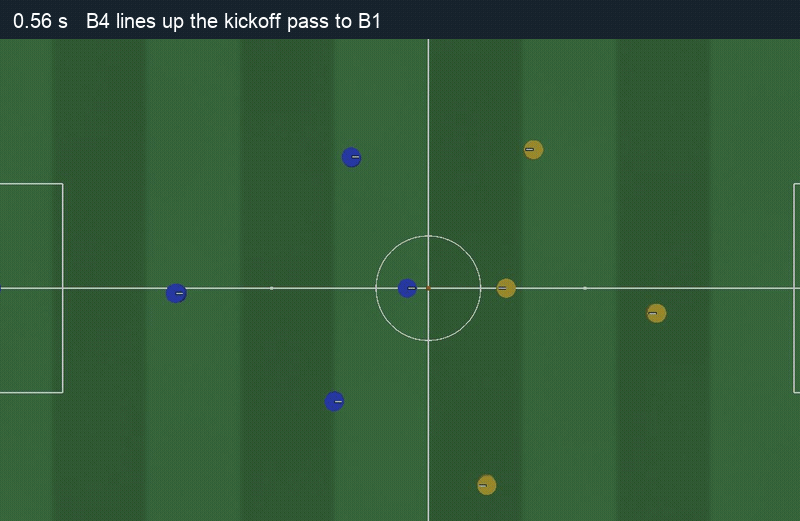

# A team plan for kickoffs

The SSL referee awards the restart. The serving team's decision controller selects a teammate and a clear passing lane. The kickoff assigns the taker, receiver, support players, keeper, and opposing players explicit tasks. The taker aligns around the center ball and uses the shared flat-pass speed calculation. The receiver and the other players hold formation until the ball moves at least 5 cm. Open play then reserves the receiver through the normal pass handoff while the taker waits for another touch.

The opening comparison uses the formation from match `2278b0f974f6`. The previous kickoff sent the ball up the middle at 2.6 m/s, where Y3 deflected it. On the same formation, the revised controller chose B1, took 1.48 s to align after `NORMAL_START`, and completed the pass. Yellow likewise completed its second-half kickoff from Y1 to Y2 in the short validation match. [Replay measurements](results.json)
