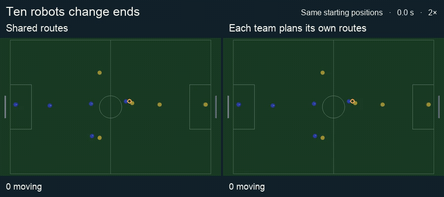
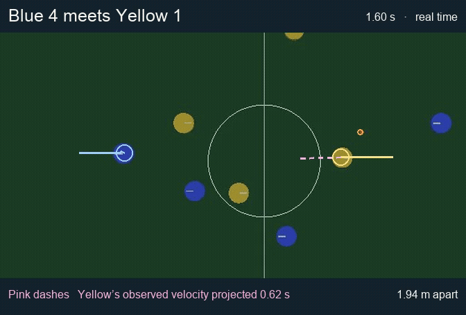

# A kickoff planner for each team

Blue and Yellow drive to their own formations with no exchange of routes. In this Webots replay the ten robots start from the same measured half-time positions in both panels. The shared planner took 12.52 s to get everyone ready. The two independent planners took 9.44 s. The replay runs at 2× and holds each panel when its team formations are ready. [Matched replay MP4](matched-kickoffs.mp4) · [Uncut match under the official referee](official-match.mp4)

[](matched-kickoffs.mp4)

## What Blue sees

The pink dashes extend Yellow’s last observed velocity for 0.62 seconds. The solid trails show the last half-second of actual motion. This real-time close-up follows the closest filmed encounter in which two moving opponents approach and then separate. [Close-up MP4](observed-opponent.mp4)

[](observed-opponent.mp4)

Each planner is constructed with only its own jersey destinations. On every control tick it receives its own robots’ states and opposing jersey IDs and x/y positions from the overhead SSL-Vision detection frame. During live preparation, the same packet goes to TIGERs. Each team estimates velocity from successive observations, starting at zero on a new award. Slow players are obstacles in the route search. Each robot adjusts its preferred body velocity for predicted encounters and limits its share of the closing speed when another robot is nearby. Once both teams report ready, the supervisor centers the ball. The table waits for confirmation before requesting NORMAL_START. The goalkeeper and field players keep their original assigned spots. Both planners use a 1 m/s travel cap, the same heading and velocity tolerances and inactive rollers and kickers during setup. The shared baseline reserves timed routes across both colors. The comparison measures the complete planner change, including local steering and the information available to each side. Both colors run the same scripted independent planner. Open-play policy weights stayed frozen. [Independent planners](../../src/roboturk_core/roboturk/team_kickoff.py) · [Shared planner](../parallel-kickoff/README.md)

A regression test changed the hidden opponent destination, true pose and simulator velocity while preserving Blue's camera frames. Blue issued identical commands. Another test varied the opponent’s observed approach while holding its last position constant and obtained different steering. We also reconstructed 23,030 individual commands across the fresh official matches using each team’s own state and destinations and the logged opponent observations. The largest absolute difference across command components was 0. [Tests](../../tests/test_kickoff_drive.py) · [Command and referee audit](../../scripts/autoref/audit_parallel.py)

## Four fresh paired openings with the official referee

| Four matches per planner | Shared | Independent |
| --- | ---: | ---: |
| Released kickoffs / awarded | 14 / 14 | 16 / 16 |
| Kickoffs requiring travel | 10 | 12 |
| Median setup after the opening, seconds | 9.38 | 6.98 |
| Median half-time setup, seconds | 14.64 | 9.88 |
| Slowest setup, seconds | 15.84 | 10.28 |
| Mean robots moving during setup | 3.59 | 4.95 |
| Peak robots moving at once | 9 | 10 |
| Smallest sampled center separation during setup, m | 0.280 | 0.275 |
| TIGERs crash reports during setup / whole match | 0 / 0 | 0 / 0 |
| Officially accepted crashes during setup / whole match | 0 / 0 | 0 / 0 |
| Completed passes / attempts | 49 / 66 | 44 / 64 |
| Official goals, both colors | 6 | 8 |

| Opening | Shared score, Blue–Yellow | Independent score, Blue–Yellow | Shared accepted crashes | Independent accepted crashes |
| ---: | ---: | ---: | ---: | ---: |
| 31300000 | 1–0 | 1–0 | 0 | 0 |
| 31300001 | 0–1 | 0–2 | 0 | 0 |
| 31300002 | 2–1 | 1–2 | 0 | 0 |
| 31300003 | 0–1 | 0–2 | 0 | 0 |

Each pair used the same first-action robot poses and velocities, ball state and official referee configuration. Seeds 31300000–31300003 alternated the serving team and run order. The 5v5 matches ran two 30-second official halves, with the previous learned open-play steering on both sides. The Game Controller awarded the goals. Kickoff time starts with the received PREPARE_KICKOFF and ends with NORMAL_START. The opening formation was already in position. Travel times exclude that first award. Later restart positions can differ as the two matches unfold. Counts of moving players use a 0.2 m/s threshold on native 40 ms samples. The setup and whole-match calls in this table come from the live TIGERs AutoRef and SSL Game Controller. The simulation uses ideal overhead detections, an ideal body-velocity drive and the same selected referee events as the previous study. [Real-time official kickoff GIF](official-kickoff.gif) · [Per-match results](results.json)

## Replay every restart from the same positions

We took every non-opening kickoff from the four shared-planner games and restored its measured planar robot poses, velocities, ball state and jersey targets in native Webots. Each arm ran from the same restored state to the first tick when both teams were ready. These timing-only replays exclude ball placement and the official table’s release delay. The independent planners were faster on 8 of 10 pairs. All four half-time restarts were faster. On two restarts following a goal, the independent teams took an additional 1.32 s and 0.32 s. Median robot-ready time was 9.24 s with shared routes and 8.58 s with independent planners.

| Opening | Restart | Occasion | Shared, s | Independent, s |
| ---: | ---: | --- | ---: | ---: |
| 31300000 | 2 | after goal | 10.84 | 8.20 |
| 31300000 | 3 | half-time | 12.52 | 9.44 |
| 31300001 | 2 | after goal | 7.64 | 8.96 |
| 31300001 | 3 | half-time | 15.00 | 10.84 |
| 31300002 | 2 | after goal | 5.36 | 5.28 |
| 31300002 | 3 | after goal | 6.48 | 6.12 |
| 31300002 | 4 | half-time | 13.68 | 9.48 |
| 31300002 | 5 | after goal | 5.32 | 5.08 |
| 31300003 | 2 | half-time | 14.80 | 9.04 |
| 31300003 | 3 | after goal | 7.00 | 7.32 |

A fresh TIGERs process also observed each exact-start trajectory. It received 25 Hz detection frames, the appropriate PREPARE_KICKOFF command, stationary warm-up frames, and 1.2 s of final hold for delayed reports. TIGERs tracked 44,800 of 44,800 expected robot samples during motion. It emitted 0 crash reports on the shared traces and 0 on the independent traces. A separate synthetic head-on approach produced 1 crash report with the same detector during kickoff preparation. These are passive detector reports. Official Game Controller decisions are counted in the live-match table above.

## Reproduce

For a new driven match the five-role runner selects independent planners with `--drive-kickoffs`. Use `--parallel-kickoffs` alongside it to select the shared concurrent planner. For an official saved fixture specify `drive_kickoffs` and `team_kickoffs` to use the independent planners. Historical specifications retain their original behavior. Use the project’s native Webots and referee environment. [Environment setup](../official-league/README.md#reproduce-and-inspect)

```sh
python scripts/autoref/run_league.py runs/teams-fresh --compare-teams
python scripts/autoref/audit_parallel.py runs/teams-fresh runs/live.json --teams --write-replay-cases runs/starts.json
python scripts/run_five_roles.py runs/team-replays --replay-kickoffs runs/starts.json --team-kickoffs --frame-images
python scripts/autoref/observe_kickoff_replays.py runs/team-replays runs/starts.json runs/team-observer
python scripts/autoref/audit_parallel.py runs/teams-fresh runs/results.json --teams --replays runs/team-replays --replay-observer runs/team-observer
python scripts/autoref/film_team_kickoff.py runs/team-replays runs/starts.json runs/team-film
python scripts/autoref/film_league.py runs/teams-fresh/31300000/teams runs/team-film --halftime-clip
```

The archive includes all eight live specifications, original AutoRef event packets, official state transitions, measured trajectories, camera observations, actual team commands, and all exact-replay starts and trajectories. It also includes the earlier eight development replays. [Evidence archive](evidence.zip)

```sh
unzip media/team-kickoff/evidence.zip -d runs/team-evidence
python scripts/autoref/audit_parallel.py runs/team-evidence/fresh runs/verified.json --teams --replays runs/team-evidence/replays --replay-observer runs/team-evidence/observer
```
