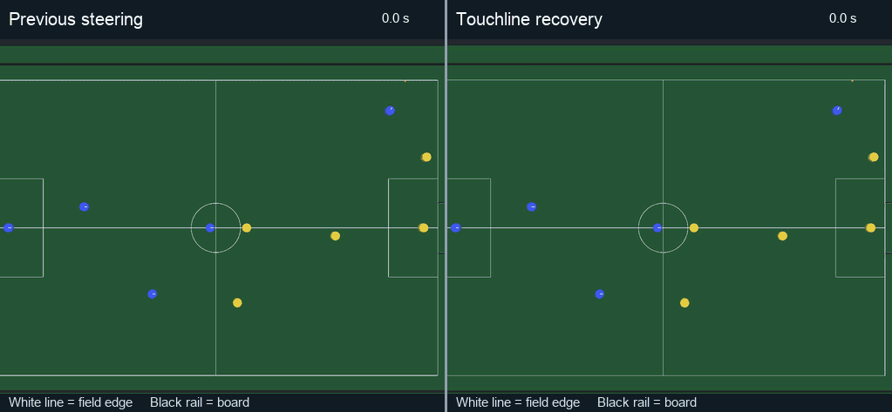

# 5v5 touchline recovery in Webots

The previous steering recovered 0 of 40 balls. The new steering recovered 37 of 40. Both teams ran the same ten-player open-play controller, recipient weights and observed-motion steering weights. The change is a scripted recovery maneuver and a boundary-aware speed limit. No training was used for this change.



Blue 1 approaches from the pitch, rounds the ball, faces inward and carries it back. On the same opening the previous controller stops inside the line. These are synchronized native Webots frames at 12.5 fps, with a shared brightness adjustment and labels. The separate recording used seed 37113000. Blue's qualifying recovery occurs at 3.074 s. [Close-up GIF](blue-recovery.gif)

## Paired results

| Measure | Previous | Touchline steering |
|---|---:|---:|
| Controlled recoveries | 0 | 37 |
| Blue / Yellow recoveries | 0 / 0 | 22 / 15 |
| Starts with a robot center across a live touchline | 0 | 40 |
| Starts with sole roller control while its robot center was outside | 0 | 40 |
| Ball out before a qualifying recovery | 0 | 0 |
| Robot–robot contact episodes | 0 | 0 |
| Robot–board contact episodes | 0 | 0 |
| Robot–goal frame contact episodes | 0 | 0 |
| Closest robot–robot clearance | 8.4 cm | 5.0 cm |
| Closest robot–board clearance | 35.6 cm | 0.4 cm |
| Closest robot–goal frame clearance | 18.5 cm | 14.9 cm |

3.12 s median among successful recoveries. All three misses came from the eight near-corner starts (seeds 37112005, 37112030 and 37112035). Each reached sole control outside the line and timed out before completing the inward carry. The closest measured board clearance was 4 mm. The sweep sampled near-corner ball positions up to 4.12 m along the field. Exact corner placements and long-match traffic remain untested.

## What the trial measures

The benchmark uses 40 consecutive seeds (37112000–37112039), both touchlines, both favored colors, eight near-corner starts, small initial ball velocities and all ten robots. The ball starts between 3 cm inside and 1.2 cm outside the line center. The whole-ball exit threshold is 2.65 cm beyond the line center. Each arm runs for six simulated seconds or until the ball goes out. Successful trials keep running until the same stopping rule. The metric credits either team when the same robot has sole roller possession for at least 0.20 s and the ball center is at least 25 cm inside the line. Simply touching the ball or crossing the line earns no credit.

Every 2 ms, the monitor checks all 45 robot pairs, the board faces and the solid goal backs and sides against each 9 cm robot envelope. A distinct pair or robot–surface encounter enters the contact count at 1 mm of clearance or closer. These are simulation geometry measurements. The official Game Controller and AutoRef were offline for this benchmark. Starting positions, headings and velocities read back from Webots matched exactly between arms. These targeted short openings measure retrieval under ideal simulated observations. General collision rates in full matches require a separate experiment.

## How steering changes

The ball-facing role can approach from the strip between the white line and the board while the ball is live. It rounds the ball on one side before facing into the field, suppresses kicks while recovering, and requests an inward carry on gaining possession. Steering still evaluates nearby players. On this Division B world, the robot-center target limit beside the board is 3.185 m, leaving a nominal 2.5 cm margin beyond the robot disk. The controller limits outward speed using remaining braking distance. The existing end limit keeps the disk clear of the goal frames. Other players keep their ordinary center inset. [Path planners used by SSL teams](../../docs/SSL_PATH_PLANNERS.md)

## Reproduce

From the ROS 2 project directory, use its Python environment and native Webots installation. Add the launcher's `--webots` option for a different executable path.

```sh
python scripts/run_five_roles.py runs/baseline --touchline-trials 40 --no-touchline-recovery --open-play-policy policies/open_motion_v1/actor.json --seconds 6 --seed 37112000
python scripts/run_five_roles.py runs/current --touchline-trials 40 --open-play-policy policies/open_motion_v1/actor.json --seconds 6 --seed 37112000
python scripts/compare_touchline.py runs/baseline/touchline.json runs/current/touchline.json
python scripts/run_five_roles.py runs/demo --touchline-trials 1 --open-play-policy policies/open_motion_v1/actor.json --seconds 6 --seed 37113000 --frame-images
```

[Paired totals and individual outcomes](paired.json) · [Four complete trial records with initial states](trials.zip)
