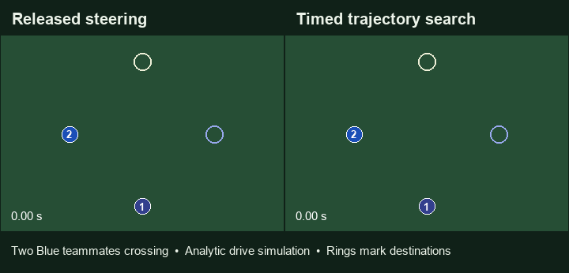

# Timed trajectories for 5v5 support players

The optional `--trajectory-planner` lets a team search for a drivable route to an off-ball player's assigned position. The learned steering continues to handle the goalkeeper and ball skills. The default is the released steering.



Each ring is one player's destination. Both start at rest. In this analytic crossing, both players came within 3 cm of their targets after 2.44 s with the released steering and 2.24 s with trajectory search. Closest body gaps were 11.6 cm and 16.8 cm. This fixture isolates one encounter with two cooperative players, fixed targets and ideal observations.

## Matched native Webots evaluation

All ten robots played the existing six-second live-ball openings. The comparison script verified identical native initial ball and robot states for all 40 seeds. The released arm is the archived 37/40 team. The new arm enables the planner on both teams. Success requires the same robot to hold the ball for 0.20 s and bring it at least 25 cm inside the line. Physical envelope contacts are measured every 2 ms.

| On the same 40 starts | Released steering | With trajectory search |
|---|---:|---:|
| Controlled recoveries | 37/40 | 37/40 |
| Near-corner recoveries | 5/8 | 7/8 |
| Median time among successes | 3.12 s | 3.06 s |
| Robot / board / goal contacts | 0 / 0 / 0 | 0 / 0 / 0 |
| Closest robot / board / goal gap (cm) | 5.0 / 0.4 / 14.9 | 6.6 / 1.6 / 15.5 |

The candidate recovered all three balls that the previous team missed, and missed three different balls. Off-ball players chose 29,804 direct routes and 3,605 detours, and braked 2,093 times. These counts include repeated 40 ms control ticks. A brake means every candidate failed screening on that tick. The three clearance minima can come from different starts. This benchmark measures how support motion affects recovery. Full-match scoring and hardware safety remain untested. [Per-seed outcomes](results.json) · [New native trials](candidate-trials.zip) · [Released baseline](../touchline/trials.zip)

## What the search does

1. A skill supplies its field-frame target. A support robot plans from its current position and velocity to that target at rest. Each axis accelerates, cruises when needed and brakes. Splitting the speed and acceleration budgets between axes bounds the planar norms. This first implementation uses a fixed split and a 1.2 m/s planar planning cap.
2. Try the direct trajectory. If blocked, search four intermediate points on either side, joining two trajectories at zero waypoint velocity. Choose the feasible detour with the shortest calculated arrival time. A bounded search can miss paths, and a failed search requests braking.
3. Check the first 1.2 s against the field corridor, both defense areas and moving robot envelopes. The checker uses relative swept segments between 80 ms samples and a curvature margin. Opponents are projected at the velocity measured from successive positions. Each team reserves its own timed routes in role-priority order. A teammate whose new route is still unknown is projected from its current steering request.
4. Send the next 40 ms velocity setpoint, preserving angular velocity, dribbler and kicker commands. Repeat from the next observation. Reservations are refreshed each tick. Prediction error, communication delay and mutually blocked robots remain open problems.

## Why start here

A temporal planner can distinguish two robots crossing the same spot at different times from a collision. The acceleration and braking model also makes an ERRT waypoint route executable later. ER-Force and RobôCIn describe related searches over timed omnidirectional trajectories. CMDragons paired an ERRT waypoint planner with a separate dynamics-aware safety check. [RobôCIn §3.3](https://arxiv.org/pdf/2307.10018) · [CMU navigation paper](https://cse-robotics.engr.tamu.edu/dshell/cs689/papers/bruce06safe.pdf) · [Team planner survey](../../docs/SSL_PATH_PLANNERS.md)

The next experiment is a sustained crossing under pressure. Measure whether a support player reaches its assigned position, how long the pair stays blocked, and whether either robot loses its braking clearance. Persistent detours or an ERRT waypoint search can then be tested on the starts where the bounded search stalls.

## Reproduce

```sh
python scripts/compare_crossing.py crossing.json
python scripts/run_five_roles.py runs/timed --trajectory-planner --touchline-trials 40 --open-play-policy policies/open_motion_v1/actor.json --seconds 6 --seed 37112000
unzip -p media/touchline/trials.zip paired-new.json > baseline.json
python scripts/compare_touchline.py baseline.json runs/timed/touchline.json
```
