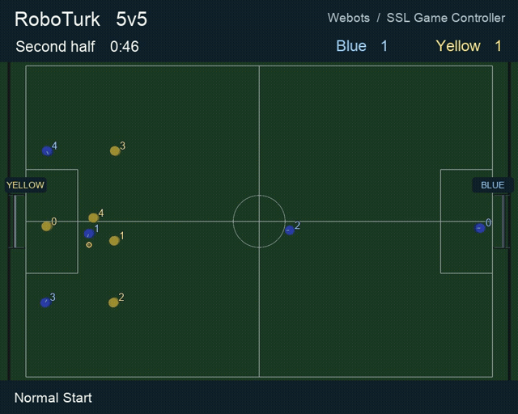

# Blue 2–1 Yellow in a two-minute 5v5 match

Blue scored first, Yellow equalized before halftime, and Blue scored the winner after the teams changed ends. All three goals were approved by the official SSL Game Controller after reports from live TIGERs AutoRef. The replay labels each defended goal by team and shows the official match clock. [Uncut native Webots replay (3:06)](official-match.mp4)

[](official-match.mp4)

| Match measure | Blue | Yellow |
| --- | ---: | ---: |
| Halftime goals | 1 | 1 |
| Final goals | 2 | 1 |
| Completed passes | 11 | 5 |
| Clean takeaways | 5 | 5 |

Both teams used independent kickoff planning, learned open-play steering, timed trajectories with the extended RRT fallback, and the tackle selector with keeper cover. The run logged zero body-contact episodes at 2 ms resolution and zero AutoRef crash reports. The Game Controller accepted two ball placements after a touchline exit and a goal-line exit. This fixture adjudicates a selected set of events. Two double-touch reports and one defense-area proximity report were logged without a stoppage.

Each half started at 60 seconds on the referee broadcast. The Game Controller received Webots timestamps through its simulator interface, so camera capture could slow wall-clock execution without taking time away from the robots. The trace contains 60.96 and 61.00 native seconds under running commands. The table closed each half after expiry. The uncut replay includes stoppages and time spent driving to formation. [Match settings](match-spec.json) · [Event audit](results.json) · [Raw telemetry and referee events](evidence.zip)

## Reproduce

Use the [official referee setup](../autoref/README.md#run-the-experiment) and run from the modern stack directory.

```sh
python scripts/autoref/run_placement.py media/two-minute-5v5/match-spec.json runs/new-two-minute-match
python scripts/autoref/film_league.py runs/new-two-minute-match runs/new-two-minute-film
```
