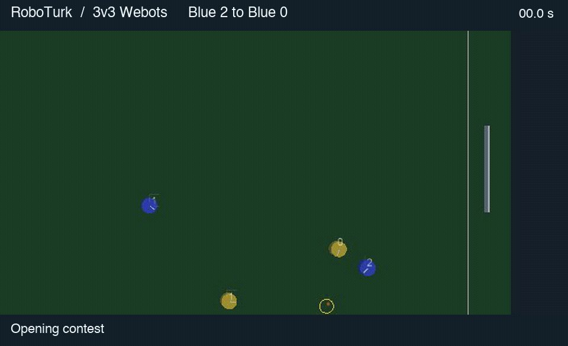

# Passing around a blocked dribble lane in 3v3

The frozen team scored **25 goals from 40 fresh opening contests**. Each goal followed a pass to a physically open teammate while an opponent blocked the direct dribble lane. Blue converted 7 and Yellow converted 18. The registered target was 24. All 40 starts are in the denominator.

[](../../media/blocked-outlet/blocked-outlet.mp4)

Blue 2 wins the ball, passes to Blue 0 at 3.64 s, and Blue 0 scores at 6.35 s. At the decision, the central defender was 0.12 m from the dribble line. The passing lane had 0.59 m of clearance, and the receiver had 1.11 m to the nearest opponent. The cyan dashes and amber line annotate measured Webots positions. The excerpt shows the first qualifying play from three separate demo openings. The full 54-second recording includes all three outcomes (1/3 qualifying). The second launch reproduced all 5,400 physical samples and the same decisions and events. [Full GIF](../../media/blocked-outlet/all-openings.gif) · [Native MP4](../../media/blocked-outlet/blocked-outlet.mp4) · [Recording provenance](../../media/blocked-outlet/recording.json)

## Qualification

| Opening outcome | Contests |
| --- | ---: |
| Pass goal | 25 |
| Intercepted | 9 |
| No uninterrupted finish | 1 |
| No opening pass | 2 |
| No confirmed recovery | 2 |
| Opponent retouch before pass | 1 |

The teams used both candidate receiver slots in scoring plays (13 and 12). In 15 of those goals, the other teammate was covered under the same clearance test. A separate observation replay moved only the central blockers out of the dribble lane. With the checkpoint and remaining player positions held fixed, it switched away from passing in 33 of 35 such frames. This measures a change in the decision. The goal counts above come from actual matches.

Each of the 40 independently launched matches lasted 18 simulated seconds. The 100 Hz audit checked all 72,000 physical samples. It recorded 0 samples with centers closer than 0.18 m and 0 with robots outside the field limits. [Every opening and its outcome](qualification-1/audit.json) · [Decision replay and alternative teammate](qualification-1/decision-replay.json) · [All event logs and native traces](qualification-1/)

## Training and measurement

The benchmark starts with two opposing dribblers on the same ball, a central cover player and wide support on each side. It randomizes player identities, field direction, ball position, wing and spacing. Both teams move during the contest, pass and shot. The cover player tracks the goal-side lane and can intercept. This is a midfield opening curriculum with ideal body velocities, simplified contact and simulator ground truth. The measured rate applies to this distribution.

A shared candidate scorer evaluates both teammates using passing clearance, receiving space, forward progress, orientation and distance. A second score compares pass, dribble and shoot. Under pressure, the first-touch motor can move sideways out of the opposing roller. The receiver can turn while settling the pass and advance until its heading intersects an open part of the goal. The teams reuse the earlier learned jaw and pass policies. Central cover, wide support, geometric aiming and command safety use explicit control rules. The new learning consists of return-based policy search in native self-play.

Five leagues ran 556 native training games. The first exposed repeated passes and blocked shots. A lateral-only finishing candidate scored 0/16 development openings. Advancing toward goal raised a later development result to 11/20. Five of that team's misses involved an opponent retouch before the first pass. Round-robin play included return-based breeding, followed by a separate mirrored league comparing lateral escape maneuvers on identical layouts. The released checkpoint's mirrored training result and seed allocation are in its selection record. [Training populations, schedules and every game](training.json.gz) · [Per-team returns](training-summary.json) · [Development outcomes](development.json) · [Checkpoint selection](selection-1.json)

The opening requires opposing contact for 0.20 s followed by sole possession for 0.20 s. At the pass decision, a defender's center must lie within 0.24 m laterally of the forward 1.65 m corridor. The selected pass requires at least 0.19 m lane clearance and 0.48 m receiving space. The intended teammate must control the ball alone for 0.20 s after at least 0.55 m travel. Any opponent retouch or restart breaks credit. The shot must physically cross the opponent's goal line inside the aperture within the recovery window. The scoring rule and seed block were registered before training. [Protocol](protocol.json) · [Frozen source hashes](freeze-1.json) · [Team parameters](policy-1.json)

## Reproduce

From the RoboTurk ROS 2 project directory, use its Python environment with NumPy and PyTorch and the native Webots binary. The archived launch files contain the exact simulator digest. GIF encoding also uses FFmpeg and Pillow.

```sh
python scripts/train_blocked_outlet.py qualify runs/blocked-recheck --version 1 --webots /path/to/webots
python scripts/audit_blocked_outlet.py runs/blocked-recheck policies/blocked_outlet_v1/policy-1.json runs/blocked-recheck/decision-replay.json
python scripts/train_blocked_outlet.py demo runs/blocked-demo --version 1 --webots /path/to/webots
python scripts/record_blocked_outlet.py runs/blocked-demo runs/blocked-media
```
